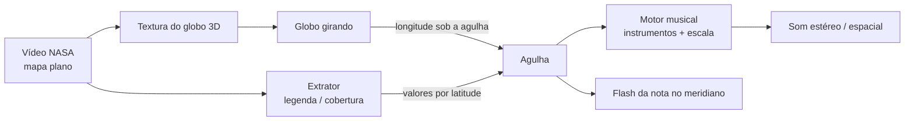
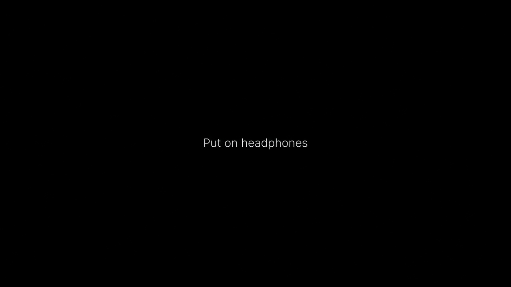
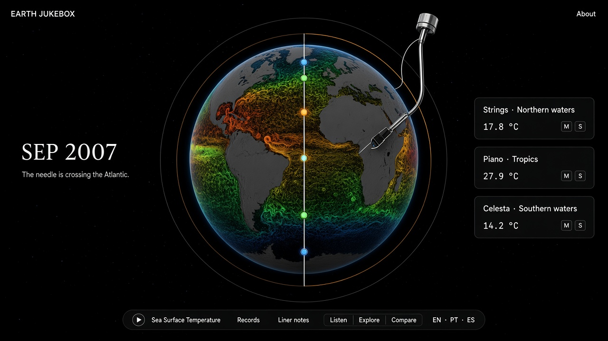
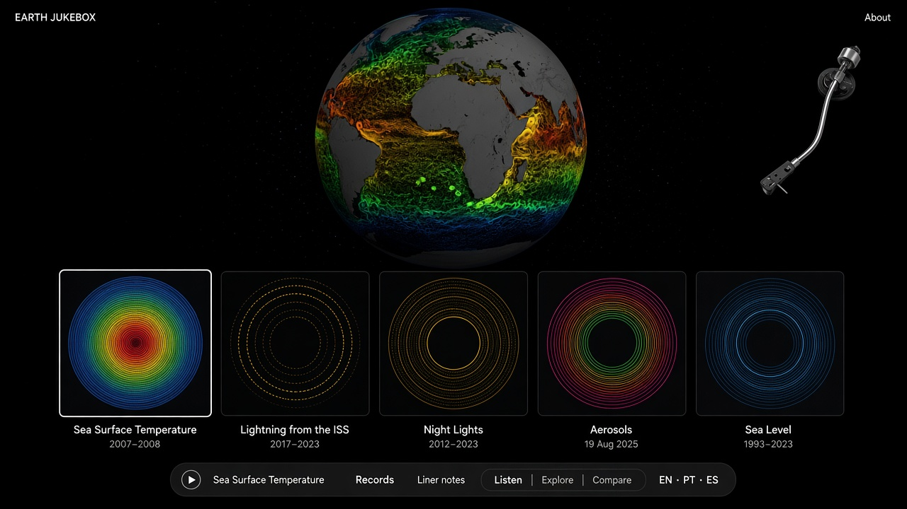
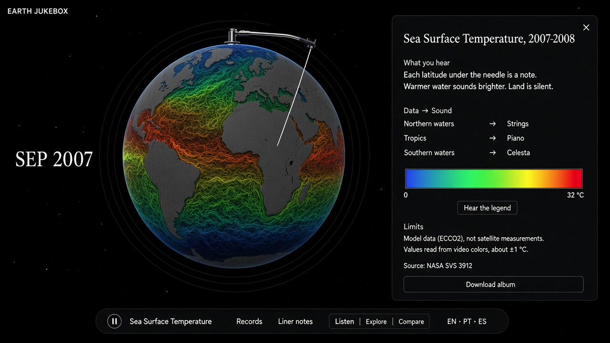
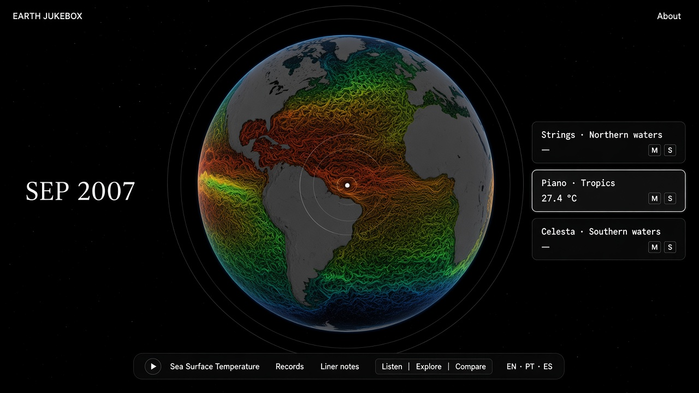
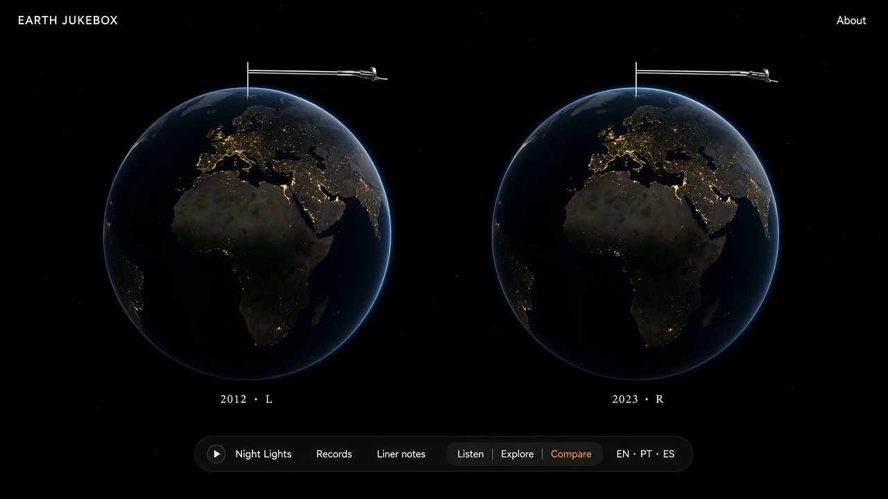

# Earth Jukebox — Direcionamento atual

> Fonte de verdade do projeto (ver [`AGENTS.md`](../AGENTS.md)). Definido em 15/11/2026; resultados de E1 (SST), E2 e E3 em §14.1.
> Substitui todas as decisões anteriores: o código, as faixas e o README atuais **não** valem como referência.
> Contexto e pesquisa: [análise estratégica](analise-estrategica.md), [recursos do desafio](recursos-do-desafio.md), [projetos anteriores](earth-jukebox-projetos-anteriores.md).
> O que já foi feito e quem faz o quê: [`STATUS.md`](../STATUS.md).

---

## 1. Objetivo

- Ser finalista global e mirar **Art & Technology** (alvos secundários: Global Connection e Most Inspirational).
- Entregar uma experiência com efeito **WOW nos primeiros 5 segundos** e som **bonito de verdade**, sem abrir mão do rigor: todo som de dado vem de um valor real lido do frame da NASA.
- A apresentação (site, vídeo e página do projeto) conta tanto quanto o código.

## 2. Conceito central: "A Terra é o disco"

- Um **globo 3D gira como um vinil**. O vídeo de mapa plano da NASA é projetado nele como textura.
- Uma **agulha fixa** toca o globo num meridiano e lê a coluna de dado que passa por baixo dela.
- **Latitude → altura da nota** (como no Caldwell 73, o recurso de sonificação do próprio desafio). **Cada variável ou categoria → um instrumento.** **Valor → intensidade e densidade.**
- O vídeo da NASA avança no tempo enquanto o globo gira: a agulha sempre lê **o frame atual** na **longitude que está sob ela**.



**Por quê:** junta a metáfora do jukebox com o recurso oficial de sonificação; nenhum projeto anterior do Space Apps fez isso; o efeito aparece em 5 segundos de demo.

### 2.1 O que é vídeo e o que não é

| O quê | De onde vem | Papel | Essencial? |
|---|---|---|---|
| Vídeos de mapa da NASA | Recursos oficiais do SVS | **São o dado**: viram a pele do globo e a fonte dos valores | Sim, é o centro do projeto |
| Globo 3D | Código nosso (three.js), ao vivo no navegador | Esfera que gira, arrasta e dá zoom; veste o vídeo da NASA | Sim |
| Vídeos do Veo | IA | **Só enfeite**: abertura do site e cenas do vídeo do pitch | Não. **O globo nunca é um vídeo do Veo** |

### 2.2 Fluxo do usuário

1. Abre o link → tela preta *"Put on headphones."* + *"Selecione um idioma"* (EN / PT / ES, navegador pré-selecionado) → clica no idioma.
2. Abertura (§5.2): a câmera chega à Terra e a agulha pousa.
3. A música começa: o globo gira vestido com o vídeo da NASA e a agulha toca o que passa embaixo dela.
4. Data avançando à esquerda, instrumentos com valores ao vivo à direita, narrador explicando.
5. "Records" troca de faixa: a pele do globo e a música mudam.
6. "Explorar": arrastar o dedo sobre um lugar e ouvir aquele ponto.
7. "Liner notes": como a faixa funciona, fonte e limites.

### 2.3 Exemplo: como um recurso vira música (temperatura do mar, SVS 3912)

1. O mapa plano da NASA (cor = temperatura, legenda 0–32 °C) é enrolado no globo.
2. A agulha fica parada num meridiano; o globo gira embaixo dela.
3. A cada instante, a agulha lê a coluna do mapa sob ela, de norte a sul, dividida em faixas de latitude; a cor de cada faixa vira temperatura pela legenda.
4. A coluna é dividida em 3 zonas (norte, trópicos, sul), cada uma tocada por um instrumento e dividida em 2 sub-faixas de latitude (até 2 notas por voz). **Temperatura → altura na escala** (mais quente = mais agudo) **e brilho**; **terra firme → silêncio** daquela sub-faixa. A latitude aparece pelo instrumento da zona e pelo ponto de luz na agulha.
5. Resultado: o Pacífico soa como um acorde largo e longo, as Américas quase em silêncio, depois o Atlântico. Com o vídeo avançando, as estações mudam a melodia volta após volta.

> **Decisão de 15/11/2026:** nesta faixa, **temperatura → altura** (como no §6.2) em vez de latitude → altura. Com latitude → altura cada faixa tocaria sempre a mesma nota e a temperatura viraria só volume, difícil de ouvir.

## 3. Escopo

| Dentro do escopo | Fora do escopo |
|---|---|
| Site estático, tela única, globo 3D, modos Ouvir / Explorar / Comparar (prioridades em §16) | Back end, login, contas |
| 4 faixas de mapa + 1 faixa bônus 2D (ver §8) | Faixas de câmera móvel sem exploração aprovada (ver E4) |
| Motor musical com instrumentos sampleados | Música composta por IA a partir do dado |
| Narração pré-gravada EN / PT / ES | Outros idiomas |
| Exportação de cada faixa como álbum | Hardware ou jukebox físico |
| Script aberto "vídeo de mapa do SVS → faixa" | Editor visual de faixas na UI |
| Teste com usuários cegos ou com baixa visão | Estudo científico formal |

## 4. Estrutura do site

- **Tela única, sem scroll.** Tudo acontece sobre o globo.
- Explicação em dois lugares: painel **"Liner notes"** (encarte, por faixa) e overlay **"About"** (método, teste, time, créditos).
- A landing atual (hero, cards, grid, "how it works", time) **sai por completo**.

**Por quê:** o juiz precisa ouvir algo em menos de 3 segundos; scroll brigaria com o arrastar do globo.

## 5. UI — descrição

### 5.1 Identidade visual

| Elemento | Decisão |
|---|---|
| Fundo | Espaço preto profundo, estrelas sutis. Reage ao mouse sem chamar atenção: duas camadas de estrelas em parallax que acompanham o cursor (a poeira próxima mexe mais que as estrelas distantes), a poeira acende um pouco perto do cursor e um brilho azul muito fraco segue o ponteiro atrás do globo, mais forte enquanto o mouse se move. Nada disso é dado. Toque não move o fundo (o arrasto é do globo); com redução de movimento, o fundo fica parado |
| Cor | As únicas cores fortes vêm do dado da NASA. UI em preto, branco e vidro, com acento âmbar mínimo. **O coral atual sai.** O acabamento do globo não conta como cor forte: o halo azul fino de atmosfera, a borda escurecida e a terra cinza mais escura (só onde o cinza é terra sem dado, como na temperatura do mar; nas luzes noturnas o branco é o próprio dado e não é escurecido). Onde a agulha lê, a cor é a da legenda |
| Controles | Liquid glass (vidro fosco translúcido, borda clara fina). Com redução de transparência ativa, vira sólido com o mesmo contraste |
| Tipografia | Serifa editorial fina e grande para datas e títulos (ex.: Instrument Serif); mono para valores de dado (ex.: Geist Mono); Atkinson Hyperlegible onde a leitura importar mais |
| Proibido | Cards em grid, seções empilhadas de landing, jukebox de desenho animado, ícones genéricos de template |

### 5.2 Abertura (cold open)

1. Tela preta: *"Put on headphones."* no centro; abaixo, o pedido *"Select a language to start."* e **"EN · PT · ES"**. Sem botão de iniciar — só texto e o seletor.
2. O idioma destacado por padrão é o do navegador (`navigator.language`), com preferência salva em `localStorage` se a pessoa já escolheu. A frase e o pedido já aparecem nesse idioma.
3. Clicar em **EN / PT / ES** (ou Enter no idioma focado) grava a escolha e inicia → **P0:** a câmera 3D desce do espaço até o próprio globo e a agulha pousa. **P2:** substituir por vídeo Veo de ~8 s (agulha + estalo de vinil).
4. O último frame do vídeo tem **o mesmo enquadramento** do globo 3D ao vivo; a troca é invisível (match cut) e o app começa a tocar.
5. Retornos à página pulam a abertura (com opção de rever no overlay About).

> **Decisão de 15/11/2026 (N1 na abertura):** o navegador só toca som depois de um clique, então a voz entra no clique. Na primeira visita: clique no idioma → a voz diz *"Put on headphones."* enquanto a tela preta some e a câmera já desce → em seguida *"Welcome to the Earth Jukebox…"* durante a descida (a música entra por baixo, abaixada) → ~2,5 s de música sozinha → narração de abertura da faixa. A descida não espera a voz. Retornos (abertura já vista) e "Replay opening" não repetem o N1.

> **Decisão de 15/11/2026 (arrastar, instrumentos e "O que estou ouvindo?", frente C):**
> - **Arrastar o globo** para os lados com o mouse ou o dedo, tocando ou pausado (setas ↑ ↓ fazem o mesmo pelo teclado). Enquanto arrasta, a agulha **toca o que passa embaixo dela** e a **data fica parada** (ver decisão "anel = tempo, globo = lugar"); ao soltar, o disco volta ao estado de antes (tocando continua tocando, pausado continua pausado). Um clique curto continua sendo play/pause.
> - **Escolher o instrumento de cada voz** no cartão da voz: menu de vidro próprio do site (não o seletor do sistema), com **no máximo 5 instrumentos por disco**, escolhidos pelo jeito de cada disco tocar: temperatura do mar (notas longas) cordas, piano, glockenspiel, harpa, flauta; raios (batidas) marimba, xilofone, pizzicato, harpa, glockenspiel; luzes noturnas piano, cordas, glockenspiel, harpa, flauta. Muda só o timbre: notas, ritmo e mapeamento dado → som ficam iguais, e continua no máximo 3 vozes por faixa. Os novos (harpa, flauta, pizzicato, xilofone; VSCO 2 CE, CC0) só são baixados quando escolhidos.
> - **O encarte vira "O que estou ouvindo?"** e abre pelo botão destacado no rodapé (com ⓘ), pela seta na borda direita e pela tecla L. Sem botão no topo. A narração **não** foi alterada. **No celular** a gaveta não cobre a tela toda: sobra uma faixa à esquerda com a seta para fechar; ela segue o dedo (arrastar para a direita fecha, puxar a seta para a esquerda abre) e a seta fica na altura do gráfico, para o globo usar a largura toda.
> - **O globo só gira quando o disco toca com a agulha no disco.** Pausado, com Records aberto ou trocando de disco, ele fica parado (e o brilho do prato também); só gira se alguém arrastar.

> **Decisão de 15/11/2026 (descobrir o que ouve, depois trocar o disco):** o rótulo do meio do rodapé é o verbo **"Trocar disco" / "Change record" / "Cambiar disco"** (não só "Records"), com o mini-disco em cima da pílula. Na primeira visita, quando a introdução falada termina: (1) o botão e a seta de "O que estou ouvindo?" brilham ~9 s, com o balão deles; (2) em seguida — ou ao **fechar** o encarte, se a pessoa abriu durante o hint — o mini-disco **levanta uma vez** e brilha ~9 s, com balão *"Troque o disco"*. No painel Records: hover tira o vinil da capa e acende a borda; o disco atual fica mais alto, com anel âmbar e o ponto âmbar no nome (capa + nome + período, sem texto extra).

> **Decisão de 15/11/2026 (repetir com narração, frente C):** o disco gira em loop só com a música; a narração do narrador (introdução, marcos e encerramento) é falada **uma vez** por disco. O botão **repetir** no rodapé (ao lado do play/pause; tecla Home) volta o disco ao primeiro passo e fala a narração de novo, do começo. Pausar e retomar ou o loop não repetem a voz; voltar no tempo (globo ou anel) para antes de um marco faz só aquele marco ser falado de novo quando o disco passar por ele.

> **Decisão de 15/11/2026 (anel = tempo, globo = lugar; substitui "globo e anel são o mesmo relógio"):**
> - **Um anel só** em volta do globo: o arco de tempo. O segundo anel (decorativo) saiu.
> - **Arrastar o anel move o tempo e o globo acompanha**, na mesma proporção da reprodução (uma volta do globo = 10 s do relógio do disco), suavizado; um salto grande gira no máximo uma volta, no sentido do salto. Setas ← →, repetir e Home também giram o globo.
> - **Arrastar o globo não mexe na data:** o tempo fica parado naquela data e o globo gira livre, para ver e ouvir outras partes do mundo no mesmo dia (setas ↑ ↓ fazem o mesmo). O arco não se move. Escotilha (nível do mar): arrastar o globo continua sem efeito; o anel funciona.
> - Nos dois arrastos a agulha toca o que passa e, ao soltar, o disco volta ao estado de antes (tocando continua tocando dali, pausado continua pausado). Passar do topo do anel arrastando trava no começo ou no fim (não dá a volta).
> - **A narração volta junto:** voltar para antes de um marco re-arma aquele marco; se a fala em andamento é de um marco que ficou à frente, ela para. Enquanto arrasta, nenhum marco dispara. Introdução e encerramento seguem a regra do repetir.
> - **Hover no anel** (visual de barra de progresso, sem texto fixo): o anel engrossa e o trilho ainda não tocado acende; aparece o cabeçote (bolinha âmbar na posição atual, sempre visível pequena, maior no hover), um traço no topo marcando início/fim e um traço onde está o ponteiro. Ponteiro **atrás** do cabeçote: o trecho que seria voltado esmaece; **à frente**: o trecho que seria pulado acende fraco. Junto ao ponteiro, a data daquele ponto em texto pequeno e esmaecido (sem ícone, sem fundo). Disco de um instante não mostra data. Cursor: mão aberta; fechada enquanto arrasta.
> - **Tutorial, 3º passo** (depois do balão "Troque o disco", ou ao fechar Records se a pessoa abriu antes), ~14 s, **dois balões ao mesmo tempo**, cada um com um título curto e uma demonstração fantasma:
>   - **À direita, apontando para o anel — "Tempo":** *"Arraste o anel para voltar ou avançar no tempo. O globo gira junto."* O anel fica no estado de hover e um ponteiro fantasma desliza para trás e para frente a partir do cabeçote.
>   - **À esquerda, apontando para o globo — "Lugar":** *"Arraste o globo para ver outras partes do mundo nesta mesma data. Clique para pausar."* Um dedo fantasma desliza de um lado para o outro sobre o globo.
>   - Somem ao tocar no anel ou no globo. Uma vez por navegador. Tela empilhada (celular): os dois balões ficam um acima e outro abaixo do globo.

> **Decisão de 15/11/2026 (idioma na abertura):** o seletor **EN · PT · ES** sai do rodapé e fica só na cold open; escolher o idioma **é** o gesto de iniciar (libera espaço na tela principal; idioma do navegador pré-selecionado).

### 5.2.1 Lista fechada de componentes

**Nada fora desta lista aparece na tela** (sem busca, perfil, menu, ícones decorativos, contadores ou textos extras).

| Componente | Forma exata |
|---|---|
| Marca | "EARTH JUKEBOX", texto pequeno, canto superior esquerdo |
| About | A palavra "About", canto superior direito, sem ícone |
| Data | Mês abreviado + ano ("MAR 2007"); faixas de um dia: dia + mês + ano ("19 AUG 2025"); faixas de um passo por ano (luzes noturnas, `time.unit = 'year'`): só o ano ("2012") |
| Legenda da narração | Uma linha abaixo da data; vazia quando não há fala |
| Gráfico de tendência | Caixa fixa (~300×96) **no canto inferior esquerdo**, afastada da borda e um pouco acima do rodapé (sobe mais em telas médias; no celular fica **centralizada e menor (~240 px)** logo acima dos chips, para o globo ter prioridade; some com Records aberto). **Um gráfico por disco:** a série inteira (mês ou ano), desenhada uma vez; o loop **não** redesenha a curva — só o marcador anda até o período que está tocando. Eixos reescalam na caixa. Rótulo diz o que é medido, sem sigla (“Temperatura do mar”, “Área com raios”, “Brilho das luzes”). **Todo número tem unidade**, no valor e nos ticks do eixo Y (°C, %); brilho das luzes em % do brilho máximo da imagem da NASA (nunca “/255”). Sem “+0,5 desde …”. Eixo X com até 5 meses, o ano numa segunda linha só no primeiro e no último (séries longas e anuais mostram o ano). Dois rótulos nunca ficam a menos de um quarto do eixo um do outro: o último ano entra e o anterior sai se encostariam (ex.: 2021 some para 2023 não colar nele). Sem card. Instantâneo = oculto |
| Chips (largura) | Coluna estreita (~210 px): instrumento numa linha, variável na linha de baixo |
| Chip de instrumento | "Instrumento · variável" + valor com unidade em mono + botões "M" e "S". **Sem ícone**. Por faixa: temperatura do mar = Cordas / Piano / Glockenspiel · águas do norte / trópicos / águas do sul, em °C; raios = Marimba · raios do norte / dos trópicos / do sul, em % da área coberta por pontos; luzes noturnas = Piano · luz (brilho 0–255, "/255"), Cordas · luzes apagadas e Glockenspiel · luzes novas (% de mudança sobre o ano anterior, com sinal). Sem valor: "—" na tela e o motivo no texto acessível (terra, sem dado, mar, sem ano anterior) |
| Rodapé | Uma pílula: play/pause · repetir · nome da faixa · "Trocar disco" / "Change record" (mini-disco na borda de cima da pílula) · "What am I hearing?" (antes "Liner notes") · "Listen \| Explore \| Compare". **Sem seletor de idioma** (idioma só na cold open, §5.2). Cada segmento de modo só aparece quando o modo existe (Explore é P1, Compare é P2; §16) |
| Agulha | Braço fino de cromo, simples, sem marca; vem sempre do canto superior direito |
| Capas (Records) | Capa + nome da faixa + período. Hover: vinil sai da capa, borda clara. Disco atual: mais alto, anel âmbar, ponto âmbar no nome. Nada além |
| Cold open | "Put on headphones." · "Select a language to start." · "EN · PT · ES" (navegador pré-selecionado; clicar no idioma inicia) |
| Liner notes | Drawer à direita: título · período · dado + link curto da NASA · frase de abertura · tabela "Data → Sound" · "Listen for" (2–3 destaques) · legenda da NASA + "Hear the legend" · "Learn more · method and limits" recolhido (no mapa, limites, fonte completa) · "Download album" (só quando o P2 existir) · aba branca com seta na borda esquerda · "×" · fecha ao clicar fora |
| Valores ainda desconhecidos | Mostrados como `[a definir]`, nunca inventados |

### 5.3 Tela principal

| Região | O que aparece |
|---|---|
| Centro | Globo grande (~70% da altura, levemente abaixo do centro), vídeo NASA projetado, halo de atmosfera e brilho suave. Em volta, um anel leve com um brilho que gira com o globo (o "prato") |
| Agulha | Braço de cromo fino vindo do canto superior direito; a ponta toca o meridiano. **Meridiano** = sulco hairline prata (baixa opacidade) na superfície: só marca onde a agulha lê — não é UI. **Flash da nota** = luz aditiva na linha quando uma nota toca, na cor do instrumento/dado (§5.4). O flash marca a **faixa musical que tocou**, não uma cidade: a latitude é o centro ponderado pelo valor na coluna sob a agulha (ex.: luzes de SP puxam o flash para ~23° S, não para o meio geométrico da faixa 20° S–45° S). Aparece no pulso da música (com arpejo), não no instante em que a cidade cruza a linha |
| Esquerda | Data enorme em serifa editorial (ex.: "AUG 2007"); abaixo, a legenda da narração em uma linha. No canto inferior esquerdo, o gráfico de tendência da média global do disco (§5.2.1) |
| Direita | Coluna de chips de vidro, um por instrumento: ícone, nome da variável, valor ao vivo com unidade, botões de mudo e solo |
| Anel do prato | Arco de progresso do tempo, arrastável (substitui o slider); arrastá-lo gira o globo junto; hover em §5.2 (decisão "anel = tempo, globo = lugar") |
| Rodapé | Pílula de vidro: play/pause, repetir, nome da faixa, "Trocar disco" (mini-disco), "O que estou ouvindo?", modo (Ouvir / Explorar / Comparar) — sem idioma |
| Canto superior esquerdo | Marca "EARTH JUKEBOX" pequena; acesso ao overlay About |

### 5.4 Troca de faixa ("Trocar disco" / Records)

- O botão do rodapé usa o verbo ("Trocar disco" / "Change record" / "Cambiar disco") e o mini-disco do prato; na primeira visita, depois da intro e do hint de "O que estou ouvindo?", ele levanta uma vez e brilha com o balão *"Troque o disco"* (ver decisão em §5.2).
- Uma fileira de capas quadradas de vidro sobe de baixo. Hover tira o vinil da capa; o disco no prato fica marcado (anel âmbar + ponto no nome).
- **Cada capa é um "vinil de dados":** a série inteira do dataset desenhada como sulcos circulares (cada anel = um passo de tempo, cor = valor). Gerada a partir do próprio dado, não de imagem decorativa. Faixa de um instante só (aerossóis): cada anel = uma faixa de latitude (norte por fora, sul por dentro).
  - **Como é desenhada (decisão de 15/11/2026, frente A):** disco visto de cima, numa capa quadrada escura (`cover.jpg`, 512 × 512; `npm run pipeline:covers` lê só a grade já gerada, e cada pipeline de faixa também a gera). **Ângulo = longitude**, na ordem em que a agulha lê (180° no topo, seguindo no sentido anti-horário, já que o disco gira no horário sob a agulha parada). **Três bandas, como as faixas de um lado de LP**, separadas por vinil liso: norte de 23,5° N na borda, trópicos no meio, sul de 23,5° S junto ao selo (as zonas das vozes). **Dentro de cada banda, raio = tempo**, num sulco em espiral: o primeiro passo por fora, o último por dentro, uma volta por passo; quando cabem poucos passos (luzes noturnas) uma linha escura separa as voltas. **Cor = média da zona** naquele passo e longitude (quadrados com dado, pesados pela área), na paleta da própria faixa: temperatura do mar = a barra de cores da NASA (0–32 °C); raios = preto → amarelo dos pontos da NASA; luzes noturnas = preto → branco quente. Raios e luzes normalizados pelo percentil 99 do próprio disco (relativo, como a leitura). Sem dado = vinil preto (ex.: a África inteira na banda dos trópicos da SST). Selo central cinza-escuro, sem texto (nome e período ficam embaixo da capa, §5.2.1). Faixa de um instante (`time.unit = 'instant'`): uma banda só, raio = latitude (90° N na borda), sem espiral. **Por quê das bandas:** a média da coluna inteira apaga a troca de estação entre os hemisférios (a capa da SST virava um verde liso).
- Ao escolher: a agulha levanta (com som), a textura do globo faz crossfade para o novo vídeo, a agulha desce.
- **Decisão de 15/11/2026 (como a troca acontece):** abrir Records já levanta a agulha (o disco silencia e a data para). Escolher a capa do disco que já toca só fecha o painel. Escolher outra capa: o painel desce, o globo segue escurecido enquanto a faixa nova carrega (o nome dela aparece no rodapé, pulsando), a pele do globo faz crossfade de 1,2 s, o globo clareia e a agulha desce; a faixa nova começa do primeiro passo com a narração de abertura dela. Mudo e solo voltam ao normal. Se estava pausado, a agulha desce e a faixa espera o play. Durante a troca, Records e Liner notes ficam bloqueados. As outras faixas (grade e capa) são baixadas em segundo plano alguns segundos depois de a música começar, para a troca ser imediata; o vídeo só é baixado ao escolher.
- **Flash na agulha (por faixa; cor do flash, não da linha):** temperatura do mar = cor da legenda da NASA na temperatura da nota; raios = amarelo dos pontos de raio da NASA; luzes noturnas = âmbar-claro (luz), laranja (luzes apagadas) e roxo (luzes novas), as cores do mapa de mudança da própria NASA (SVS 5313). Latitude do flash = centro ponderado pelo valor na faixa (§5.3).
- **Luzes noturnas (faixa de imagens):** a textura troca de ano com fade de 1,2 s no começo de cada ano; o relógio do dado é do próprio app (10 s por ano, `time.secondsPerStep`), parado quando a agulha está levantada, como o vídeo nas outras faixas.
- **Faixa bônus 2D (nível do mar):** o globo recua e esmaece; o vídeo da NASA aparece numa escotilha circular de vidro no centro; o resto da UI continua igual. Formato (frente A, 15/11/2026): `texture.kind = 'porthole'`, com o vídeo quadrado da NASA (`video-1080.mp4` / `video-720.mp4`, 30 s) como relógio do dado, igual às faixas de vídeo; a grade tem um valor só por passo (`lats = lons = 1`), então a agulha não lê coluna: o que toca é o nível do mar naquele instante.
- **Decisão de 15/11/2026 (aerossóis e nível do mar no app; feito pela frente A nos arquivos da B, com aviso no `STATUS.md`):**
  - **Escotilha (3D):** o vídeo quadrado da NASA já é um círculo que enche o quadro, então vira um disco de vídeo do tamanho aparente do globo, no lugar dele, com um aro de cromo fino; o halo azul e o prato continuam em volta. O globo fica escondido atrás (na troca de disco ele escurece até o preto enquanto a escotilha aparece por cima, em 1,2 s). O meridiano e os flashes somem (não há coluna para ler). Arrastar não gira nada (o dado é um número só); clique continua play/pause. **2D:** o vídeo num círculo centralizado no lugar do mapa, sem a linha da agulha.
  - **Nível do mar a 1×** (30 s por volta do disco): a música muda devagar (um grau por centímetro), e a 0,5× a escotilha fica lenta demais para o olho. Revisitar no teste (Q1).
  - **Chips:** nível do mar com sinal e uma casa ("+6,4 cm"); o centímetro alcançado inteiro ("+6 cm"). Aerossóis: força de cada tipo em % do mais forte daquele tipo na imagem ("12%"), e o leitor de tela diz isso por extenso ("12% da fumaça mais forte desta imagem"). Data de um instante com dia: "19 AGO 2025" / "19 de agosto de 2025".
  - **Flash na agulha (aerossóis):** a cor da legenda da NASA de cada tipo (fumaça #d25e45, poeira #c19adc, sal #85aaa9). **Legenda:** a imagem categórica da NASA, com texto alternativo listando os quatro tipos; "Ouvir a legenda" toca as 6 faixas de cada voz de sul a norte (fumaça, poeira, sal). Nível do mar: sem barra de cores (a régua é a legenda); a legenda em som sobe as cordas de 0 a 11 cm e termina com o sino.
  - **Marcos por lugar (aerossóis):** a fala toca quando a agulha cruza a longitude do marco, uma vez, e só com o narrador livre (a introdução não é cortada; o marco espera a próxima volta). Encerramento depois de 4 voltas do globo com a agulha baixada (40 s), também só com o narrador livre.
  - **Gráfico de tendência:** nível do mar por ano, em cm; aerossóis sem gráfico (instante).
  - **Instrumentos no menu:** aerossóis = cordas, marimba, glockenspiel, pizzicato, harpa; nível do mar = cordas, glockenspiel, flauta, harpa, piano.
  - **Narração ainda não gravada** (frente C): até gravar, as falas desses dois discos usam a voz sintetizada do navegador, com legenda.

### 5.5 Liner notes (encarte)

Drawer de vidro que desliza da direita (música continua tocando), com:
- Aba branca na borda esquerda, com seta (chevron) para fora, no estilo de um puxador de painel; clicar na aba fecha.
- Fecha também ao clicar fora do drawer (backdrop) ou em "×" / Esc.
- **Decisão de 15/11/2026 (encarte enxuto):** quem abre quer entender em segundos e ver que é sério, não ler tudo. Visível de cara: título, período · dado (ex.: "Modelo oceânico ECCO2 (MIT/JPL)") · link curto "NASA SVS nnnn"; **uma ou duas frases** do que se ouve; tabela "dado → som" com 2–5 linhas curtas; **"Preste atenção"** com 2–3 destaques, cada um com número e unidade; legenda + "Ouvir a legenda". O resto fica num bloco recolhido **"Saiba mais · método e limites"** (`<details>`, fechado por padrão): o que aparece no mapa, os limites ditos com franqueza e a fonte completa. Nenhum fato foi tirado do texto: o que saiu do topo foi para o "Saiba mais". A narração não mudou (está gravada).
- O que você está ouvindo, em linguagem simples.
- Tabela "dado → som" da faixa.
- Texto descritivo: o que acontece na imagem (também lido pelo leitor de tela), no "Saiba mais".
- Barra de cores da NASA com o botão **"Hear the legend"**: toca do mínimo ao máximo para calibrar o ouvido.
  - **Faixas sem barra de cores numérica (raios, luzes noturnas; decisão de 15/11/2026):** a seção vira "Legend in sound", com uma frase dizendo o que a imagem mostra, e "Hear the legend" toca as notas que a própria faixa usa, geradas pelo mapeamento da faixa: raios = as 10 faixas de latitude de 55° S (mais grave) a 55° N (mais agudo), na força máxima; luzes noturnas = as 6 faixas de latitude do piano de sul a norte, depois a figura de luzes apagadas (cordas descendo) e a de luzes novas (sinos subindo).
- Fonte NASA com link e limites da leitura, ditos com franqueza (link curto no topo; fonte completa e limites no "Saiba mais").
- Botão de exportar a faixa como álbum (§7.4).

### 5.6 Modo Explorar

- A agulha sai; o cursor vira um ponto brilhante. **Nenhum texto junto ao cursor:** o chip do instrumento daquele ponto acende e mostra o valor.
- Arrastar sobre o globo toca o valor daquele lugar, com **áudio espacial**: com fone, o som vem da direção do ponto em relação à câmera.
- No celular, vibração proporcional ao valor (onde o navegador suportar).

### 5.7 Modo Comparar (dueto) — P2, diferencial

- Só entra depois do P0 e do P1 prontos (§16). Riscos: exige fone, exclui quem ouve de um lado só e dobra as vozes (R6).
- Se for feito: **1 voz por ano** e um modo alternado sem fone (um trecho de cada ano, em sequência). Enquanto não existir, o segmento "Compare" não aparece no rodapé.

- Dois globos lado a lado, mesmo lugar em dois tempos (faixa padrão: luzes noturnas 2012 × 2023).
- Globo da esquerda no ouvido esquerdo, da direita no direito.
- Cada globo com a sua agulha (igual à do Ouvir). Sob cada globo, só o ano e "L" ou "R". Data e chips da tela principal ficam ocultos.

### 5.8 Acessibilidade

- Mantém tudo que o projeto já tem: teclado completo, leitor de tela, `aria-live`, valores reais no texto acessível, legendas, áudio só após interação, movimento reduzido.
- **Modo Audio-first** (tecla A): esconde o visual e anuncia tudo por voz.
- Nada depende só de cor; o vidro respeita contraste mínimo.

### 5.9 Mocks (visualização)

- Imagens geradas por IA a partir deste §5, com frames reais da NASA como referência para a pele do globo. Arquivos em [`mockups/`](mockups/).
- **O texto deste §5 vence o mock.** Os mocks têm desvios do gerador (listados abaixo); no produto real esses pontos seguem o texto e ficam melhores.
- Valores de temperatura nos mocks são ilustrativos; no produto vêm da leitura do frame.

| Tela | O que faz | Desvios do mock (no produto segue o §5) |
|---|---|---|
| 1. Abertura | Tela preta com "Put on headphones." + EN/PT/ES; clique na frase leva à descida até o globo | Falta o ponto final da frase; mock sem seletor de idioma |
| 2. Ouvir | Tela principal: globo com o mapa da NASA, agulha lendo o meridiano (hairline + flashes = notas), data e legenda à esquerda, chips com valor ao vivo à direita, arco âmbar = tempo; rodapé sem idioma | Mock: linha branca grossa e bolinhas opacas; no produto: sulco hairline + flash aditivo (§5.3). A ponta da agulha não encosta exatamente na linha |
| 3. Records | Agulha levanta, globo escurece, 5 capas "vinil de dados" com nome e período; clicar troca a pele do globo e a agulha desce | Globo pouco escurecido; "Listen" aparece em negrito junto com "Records" |
| 4. Liner notes | Drawer à direita com aba/seta, música continua: o que você ouve, tabela dado → som, legenda da NASA + "Hear the legend", limites, fonte, "Download album", "×"; fecha ao clicar fora | Sumiu o "About"; a agulha virou uma linha diagonal solta, sem meridiano; "Liner notes" não aparece destacado no rodapé; mock sem aba |
| 5. Explorar | Sem agulha; ponto branco segue o cursor; o chip da zona sob o cursor acende com o valor, os outros mostram "—" | Nenhum relevante |
| 6. Comparar (P2) | Dois globos de luzes noturnas, 2012 no ouvido esquerdo e 2023 no direito; sob cada um só o ano e o lado | A agulha ficou reta e por cima do globo, sem tocar um meridiano; no produto é igual à do Ouvir |








## 6. Som

### 6.1 Motor

- Síntese ao vivo no navegador com **instrumentos sampleados reais** (piano, cordas, marimba, celesta, percussão afinada) e **regras de teoria musical**: escala por faixa, harmonia, limite de saltos.
- **No máximo 3 vozes por faixa**, todas com solo e mudo. Clareza vence riqueza.
- **Regra emocional:** quando a tendência piora (temperatura, perda de luz), a harmonia vai de consonante para dissonante. Emoção derivada do dado.
- O som de cada faixa precisa ser **aprovado de ouvido por alguém do time com formação musical** antes de considerar a faixa pronta.

**Por quê:** Art & Technology premia arte com rigor; nenhum premiado entregou ruído. Música gerada por IA seria caixa-preta e destruiria Validity.

### 6.2 Som por faixa (ponto de partida; ajuste fino é do designer de som)

| Faixa | Vozes |
|---|---|
| Aerossóis | Fumaça → violoncelo grave · Poeira → marimba · Sal marinho → celesta (sulfato só se couber no limite de 3 vozes, ver Q2). **Primeira versão (15/11/2026):** 3 vozes, sulfato fica no globo mas não toca (Q2). 6 faixas de latitude de 70° N a 70° S; latitude → altura numa pentatônica de Dó (norte mais agudo); força da cor → força da nota. Fumaça = cordas graves (Lá2–Lá3), até 2 notas longas (mínima) a cada meio compasso, as 2 faixas mais fortes; poeira = marimba (Dó4–Dó5), 1 batida por faixa por pulso, em arpejo; sal marinho = glockenspiel (Sol5–Sol6), a cada semínima, em arpejo. Até 4 faixas por pulso em poeira e sal (as mais fortes). Faixa silenciosa abaixo de 0,03 (fumaça, poeira) ou 0,10 (sal, que está em quase todo o oceano) |
| Temperatura do mar | 3 zonas da coluna sob a agulha: águas do norte (acima de 23,5° N) → cordas · trópicos → piano · águas do sul (abaixo de 23,5° S) → glockenspiel (o VSCO 2 CE não tem celesta, ver E2). Cada zona = 2 sub-faixas de latitude = até 2 notas. Temperatura → altura na escala, a mesma para as 3 vozes (mesma temperatura = mesmo grau); água mais quente → timbre mais brilhante. Regra emocional não se aplica: a série é um ciclo de estações, não uma tendência |
| Raios | Cada raio → batida de percussão afinada; latitude → altura (migração norte/sul audível). **Primeira versão (15/11/2026):** marimba (VSCO 2 CE) em 10 faixas de latitude de 55° N a 55° S; latitude → altura numa pentatônica de Dó (norte mais agudo); cada faixa bate no máximo 1 vez por pulso, com força pela fração do quadrado coberta por raios (a partir de 1%); as 3 vozes são as zonas norte, trópicos e sul (mudo, solo e chips), e as notas de cada zona saem em arpejo, nunca em acorde |
| Luzes noturnas | Quantidade de luz → densidade de notas de piano; luz apagada → notas descendo em menor; luz nova → sinos subindo. **Primeira versão (15/11/2026):** piano em 6 faixas de latitude (70° N a 45° S), latitude → altura; a faixa toca a cada 8, 4, 2 ou 1 pulso conforme a luz (cheia a partir de brilho 15); faixa com pelo menos 10% menos luz que no ano anterior → cordas graves, terça menor descendo; 10% a mais → glockenspiel, terça maior subindo; 10 s por ano (uma volta do globo) |
| Nível do mar (bônus) | Nível → tom sustentado subindo; marcos por década. **Primeira versão (15/11/2026):** 2 vozes. Cordas: uma nota longa, tocada de novo a cada compasso, que sobe um grau da pentatônica de Dó (a partir de Dó3) a cada centímetro inteiro acima de 1993 e fica um pouco mais forte; glockenspiel: um sino na primeira vez que o mar chega a um centímetro inteiro novo (1 cm = Sol5, mais agudo a cada um), recomeçando quando o disco volta a 1993. Marcos da narração: janeiro de 2003 e de 2013 (2023 e o ponto mais alto caem a menos de 1 s do fim do disco, então o encerramento fala deles) |

### 6.3 Regras de clareza do som

| Regra | Decisão |
|---|---|
| Notas simultâneas | Teto de **2 notas por voz** e **6 no total**. Acima disso, as notas daquela voz viram arpejo em vez de acorde |
| Eventos discretos (raios) | Cada faixa de latitude toca **no máximo 1 batida por passo**; a força da batida segue a quantidade de pontos |
| Narração | A música abaixa enquanto o narrador fala (ducking) e volta ao fim da fala |
| Fone | Nada do P0 depende de fone. Áudio espacial é bônus |
| Terra firme em faixa de oceano | Ver Q5 |

## 7. Conteúdo gerado por IA e entregáveis extras

Prompts de cada item: [`prompts-assets.md`](prompts-assets.md). Créditos disponíveis no Flow: ~1.600 somando as contas do time; o modo Quality está liberado para as versões finais.

### 7.1 Google Veo — itens

| Usar | Não usar |
|---|---|
| Abertura do site (§5.2) | Qualquer imagem que pareça dado |
| Planos abstratos do vídeo do pitch (espaço, sulcos, agulha) | Pessoas, principalmente "testadores" — **nunca** |
| — | Transições entre faixas |

**Processo para todo item:** imagem no Nano Banana (grátis, iterar até ficar perfeita) → animar com Veo 3.1 usando a imagem como frame → testes no **Fast**, versão final no **Quality** → baixar em 1080p, 16:9, **sem o áudio do Veo**.

| ID | Item | Usado em | Quando fazer | Arquivo |
|---|---|---|---|---|
| V1 | Abertura: descida do espaço até a Terra, agulha pousando. **Último frame = screenshot do globo 3D** | Site (§5.2), **P2** | **Depois do P0 e do P1 prontos** (a implementação gera o screenshot) | `media-src/veo/v1-abertura.mp4` |
| V2 | A Terra como o centro de um disco de vinil | Pitch | Agora | `media-src/veo/v2-terra-disco.mp4` |
| V3 | A mesma cena com a agulha de cromo pousada | Pitch | Agora | `media-src/veo/v3-terra-agulha.mp4` |
| V4 | Só a borda da Terra surgindo no escuro | Pitch (abertura e fechamento) | Agora | `media-src/veo/v4-borda-terra.mp4` |
| V5 | Macro da agulha nos sulcos, que viram litorais vistos da órbita | Pitch | Agora | `media-src/veo/v5-sulcos-costa.mp4` |
| V6 | Fitas de luz subindo do oceano como ondas sonoras | Pitch | Agora | `media-src/veo/v6-oceano-som.mp4` |

- Salvar também a imagem-base de cada item ao lado do vídeo, com o mesmo nome e extensão `.png`.

> **Decisão de 15/11/2026 (trailer):** o vídeo usa só **V5** (agulha descendo, com prompt de movimento novo) e **V3** (agulha pousada **sobre o próprio planeta**, fundo do slogan), prompts em [`roteiro-video.md`](roteiro-video.md) §5. A imagem do V2 é gerada só como referência do V3; o vídeo do V2 e o V6 não são mais necessários; V4 fica de reserva. O resto do vídeo é captura real do app e mapas reais da NASA.

### 7.2 ElevenLabs — itens

| Usar | Não usar |
|---|---|
| Narrador profissional EN / PT / ES pré-gerado | Música do dado |
| Efeitos: agulha, vinil, prato, transições | Falar valores que não estão no dado da faixa |
| Voz do vídeo do pitch e vinheta de abertura (opcional) | — |

- **Uma voz só** para os três idiomas, com o modelo multilíngue. A voz escolhida: **voz clonada (Professional Voice Clone do ElevenLabs) do integrante Lucas Souza, gravada com consentimento dele, modelo `eleven_multilingual_v2`, stability 50, similarity 75, style 10** (Q4, decidido em 15/11/2026 pela frente C). Falas com pouco tempo até a fala seguinte são gravadas até 1,2× mais rápidas para não serem cortadas.
- Exportar em MP3, 44,1 kHz, 128 kbps.
- A fala sintetizada do navegador fica só como reserva para falas dinâmicas (valores ao vivo no Explorar).

| ID | Item | Quando fazer | Arquivo |
|---|---|---|---|
| S1 | Agulha pousando no disco (2 s) | Agora | `media-src/elevenlabs/sfx/needle-drop.mp3` → `public/sfx/` |
| S2 | Estalo de vinil em loop (10 s) | Agora | `media-src/elevenlabs/sfx/vinyl-crackle-loop.mp3` → `public/sfx/` |
| S3 | Agulha levantando (1,5 s) | Agora | `media-src/elevenlabs/sfx/needle-lift.mp3` → `public/sfx/` |
| S4 | Prato do toca-discos ligando (3 s) | Agora | `media-src/elevenlabs/sfx/platter-spin-up.mp3` → `public/sfx/` |
| S5 | Disco saindo da capa e indo para o prato (2,5 s) | Agora | `media-src/elevenlabs/sfx/record-swap.mp3` → `public/sfx/` |
| S6 | Toque em vidro, som de interface (0,5 s) | Agora | `media-src/elevenlabs/sfx/glass-tap.mp3` → `public/sfx/` |
| S7 | Whoosh suave pelo espaço (3 s) | Agora | `media-src/elevenlabs/sfx/space-whoosh.mp3` → `public/sfx/` |
| M1 | Vinheta de abertura (6 s, opcional) | Agora | `media-src/elevenlabs/music/opening-sting.mp3` |

> **Decisão de 15/11/2026 (pausa como num toca-discos):** pausar (botão, Espaço ou clique no globo) levanta a agulha e para a música, a narração e a data; **o globo continua girando**, como o prato de um toca-discos com o braço levantado. Vale também com Records aberto. Retomar só baixa a agulha (sem o som de prato ligando).

> **Decisão de 15/11/2026 (gráfico de tendência sob a data):** um gráfico por disco, série completa, marcador no período atual (o loop não zera a curva). Caixa fixa no canto inferior esquerdo; todo número com unidade (§5.2.1). Média global (peso = cos(lat)), mês (temperatura do mar, raios) ou ano (luzes). O disco de temperatura do mar cobre só mar/2007–mar/2008 porque o vídeo da NASA (SVS 3912) é esse ano; raios 2017–2023; luzes 2012–2023. Sem card. Instantâneo = oculto.

> **Decisão de 15/11/2026 (S1–S7 no site + motion da UI):** a frente B liga os efeitos no motor e na interface. **Quando toca o quê:** S7 no clique que inicia a abertura; S4 quando o prato começa a girar (só a primeira vez: o prato não para no pause); S1 / S3 com a agulha pousando / levantando (substitui o thump sintetizado); S2 como cama de vinil sob a agulha (substitui o hiss/crackle sintetizado; se o arquivo falhar, o sintetizado fica de reserva); S5 ao trocar de disco em Records; S6 em todo botão da UI (toque curto, sem atrapalhar a música). **Volumes:** `glass-tap` e `record-swap` são normalizados ao copiar para `public/sfx/` (originais baixos); S7 toca baixo para não cobrir a voz. **Motion (mesmo commit):** micro-animações só onde há feedback real — cold open, chips, rodapé, painéis, botões — com `prefers-reduced-motion` a zerar duração como já faz o site. Sem partículas, sem glow genérico, sem animação decorativa fora da lista fechada (§5.2.1).
| N1 | Falas fixas da UI: `put-on-headphones`, `welcome` | Depois de escolher a voz | `media-src/elevenlabs/voice/<en\|pt\|es>/<id>.mp3` |
| N2 | Narração das faixas: intro, marcos e encerramento de cada faixa | **Depois da E1** (o roteiro vai para `prompts-assets.md`) | `media-src/elevenlabs/voice/<en\|pt\|es>/<faixa>-<intro\|outro\|marco-N>.mp3` |
| N3 | Narração do vídeo do pitch: 8 falas, texto e ajustes em [`roteiro-video.md`](roteiro-video.md) §4 | Agora (roteiro pronto) | `media-src/elevenlabs/voice/en/pitch-<02…09>.mp3` (a F1 reaproveita `put-on-headphones` do N1) |
| S8 | Impacto grave para o trailer, sem nota (3 s), só no vídeo | Agora | `media-src/elevenlabs/sfx/sub-impact.mp3` |

### 7.2.1 Onde subir os arquivos no repositório

```
earth-jukebox/media-src/
  veo/                      V1–V6 (.mp4) + imagem-base (.png)
  elevenlabs/
    sfx/                    S1–S7
    music/                  M1
    voice/en|pt|es/         N1–N3
```

- `media-src/` **é versionada no git** (é como o time compartilha os originais). Cada arquivo abaixo de 100 MB (limite do GitHub).
- São os **originais**: a implementação comprime e copia para `public/` só o que o site usa. Ninguém edita `public/` à mão com esses arquivos.
- **Deploy e Angelito (15/11/2026):** `npm run deploy` cria um git novo em `dist/` e o hook ExecutablePolicy bloqueia `*.bin`. Os `grid.bin` são grades uint8 da NASA, não executáveis: isenção em `.dlp-ignore.json` (caminhos `public/tracks/...`) e a mesma isenção escrita em `dist/.dlp-ignore.json` (caminhos `tracks/...`) pelo script de deploy. Sem `--no-verify`.
- Marca d'água do Veo e metadados do ElevenLabs: aplicados conforme [`si-e-referencias.md`](si-e-referencias.md) §2.

### 7.3 Regra comum

- Todo conteúdo gerado por IA (vídeo, voz, efeitos) e todo sample de instrumento vai listado em **References** na página do projeto, como a regra do Space Apps exige.
- Regras de uso de IA, marcação (marca d'água, metadados) e respostas do formulário: [`si-e-referencias.md`](si-e-referencias.md).

### 7.4 Álbum exportável

- Cada faixa pode ser baixada como arquivo de áudio com encarte acessível (texto do Liner notes + fonte NASA).
- **Por quê:** o enunciado aceita "app interativo" **ou** "playlist de áudios gerados"; entregamos as duas formas.

### 7.5 Script aberto "vídeo de mapa do SVS → faixa"

- Script reproduzível que recebe um vídeo de mapa plano do SVS, extrai os frames (escala, recorte, intervalo) e gera a faixa completa.
- Substitui os frames versionados sem processo documentado.
- **Por quê:** Validity (reprodutível) e Influence (qualquer pessoa adiciona dados novos).

## 8. Faixas

| Faixa | Recurso | Situação |
|---|---|---|
| Aerossóis (GEOS 2025) | [SVS 5669](https://svs.gsfc.nasa.gov/5669/), recurso oficial | Nova. Imagem estática: a agulha varre o mesmo instante a cada volta |
| Temperatura do mar (ECCO2) | [SVS 3912](https://svs.gsfc.nasa.gov/3912/), recurso oficial | Nova. Legenda 0–32 °C |
| Luzes noturnas 2012–2023 | [SVS 5313](https://svs.gsfc.nasa.gov/5313/), recurso oficial | Nova. Também é a faixa do modo Comparar |
| Raios da ISS 2017–2023 | [SVS 5011](https://svs.gsfc.nasa.gov/5011/), recurso oficial | Refeita para a agulha |
| Nível do mar 1993–2023 (bônus 2D) | [SVS 5235](https://svs.gsfc.nasa.gov/5235/), EIC | Mantida como bônus: tendência mais clara e emocional |

**Saem:** TEMPO NO₂ (não é EIC), Dixie Fire e Queimadas VIIRS (não são mapa plano projetável e repetem a história dos raios).
**Em exploração:** CO₂ DYAMOND (melhor história, mas câmera móvel; ver E4).

## 9. História e gancho

- Gancho: **acessibilidade provada com teste real** + **"uma camada sonora para o Earth Information Center"**.
- Frase de posicionamento (rascunho). **Número conferido em 15/11/2026:** 43,3 milhões de pessoas cegas em 2020 (Vision Loss Expert Group, *The Lancet Global Health*, fev. 2021); citar essa fonte na página e nas References:

> *"NASA's Earth Information Center is a wall of screens. 43 million people are blind. We turned the wall into music — and tested it with people who can't see it: X of Y heard the trend."*

- **Teste com usuários é entrega obrigatória, não extra.** Contatos: Fundação Dorina Nowill, Instituto Benjamin Constant, Laramara. Teste remoto por áudio vale. Complemento: teste de olhos fechados com outras pessoas.
- **Nunca** inventar ou simular resultado ou depoimento.

## 10. Entregáveis da submissão

| Entregável | Decisão |
|---|---|
| Site | Publicado e funcionando em notebook comum e celular, com versão 2D se o 3D não rodar |
| Vídeo (até 30 s) | **Decisão de 15/11/2026: trailer de cinema, épico e positivo, em inglês, 29,0 s.** Roteiro plano a plano, narração, prompts, captura, mixagem e legendas em [`roteiro-video.md`](roteiro-video.md). Arco: tela preta *"Put on headphones."* → os mapas da NASA, mudos → a agulha desce no globo e o som chega → *"Warmer water. Higher note."* / *"Every note is real NASA data."* → montagem das cinco faixas → tela preta com a música no auge (*"Close your eyes."* + para quem é feito) → *"The future of seeing our planet is hearing it."* → título. **A trilha é o próprio app:** toda nota foi gravada ao vivo do Earth Jukebox (sem música de IA; corte, camadas e volume sim, mudar altura ou tempo das notas não). Imagem real (site ao vivo + mapas da NASA) em ~14 s; Veo em no máximo ~5 s, em 2 planos (V5 e V3), com marca d'água; o resto é preto e cartelas. Legendas em inglês queimadas (regra do Space Apps). O vídeo funciona de olhos fechados (tudo o que importa é dito) e sem som (tudo o que é dito aparece escrito). Resultado do teste com usuários só entra se for real; sem ele, a fala é sobre o público (43,3 milhões de pessoas cegas). Explorar e Comparar não aparecem (não existem no site). Nenhuma frase de "primeiro do mundo" (houve sonificações da Terra antes, ver [projetos anteriores](earth-jukebox-projetos-anteriores.md)) |
| Página do projeto | Em inglês, escrita na linguagem dos prêmios ("combines technical and creative skills", "makes NASA data accessible to blind and low-vision people"). **Texto de cada campo do formulário pronto para colar em [`project-page.md`](project-page.md)** (15/11/2026): só cita o que está no site (sem Explorar, Comparar, áudio espacial, vibração, álbum, Audio-first) e nenhum resultado de teste que não tenha acontecido |
| References | Todas as fontes NASA, samples, conteúdo de IA e bibliotecas |
| README | Reescrito para refletir este direcionamento |

> **Regras oficiais conferidas em 15/11/2026 (Project Submission Guide e Judging & Awards Guide de 13/11/2026):** submeter ("Submit for Judging") até **domingo 15/11, 23:59 no fuso do evento local**; o que for salvo ou submetido depois não é julgado. A **demo é obrigatória**: vídeo de até 30 s **ou** até 7 slides; passar do limite tira o projeto do julgamento global. Página e todo material linkado em inglês (vídeo pode ter fala em outra língua com legenda em inglês). Links públicos, sem login. Sem imagem, vídeo, áudio ou semelhança de menores de 18 anos. Conteúdo de SI: imagem e vídeo com marca d'água visível; áudio com texto descritivo **e** metadado (a narração passou a ser creditada no About em 15/11). Pelo menos um dado ou recurso da NASA. Todos os membros no mesmo evento local, fora da lista de espera, na aba Members.

## 11. Stack

| Camada | Escolha |
|---|---|
| App | React + Vite, site estático publicado no GitHub Pages |
| 3D | three.js via React Three Fiber, drei e postprocessing (bloom) |
| Animação e câmera | GSAP (Theatre.js se a coreografia da câmera exigir) |
| Áudio | Tone.js com samples de licença aberta; panner espacial (HRTF) no Explorar |
| Modelo da agulha | Blender ou Spline |
| Pipeline de frames | Script com ffmpeg + Python (§7.5) |

**Por quê:** 3D bem mais simples com R3F; é o stack em que as IAs produzem melhor.

## 12. O que sai do produto atual

- Landing inteira, jukebox de desenho animado, transição de vinil atual, cor coral.
- Fala do navegador como voz principal.
- Faixas TEMPO, Dixie Fire e Queimadas VIIRS.
- `src/data/illustrative.js` (dado inventado).
- Motor de som atual (onda dente-de-serra, ruído e tique).
- O extrator atual **pode ser reaproveitado** se servir à agulha; não é obrigatório mantê-lo.

> **Feito em 15/11/2026 (fatia SST):** tudo acima saiu. O extrator antigo não foi reaproveitado: a leitura agora é offline, por script (`scripts/pipeline/`). A pasta antiga de raios (`iss-lightning`) saiu em 15/11/2026, substituída por `public/tracks/lightning/`; a de nível do mar (`sea-level-porthole`, frames do app antigo) saiu no mesmo dia, substituída por `public/tracks/sea-level/` (`npm run pipeline:sealevel`).

## 13. Como cobrimos os critérios

| Critério | Como pontuamos |
|---|---|
| Impact (o guia de 2026, de 13/11, usa "Impact", não "Influence") | Dados da NASA para pessoas cegas e com baixa visão, 3 idiomas, camada sonora para o EIC, script aberto para novos dados, **teste real** |
| Creativity | A Terra como disco, agulha lendo o planeta, áudio espacial, capas que são o próprio dado |
| Validity | Valor lido da legenda do frame, legenda sonora, limites no encarte, pipeline reproduzível, teste com usuários |
| Relevance | Recursos oficiais, síntese em tempo real, exploração interativa, feedback tátil, texto descritivo rico, app + álbum |
| Presentation | Abertura cinematográfica, narrador profissional, tela única, trailer que começa no escuro e cuja trilha é o próprio dado, página na linguagem dos prêmios |

## 14. Exploração (bloqueante)

Fazer antes de implementar os itens bloqueados. Resultado entra neste documento.

| # | O que precisamos descobrir | Bloqueia |
|---|---|---|
| E1 | Quais vídeos de cada faixa estão em mapa plano 2:1 (equirretangular) e qual versão usar como textura (sem legenda) e qual para leitura (com legenda). Atenção: luzes noturnas EIC é 32:9 (ver original SVS 5276); aerossóis 1920×1080 | §2, §5.3, §8 (faixas de mapa) |
| E2 | Licença dos samples (Salamander Piano, VSCO 2 CE ou outros) permite uso e redistribuição | §6.1 |
| E3 | Desempenho de vídeo como textura do globo em notebook comum e celular; tamanho e codec necessários | §5.3, §10 (site) |
| E4 | É viável ler o CO₂ DYAMOND (câmera móvel) com qualidade? | Inclusão do CO₂ em §8 |

**Regra para E1 (15/11/2026):** usamos **só os arquivos que a NASA publica nos recursos do desafio**; não procuramos versões alternativas. Quando um vídeo não for 2:1 de polo a polo, ele veste só a faixa de latitudes que cobre (o resto do globo fica escuro), em vez de ser trocado por outro arquivo.

### 14.1 Resultados

| # | Faixa | Resultado |
|---|---|---|
| E1 | Temperatura do mar | **Feito.** `ecco2_sst_flow.mp4` (SVS 3912): 2048×1024, 2:1 equirretangular de polo a polo, câmera fixa, 2001 frames a 30 fps, sem legenda nem data no frame. Serve como **textura e como leitura**: a legenda é o arquivo oficial `sst_ecco2_cbar.png` (0–32 °C, linear entre x=15 e x=291 na linha 47). O matiz da legenda cai de forma monótona de 228° (0 °C) a −6° (32 °C), então cada cor vira temperatura pelo matiz, inclusive nas linhas de corrente esmaecidas. Pixels válidos: saturação > 0,45, brilho > 0,22, matiz dentro da legenda (~22% do frame; a terra é cinza e fica de fora). Datas exatas por frame: `flat_ecco2_dates.txt` (25/03/2007 12:00Z a 03/03/2008 12:00Z, ~4 h por frame). Checagem física: 40° N a 10 °C e 40° S a 17 °C em março; 22 °C e 11 °C em setembro |
| E1 | Raios | **Feito.** `iss_lightning_sos_yearly_07312023_2048p60.mp4` (SVS 5011): 4096×2048, 60 fps, 6002 frames, 100 s, H.264. **2:1 equirretangular de polo a polo, 180° W a 180° E** (conferido sobrepondo a costa do mapa da SST). Serve como **textura e como leitura**. Tem linhas da NASA desenhadas (equador contínuo, trópicos tracejados): ficam na textura e saem da leitura pela cor. **Datas:** o arquivo oficial `labels.txt` da página (para o Science On a Sphere) dá a data de cada frame, de 01/03/2017 a 31/08/2023; a partir da linha 4927 ele escreve "2003" no lugar de 2023 (erro de digitação: o ciclo das estações continua igual, medido). O tempo **não é uniforme**: os ~300 primeiros frames cobrem só o 1º dia (a janela de 10 dias enchendo; mapa vazio até o frame ~310), depois ~11 h por frame; há um buraco de dados de 13/01 a 01/02/2019. Conferência: ao norte do equador os raios chegam ao máximo entre junho e agosto e ao mínimo em janeiro, todo ano, nas datas do `labels.txt`. **Leitura:** pontos amarelos (RGB médio ~190, 184, 28); valor = fração do quadrado coberta por pontos de raio na janela de 10 dias (relativo: não é contagem de raios nem tem unidade). O sensor só vê até ~55° N/S (órbita da ISS): fora disso é **sem dado**, não zero |
| E1 | Luzes noturnas | **Feito.** `nightlights_flat_series_and_change_wZooms_13_EIC_2160p30_h265.mp4` (SVS 5313): 7680×2160, 30 fps, 1300 frames, H.265. O quadro 32:9 são **duas cópias do mapa-múndi lado a lado** (3840×2160 cada); cada cópia é **equirretangular de polo a polo (90° N a 90° S) esticada para 16:9, começando em 168,5° W** (ajuste contra a terra do mapa da SST: 0,87 de concordância; conferido sobrepondo a costa). O ano impresso no centro cai na cópia da direita: **usar a cópia da esquerda**. Linha do tempo: frames 0–269 série anual 2012–2023 (anos começam nos frames 0, 15, 33, 51, 69, 86, 104, 122, 139, 157, 175 e 193; o ano está impresso); 270–289 as luzes somem; **290 = mapa-base sem luzes**; 300–615 mapa de mudança 2012→2023 (laranja = luz apagada, branco = sem mudança, roxo = luz nova, sem números); 640–1095 a série de novo com janelas de zoom tapando o mapa; 1100–1300 mudança com zoom. Usar só 0–269 e o 290. **Leitura:** luz = brilho do frame do ano menos o brilho do frame 290 (sem luzes), média por quadrado de 2° (brilho relativo da imagem, sem unidade: a série não tem legenda numérica). Medido: a luz sobe nas duas contagens. Pelo brilho somado (a leitura que usamos), +35% de 2012 a 2023, maior salto em 2022 (+10%), e só 2016 cai (−4%); contando só os pixels muito brilhantes, a única queda é em 2020. Qual ano cai depende da medida, então a narração fala só da subida e do salto de 2022, que valem nas duas. **Textura:** não precisa de vídeo nem de H.265 no navegador: 12 imagens (meio de cada ano), cópia da esquerda, reamostrada para 2:1 e girada 11,5° para começar em 180° W |
| E1 | Aerossóis | **Feito.** `Aerosols_2025-08-19T20_00_00_3840x2160.png` (SVS 5669): imagem única (19/08/2025 20:00 UTC, GEOS-FP replay de 2 km), 3840×2160. **Equirretangular de polo a polo, de 180° W a 180° E, esticada para 16:9** (ajuste contra a terra do mapa da SST: melhor com 90° N–90° S e início em 180,0° W; conferido sobrepondo a costa). Textura = a própria imagem reamostrada para 2:1 (2048×1024), sem recorte. **Legenda** (`Aerosols_cbar.png`, categórica, sem escala numérica): Black Carbon #d25e45, Dust #c19adc, Sea Salt #85aaa9, Sulfate #53dc34 (medidas no arquivo). Fundo: terra cinza (~40, 47, 40), mar quase preto, luzes de cidades amarelo-brancas. **Leitura:** tipo pelo matiz (vermelho-laranja 350°–35° = carbono negro, rosa-lilás 255°–320° = poeira, azul-acinzentado 170°–235° = sal, verde 75°–140° = sulfato; misturas entre tipos vizinhos divididas linearmente; amarelo 45°–55° = luzes, fica de fora); força = croma (máx − mín do RGB) acima do tom do próprio mapa-base (0,04), dividido pelo percentil 99 do croma do tipo. Esses percentis saem iguais à cor da legenda (carbono 0,56 × 0,55 na legenda; poeira 0,27 × 0,26), o que confirma a leitura. Medido: sulfato em 36% dos quadrados (> 0,05), sal 30%, poeira 4%, fumaça 2%; toda a poeira ao norte do equador (65° W a 67° E), 71% da fumaça e 74% do sal ao sul; picos: fumaça 3° S 17° E (África central), poeira 21° N 23° W (Atlântico), sal 51° S 91° W. **Limite:** sobre a terra a cor se mistura ao cinza e o aerossol lê mais fraco do que sobre o mar (poeira sobre o Saara < pluma sobre o Atlântico); declarado no encarte |
| E1 | Nível do mar (bônus) | **Feito.** `seaLevelWaveTankComp_noWW_3-5-5-2024a_2160p30.mp4` (SVS 5235, versão com a escotilha): 2160×2160, 30 fps, 1500 frames, 50 s. Não é mapa: vira a escotilha 2D (§5.4). A página **não publica arquivo de dados**; a barra azul na régua mostra, segundo a NASA, as medições exatas do registro de altímetros (TOPEX/Poseidon, Jason-1/2/3; Sentinel-6 MF depois de mar/2022, preliminar), e a água segue uma média de 60 dias. **Leitura:** topo da barra azul-escura (R < 90, G < 90, B > 130; a água é ciano) numa faixa de 60 px sobre a régua; régua impressa: traços de 10 cm a 205,75 px (+50 cm na linha 50,0, −50 cm na 2107,5), ou seja 1 px ≈ 0,5 mm; zero = posição da marca de 1993 nos frames 0–299 (parada). **Datas:** o ano impresso ao lado da barra muda numa reta, 1993,0 no frame 300 e 31 anos em 900 frames (troca medida em 503, 648, 794, 939, 1084 e 1171 = 2000, 2005, 2010, 2015, 2020 e 2023); frames 0–299 só a marca de 1993, 1200–1499 parados no fim. Registro = frames 300–1199, 900 passos (01/1993 a 12/2023). Medido: +3,16 cm em jan/2003, +6,37 em jan/2013, +9,82 em jan/2023, máximo +11,52 em out/2023; a última década somou mais (3,45 cm contra 3,16 e 3,21) |
| E2 | — | **VSCO 2 CE: CC0** (cordas em seção, piano de armário, glockenspiel, marimba, xilofone, harpa; **sem celesta**). **Usado na fatia SST:** seções de violoncelo e violino (cordas), piano de armário, glockenspiel; 35 arquivos, 3,1 MB (`scripts/pipeline/samples.py`). O Salamander Grand Piano (CC-BY 3.0) não foi usado |
| E3 | Temperatura do mar | O vídeo é denso (linhas de corrente): 2048×1024 em H.264 fica com 122 MB mesmo comprimido. **Escolha:** 1536×768 (20 MB, computador) e 1024×512 (11 MB, celular e telas pequenas), H.264, 30 fps, sem áudio. O vídeo veste o globo e toca no navegador (Chromium, verificado). **Fluidez (FPS) em notebook comum e celular real: pendente** (o teste automático rodou com a janela fora da tela, sem quadros por segundo confiáveis) |

**Decisões do E1 de raios e luzes (15/11/2026):**
- **Raios:** os passos da grade saem das datas do `labels.txt`, não de um número fixo de frames: **um passo a cada 10 dias** (igual à janela de 10 dias da NASA, então cada passo é independente), começando quando a janela está cheia (~11/03/2017) e terminando em 31/08/2023. O ano "2003" é corrigido para 2023 e isso vai declarado no encarte. O `track.json` passa a levar o frame de cada passo (lista), porque o tempo do vídeo não é uniforme. Quadrados acima de ~55° são "sem dado".
- **Luzes noturnas:** 12 passos (um por ano). A textura é uma sequência de 12 imagens que o site troca com fade, e não um vídeo. O site precisa suportar esse tipo de faixa (frente B). O mapa de mudança da NASA não entra no P0: "luz apagada / luz nova" (§6.2) sai da diferença ano a ano lida da própria série.
- O formato do `track.json` cresce para os dois casos (passos por lista de frames; textura por imagens); a frente A define e avisa a B antes de mudar.

**Decisões do E1 de aerossóis (15/11/2026, frente A):**
- **Q2:** 3 vozes (fumaça, poeira, sal marinho). O sulfato está em mais de um terço do mapa: como voz, tocaria quase sem parar e encobriria as outras. Fica no globo (é parte da imagem) e na grade, mas não toca; declarado no encarte. Se o teste de ouvido pedir a 4ª voz, é uma linha em `src/music/tracks/aerosols.js`.
- **Grade em camadas:** `grid.bin` = `uint8[passo][camada][lat][lon]` com `grid.layers = 4` e `grid.layerIds` (carbono negro, poeira, sal, sulfato); valor 0–1 (`scale` 1/254), relativo ao tipo. A coluna lida pelo app traz as 4 camadas de 90 linhas em sequência (`readColumn` em `src/data/grid.js`; `layerOf` no módulo de música).
- **Tempo:** um instante só: `time.unit = 'instant'`, 1 passo, textura de 1 imagem (`texture.kind = 'stills'`), data com dia ("19 AUG 2025", §5.2.1). Cada volta do globo toca a mesma imagem.
- **Marcos da narração são lugares, não datas:** `markers` = `{id, lat, lon}` do quadrado mais forte de cada tipo com voz (poeira, fumaça, sal); a fala toca quando a agulha chega àquela longitude (uma vez, na primeira volta). Encerramento depois de algumas voltas (a frente B decide quantas, Q1).
- **Valor nos chips:** unidade `strength` (0–1, força da cor relativa ao mais forte daquele tipo). Não é concentração; o encarte diz isso.

**Achados da fatia SST (15/11/2026):**
- Cada voz toca a média de duas faixas largas de latitude, então a música quase nunca para: em qualquer longitude pelo menos 4 das 6 notas encontram oceano. **R5 (silêncio longo sobre a terra) praticamente não acontece** com esse desenho; o estalo de vinil do Q5 fica só como textura.
- O exemplo do §2.3 ("as Américas quase em silêncio") **não vale** com faixas largas; o encarte diz o que o dado mostra.
- Média do planeta inteiro, calculada da grade: águas do norte de 9,0 °C (mar/2008) a 15,4 °C (set/2007); sul de 7,5 °C (set/2007) a 11,6 °C (fev/2008); trópicos entre 26,6 e 27,7 °C o ano todo. Marcos da narração: norte mais quente em 2/9/2007, sul em 10/2/2008.
- Com a agulha levantada (Records aberto) o disco fica em silêncio, como num toca-discos de verdade: param as notas e o estalo de vinil, e a data para junto (o vídeo, que é o relógio do dado, pausa). O globo continua girando, como o prato. Uma narração já em andamento termina; marcos novos não disparam, porque a data está parada.

## 15. Perguntas em aberto

| # | Pergunta | Afeta | Recomendação |
|---|---|---|---|
| Q1 | Velocidade de rotação do globo e quanto tempo de dado passa por volta | §2, §6 | Definir de ouvido por faixa; ponto de partida ~10 s por volta. Na SST: vídeo a 1× (66,7 s por ano de dado), ~6,7 voltas por ano |
| Q2 | Aerossóis têm 4 categorias e o limite é 3 vozes: corta sulfato ou abre exceção? | §6.2 | **Resolvida em 15/11/2026 (frente A):** corta o sulfato da música (fica no globo e na grade). Ele está em 36% dos quadrados do mapa, contra 30% do sal, 4% da poeira e 2% da fumaça: como voz, soaria quase sempre e esconderia as outras. Se o teste de ouvido (§6.1) pedir, a 4ª voz volta com uma linha |
| Q3 | Quantos testadores cegos ou com baixa visão conseguimos, e quando? | §9, §10 | Pelo menos 3 reais + 5 de olhos fechados |
| Q4 | Qual voz do ElevenLabs será o narrador? | §7.2 (N1–N3) | **Resolvida em 15/11/2026:** voz clonada (Professional Voice Clone do ElevenLabs) do integrante Lucas Souza, gravada com consentimento dele, modelo `eleven_multilingual_v2`, stability 50, similarity 75, style 10. N1 e N2 (temperatura do mar, raios e luzes noturnas) gravadas com ela, em `public/narration/` e `media-src/elevenlabs/voice/` |
| Q5 | O que soa quando a agulha passa sobre terra numa faixa de oceano? | §6.3, R5 | **Resolvida em 15/11/2026:** S2 (`vinyl-crackle-loop`) como cama sob a agulha, declarado no encarte; sintetizado só se o arquivo não carregar. Validar de ouvido o nível (§6.1) |

## 16. Prioridade

**Regra:** só começar um nível quando o anterior estiver pronto e verificado (§17). Um projeto ótimo precisa só do **P0**; P1 fortalece; P2 é diferencial e pode ficar de fora sem prejuízo.

| Nível | Itens | Por quê |
|---|---|---|
| **P0 — Essencial** | Explorações E1 e E3 · globo com agulha (§5.3) · motor musical com samples e regras de clareza (§6.1, §6.3) · 3 faixas de mapa: temperatura do mar, raios, luzes noturnas · Records (§5.4) · Liner notes com legenda, limites e fonte (§5.5) · acessibilidade de base (§5.8, sem Audio-first) · narração ElevenLabs (N1, N2) · pipeline reproduzível de frames (§7.5, para as faixas do projeto) · abertura simples: tela preta + descida 3D do próprio globo · teste com usuários (§9) · vídeo, página e README (§10) | Responde ao desafio inteiro e cobre os 5 critérios |
| **P1 — Fortalece** | Explorar (§5.6), funcionando sem fone (áudio espacial é bônus com fone) · aerossóis (4ª faixa, depende de E1) · capas "vinil de dados" (no P0 a capa pode ser um frame da faixa) · modo Audio-first · efeitos S1–S7 · faixa bônus nível do mar | Exploração interativa e feedback tátil, sugeridos pelo enunciado |
| **P2 — Diferencial** | Comparar (§5.7) · abertura com Veo (V1) · vinheta M1 · exportar álbum (§7.4) · script aberto para qualquer vídeo do SVS (§7.5) | Impressiona, mas tem custo ou risco próprio (ver R6) |

**Em paralelo desde já, fora do código:** contato com testadores (§9); V2–V6 para o pitch. S1–S7 já estão no site (§7.2); falta aprovação de ouvido.

## 17. Riscos e verificação

### 17.1 Mapa de riscos

| # | Risco | Impacto | Mitigação | Como verificar |
|---|---|---|---|---|
| R1 | Vídeos não estão em mapa plano 2:1 e não vestem o globo | Faixa sai do P0 | E1 antes de tudo; trocar por outra faixa de mapa da lista de recursos | Textura no globo alinha com a costa do Blue Marble |
| R2 | Vídeo como textura trava em notebook comum ou celular | Juiz vê site lento | E3; vídeos leves; versão 2D quando o 3D não roda | Abre e toca em notebook comum e celular |
| R3 | Notas demais ao mesmo tempo (a agulha lê várias latitudes por voz) | Som embolado; perde Creativity e Validity | Teto de notas (§6.3) | Escuta: cada voz identificável; contagem de notas simultâneas nunca passa do teto |
| R4 | Raios viram metralhadora (centenas de pontos por instante) | Ruído | Agrupar por faixa de latitude (§6.3) | Escuta da faixa de raios |
| R5 | Silêncio longo quando a agulha passa sobre terra (temperatura do mar) | Parece que o som quebrou | Ver Q5 | Escuta de uma volta completa |
| R6 | Comparar exige fone, exclui quem ouve de um lado só e dobra o número de vozes | Experiência confusa ou inacessível | Fica no P2; se feito, 1 voz por ano e modo alternado sem fone (§5.7) | Teste com fone, sem fone e com um ouvido só |
| R7 | Áudio espacial do Explorar sem fone | Perde a direção do som | O Explorar funciona sem fone; a direção é bônus | Explorar com caixas do notebook continua útil |
| R8 | Narração some sob a música | Contexto perdido | Ducking: a música abaixa enquanto o narrador fala (§6.3) | Toda fala inteligível na escuta |
| R9 | Sem testadores cegos reais | Perde Influence e Validity; vira "mais um Arcobaleno" | Contato desde já (§9); teste remoto por áudio vale | Resultado real publicado, nunca simulado |
| R10 | Vidro com pouco contraste | Leitura ruim e acessibilidade falha | Contraste mínimo; vidro vira sólido com redução de transparência | Checagem de contraste e VoiceOver |
| R11 | Licença dos samples não permite redistribuição | Remover instrumentos no fim | E2 antes de escolher samples | Licença registrada em `si-e-referencias.md` |
| R12 | Conteúdo de IA parecer dado ou sem marcação | Validity e regras do Space Apps | Regras do §7 e de `si-e-referencias.md` | Checklist de `si-e-referencias.md` §2 |

### 17.2 Verificação por componente

| Componente | Como verificar |
|---|---|
| Extração de valores | Comparar leitura com a legenda em frames de referência; erro declarado no encarte |
| Agulha e mapeamento | Teste unitário: latitude e valor conhecidos geram a nota esperada |
| Motor musical | Aprovação de ouvido do designer de som; nenhuma faixa com mais de 3 vozes; tetos de notas do §6.3 respeitados |
| Acessibilidade | Navegação completa só por teclado e com leitor de tela (VoiceOver); modo Audio-first |
| Desempenho | Site abre e toca em notebook comum e celular; versão 2D aparece quando o 3D não roda |
| Teste com usuários | Protocolo simples ("a tendência subiu ou desceu?", "onde está o máximo?") e resultado real publicado |
