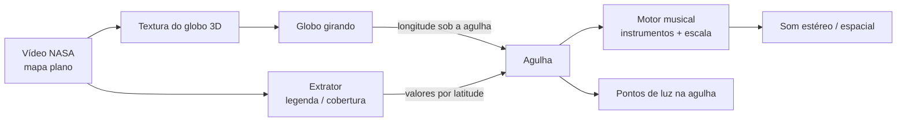

# Earth Jukebox — Direcionamento atual

> Fonte de verdade do projeto (ver [`AGENTS.md`](../AGENTS.md)). Definido em 15/11/2026.
> Substitui todas as decisões anteriores: o código, as faixas e o README atuais **não** valem como referência.
> Contexto e pesquisa: [análise estratégica](analise-estrategica.md), [recursos do desafio](recursos-do-desafio.md), [projetos anteriores](earth-jukebox-projetos-anteriores.md).

---

## 1. Objetivo

- Ser finalista global e mirar **Art & Technology** (alvos secundários: Global Connection e Most Inspirational).
- Entregar uma experiência com efeito **WOW nos primeiros 5 segundos** e som **bonito de verdade**, sem abrir mão do rigor: todo som de dado vem de um valor real lido do frame da NASA.
- A apresentação (site, vídeo e página do projeto) conta tanto quanto o código.

## 2. Conceito central: "A Terra é o disco"

- Um **globo 3D gira como um vinil**. O vídeo de mapa plano da NASA é projetado nele como textura.
- Uma **agulha fixa** toca o globo num meridiano e lê a coluna de dado que passa por baixo dela.
- **Latitude → altura da nota** (como no Caldwell 73, o recurso de sonificação do próprio desafio). **Cada variável ou categoria → um instrumento.** **Valor → intensidade e densidade.**
- O vídeo da NASA avança no tempo enquanto o globo gira: a agulha sempre lê **o frame atual** na **longitude que está sob ela**.



**Por quê:** junta a metáfora do jukebox com o recurso oficial de sonificação; nenhum projeto anterior do Space Apps fez isso; o efeito aparece em 5 segundos de demo.

### 2.1 O que é vídeo e o que não é

| O quê | De onde vem | Papel | Essencial? |
|---|---|---|---|
| Vídeos de mapa da NASA | Recursos oficiais do SVS | **São o dado**: viram a pele do globo e a fonte dos valores | Sim, é o centro do projeto |
| Globo 3D | Código nosso (three.js), ao vivo no navegador | Esfera que gira, arrasta e dá zoom; veste o vídeo da NASA | Sim |
| Vídeos do Veo | IA | **Só enfeite**: abertura do site e cenas do vídeo do pitch | Não. **O globo nunca é um vídeo do Veo** |

### 2.2 Fluxo do usuário

1. Abre o link → tela preta *"Put on headphones."* → clique.
2. Abertura (§5.2): a câmera chega à Terra e a agulha pousa.
3. A música começa: o globo gira vestido com o vídeo da NASA e a agulha toca o que passa embaixo dela.
4. Data avançando à esquerda, instrumentos com valores ao vivo à direita, narrador explicando.
5. "Records" troca de faixa: a pele do globo e a música mudam.
6. "Explorar": arrastar o dedo sobre um lugar e ouvir aquele ponto.
7. "Liner notes": como a faixa funciona, fonte e limites.

### 2.3 Exemplo: como um recurso vira música (temperatura do mar, SVS 3912)

1. O mapa plano da NASA (cor = temperatura, legenda 0–32 °C) é enrolado no globo.
2. A agulha fica parada num meridiano; o globo gira embaixo dela.
3. A cada instante, a agulha lê a coluna do mapa sob ela, de norte a sul, dividida em faixas de latitude; a cor de cada faixa vira temperatura pela legenda.
4. Cada faixa de latitude é uma nota: **latitude → altura** (norte agudo, sul grave); **temperatura → intensidade e brilho**; **terra firme → silêncio**.
5. Resultado: o Pacífico soa como um acorde largo e longo, as Américas quase em silêncio, depois o Atlântico. Com o vídeo avançando, as estações mudam a melodia volta após volta.

## 3. Escopo

| Dentro do escopo | Fora do escopo |
|---|---|
| Site estático, tela única, globo 3D, modos Ouvir / Explorar / Comparar | Back end, login, contas |
| 4 faixas de mapa + 1 faixa bônus 2D (ver §8) | Faixas de câmera móvel sem exploração aprovada (ver E4) |
| Motor musical com instrumentos sampleados | Música composta por IA a partir do dado |
| Narração pré-gravada EN / PT / ES | Outros idiomas |
| Exportação de cada faixa como álbum | Hardware ou jukebox físico |
| Script aberto "vídeo de mapa do SVS → faixa" | Editor visual de faixas na UI |
| Teste com usuários cegos ou com baixa visão | Estudo científico formal |

## 4. Estrutura do site

- **Tela única, sem scroll.** Tudo acontece sobre o globo.
- Explicação em dois lugares: painel **"Liner notes"** (encarte, por faixa) e overlay **"About"** (método, teste, time, créditos).
- A landing atual (hero, cards, grid, "how it works", time) **sai por completo**.

**Por quê:** o juiz precisa ouvir algo em menos de 3 segundos; scroll brigaria com o arrastar do globo.

## 5. UI — descrição

### 5.1 Identidade visual

| Elemento | Decisão |
|---|---|
| Fundo | Espaço preto profundo, estrelas sutis |
| Cor | As únicas cores fortes vêm do dado da NASA. UI em preto, branco e vidro, com acento âmbar mínimo. **O coral atual sai** |
| Controles | Liquid glass (vidro fosco translúcido, borda clara fina). Com redução de transparência ativa, vira sólido com o mesmo contraste |
| Tipografia | Serifa editorial fina e grande para datas e títulos (ex.: Instrument Serif); mono para valores de dado (ex.: Geist Mono); Atkinson Hyperlegible onde a leitura importar mais |
| Proibido | Cards em grid, seções empilhadas de landing, jukebox de desenho animado, ícones genéricos de template |

### 5.2 Abertura (cold open)

1. Tela preta, uma frase pequena no centro: *"Put on headphones."*
2. Clique em qualquer lugar → vídeo Veo de ~8 s: a câmera desce do espaço até a Terra, a superfície revela sulcos finos de vinil, uma agulha de cromo desce; som de agulha e estalo de vinil (ElevenLabs).
3. O último frame do vídeo tem **o mesmo enquadramento** do globo 3D ao vivo; a troca é invisível (match cut) e o app começa a tocar.
4. Retornos à página pulam a abertura (com opção de rever no overlay About).

### 5.3 Tela principal

| Região | O que aparece |
|---|---|
| Centro | Globo grande (~70% da altura, levemente abaixo do centro), vídeo NASA projetado, halo de atmosfera e brilho suave. Em volta, anéis concêntricos leves girando devagar (o "prato") |
| Agulha | Braço de cromo fino vindo do canto superior direito; a ponta toca o meridiano, desenhado como uma linha de luz. Cada nota acende um ponto na linha, na latitude da nota e na cor do instrumento |
| Esquerda | Data enorme em serifa editorial (ex.: "AUG 2007"); abaixo, a legenda da narração em uma linha |
| Direita | Coluna de chips de vidro, um por instrumento: ícone, nome da variável, valor ao vivo com unidade, botões de mudo e solo |
| Anel do prato | Arco de progresso do tempo, arrastável (substitui o slider) |
| Rodapé | Pílula de vidro: play/pause, nome da faixa, "Records", "Liner notes", modo (Ouvir / Explorar / Comparar), idioma |
| Canto superior esquerdo | Marca "EARTH JUKEBOX" pequena; acesso ao overlay About |

### 5.4 Troca de faixa ("Records")

- Uma fileira de capas quadradas de vidro sobe de baixo.
- **Cada capa é um "vinil de dados":** a série inteira do dataset desenhada como sulcos circulares (cada anel = um passo de tempo, cor = valor). Gerada a partir do próprio dado, não de imagem decorativa.
- Ao escolher: a agulha levanta (com som), a textura do globo faz crossfade para o novo vídeo, a agulha desce.
- **Faixa bônus 2D (nível do mar):** o globo recua e esmaece; o vídeo da NASA aparece numa escotilha circular de vidro no centro; o resto da UI continua igual.

### 5.5 Liner notes (encarte)

Painel de vidro que desliza da direita, com:
- O que você está ouvindo, em linguagem simples.
- Tabela "dado → som" da faixa.
- **Texto descritivo rico**: o que acontece na imagem em cada trecho (também lido pelo leitor de tela).
- Barra de cores da NASA com o botão **"Hear the legend"**: toca do mínimo ao máximo para calibrar o ouvido.
- Fonte NASA com link e limites da leitura, ditos com franqueza.
- Botão de exportar a faixa como álbum (§7.4).

### 5.6 Modo Explorar

- A agulha sai; o cursor vira um ponto brilhante.
- Arrastar sobre o globo toca o valor daquele lugar, com **áudio espacial**: com fone, o som vem da direção do ponto em relação à câmera.
- No celular, vibração proporcional ao valor (onde o navegador suportar).

### 5.7 Modo Comparar (dueto)

- Dois globos lado a lado, mesmo lugar em dois tempos (faixa padrão: luzes noturnas 2012 × 2023).
- Globo da esquerda no ouvido esquerdo, da direita no direito.

### 5.8 Acessibilidade

- Mantém tudo que o projeto já tem: teclado completo, leitor de tela, `aria-live`, valores reais no texto acessível, legendas, áudio só após interação, movimento reduzido.
- **Modo Audio-first** (tecla A): esconde o visual e anuncia tudo por voz.
- Nada depende só de cor; o vidro respeita contraste mínimo.

## 6. Som

### 6.1 Motor

- Síntese ao vivo no navegador com **instrumentos sampleados reais** (piano, cordas, marimba, celesta, percussão afinada) e **regras de teoria musical**: escala por faixa, harmonia, limite de saltos.
- **No máximo 3 vozes por faixa**, todas com solo e mudo. Clareza vence riqueza.
- **Regra emocional:** quando a tendência piora (temperatura, perda de luz), a harmonia vai de consonante para dissonante. Emoção derivada do dado.
- O som de cada faixa precisa ser **aprovado de ouvido por alguém do time com formação musical** antes de considerar a faixa pronta.

**Por quê:** Art & Technology premia arte com rigor; nenhum premiado entregou ruído. Música gerada por IA seria caixa-preta e destruiria Validity.

### 6.2 Som por faixa (ponto de partida; ajuste fino é do designer de som)

| Faixa | Vozes |
|---|---|
| Aerossóis | Fumaça → violoncelo grave · Poeira → marimba · Sal marinho → celesta (sulfato só se couber no limite de 3 vozes, ver Q2) |
| Temperatura do mar | Temperatura → altura na escala; água mais quente → timbre mais brilhante |
| Raios | Cada raio → batida de percussão afinada; latitude → altura (migração norte/sul audível) |
| Luzes noturnas | Quantidade de luz → densidade de notas de piano; luz apagada → notas descendo em menor; luz nova → sinos subindo |
| Nível do mar (bônus) | Nível → tom sustentado subindo; marcos por década |

## 7. Conteúdo gerado por IA e entregáveis extras

Prompts de cada item: [`prompts-assets.md`](prompts-assets.md). Créditos disponíveis no Flow: ~1.600 somando as contas do time; o modo Quality está liberado para as versões finais.

### 7.1 Google Veo — itens

| Usar | Não usar |
|---|---|
| Abertura do site (§5.2) | Qualquer imagem que pareça dado |
| Planos abstratos do vídeo do pitch (espaço, sulcos, agulha) | Pessoas, principalmente "testadores" — **nunca** |
| — | Transições entre faixas |

**Processo para todo item:** imagem no Nano Banana (grátis, iterar até ficar perfeita) → animar com Veo 3.1 usando a imagem como frame → testes no **Fast**, versão final no **Quality** → baixar em 1080p, 16:9, **sem o áudio do Veo**.

| ID | Item | Usado em | Quando fazer | Arquivo |
|---|---|---|---|---|
| V1 | Abertura: descida do espaço até a Terra, agulha pousando. **Último frame = screenshot do globo 3D** | Site (§5.2) | **Depois do globo pronto** (a implementação gera o screenshot) | `media-src/veo/v1-abertura.mp4` |
| V2 | A Terra como o centro de um disco de vinil | Pitch | Agora | `media-src/veo/v2-terra-disco.mp4` |
| V3 | A mesma cena com a agulha de cromo pousada | Pitch | Agora | `media-src/veo/v3-terra-agulha.mp4` |
| V4 | Só a borda da Terra surgindo no escuro | Pitch (abertura e fechamento) | Agora | `media-src/veo/v4-borda-terra.mp4` |
| V5 | Macro da agulha nos sulcos, que viram litorais vistos da órbita | Pitch | Agora | `media-src/veo/v5-sulcos-costa.mp4` |
| V6 | Fitas de luz subindo do oceano como ondas sonoras | Pitch | Agora | `media-src/veo/v6-oceano-som.mp4` |

- Salvar também a imagem-base de cada item ao lado do vídeo, com o mesmo nome e extensão `.png`.

### 7.2 ElevenLabs — itens

| Usar | Não usar |
|---|---|
| Narrador profissional EN / PT / ES pré-gerado | Música do dado |
| Efeitos: agulha, vinil, prato, transições | Falar valores que não estão no dado da faixa |
| Voz do vídeo do pitch e vinheta de abertura (opcional) | — |

- **Uma voz só** para os três idiomas, com o modelo multilíngue. A voz escolhida fica registrada aqui: *(pendente, ver Q4)*.
- Exportar em MP3, 44,1 kHz, 128 kbps.
- A fala sintetizada do navegador fica só como reserva para falas dinâmicas (valores ao vivo no Explorar).

| ID | Item | Quando fazer | Arquivo |
|---|---|---|---|
| S1 | Agulha pousando no disco (2 s) | Agora | `media-src/elevenlabs/sfx/needle-drop.mp3` |
| S2 | Estalo de vinil em loop (10 s) | Agora | `media-src/elevenlabs/sfx/vinyl-crackle-loop.mp3` |
| S3 | Agulha levantando (1,5 s) | Agora | `media-src/elevenlabs/sfx/needle-lift.mp3` |
| S4 | Prato do toca-discos ligando (3 s) | Agora | `media-src/elevenlabs/sfx/platter-spin-up.mp3` |
| S5 | Disco saindo da capa e indo para o prato (2,5 s) | Agora | `media-src/elevenlabs/sfx/record-swap.mp3` |
| S6 | Toque em vidro, som de interface (0,5 s) | Agora | `media-src/elevenlabs/sfx/glass-tap.mp3` |
| S7 | Whoosh suave pelo espaço (3 s) | Agora | `media-src/elevenlabs/sfx/space-whoosh.mp3` |
| M1 | Vinheta de abertura (6 s, opcional) | Agora | `media-src/elevenlabs/music/opening-sting.mp3` |
| N1 | Falas fixas da UI: `put-on-headphones`, `welcome` | Depois de escolher a voz | `media-src/elevenlabs/voice/<en\|pt\|es>/<id>.mp3` |
| N2 | Narração das faixas: intro, marcos e encerramento de cada faixa | **Depois da E1** (o roteiro vai para `prompts-assets.md`) | `media-src/elevenlabs/voice/<en\|pt\|es>/<faixa>-<intro\|outro\|marco-N>.mp3` |
| N3 | Narração do vídeo do pitch | Depois do roteiro do vídeo | `media-src/elevenlabs/voice/en/pitch.mp3` |

### 7.2.1 Onde subir os arquivos no repositório

```
earth-jukebox/media-src/
  veo/                      V1–V6 (.mp4) + imagem-base (.png)
  elevenlabs/
    sfx/                    S1–S7
    music/                  M1
    voice/en|pt|es/         N1–N3
```

- `media-src/` **é versionada no git** (é como o time compartilha os originais). Cada arquivo abaixo de 100 MB (limite do GitHub).
- São os **originais**: a implementação comprime e copia para `public/` só o que o site usa. Ninguém edita `public/` à mão com esses arquivos.
- Marca d'água do Veo e metadados do ElevenLabs: aplicados conforme [`si-e-referencias.md`](si-e-referencias.md) §2.

### 7.3 Regra comum

- Todo conteúdo gerado por IA (vídeo, voz, efeitos) e todo sample de instrumento vai listado em **References** na página do projeto, como a regra do Space Apps exige.
- Regras de uso de IA, marcação (marca d'água, metadados) e respostas do formulário: [`si-e-referencias.md`](si-e-referencias.md).

### 7.4 Álbum exportável

- Cada faixa pode ser baixada como arquivo de áudio com encarte acessível (texto do Liner notes + fonte NASA).
- **Por quê:** o enunciado aceita "app interativo" **ou** "playlist de áudios gerados"; entregamos as duas formas.

### 7.5 Script aberto "vídeo de mapa do SVS → faixa"

- Script reproduzível que recebe um vídeo de mapa plano do SVS, extrai os frames (escala, recorte, intervalo) e gera a faixa completa.
- Substitui os frames versionados sem processo documentado.
- **Por quê:** Validity (reprodutível) e Influence (qualquer pessoa adiciona dados novos).

## 8. Faixas

| Faixa | Recurso | Situação |
|---|---|---|
| Aerossóis (GEOS 2025) | [SVS 5669](https://svs.gsfc.nasa.gov/5669/), recurso oficial | Nova. Imagem estática: a agulha varre o mesmo instante a cada volta |
| Temperatura do mar (ECCO2) | [SVS 3912](https://svs.gsfc.nasa.gov/3912/), recurso oficial | Nova. Legenda 0–32 °C |
| Luzes noturnas 2012–2023 | [SVS 5313](https://svs.gsfc.nasa.gov/5313/), recurso oficial | Nova. Também é a faixa do modo Comparar |
| Raios da ISS 2017–2023 | [SVS 5011](https://svs.gsfc.nasa.gov/5011/), recurso oficial | Refeita para a agulha |
| Nível do mar 1993–2023 (bônus 2D) | [SVS 5235](https://svs.gsfc.nasa.gov/5235/), EIC | Mantida como bônus: tendência mais clara e emocional |

**Saem:** TEMPO NO₂ (não é EIC), Dixie Fire e Queimadas VIIRS (não são mapa plano projetável e repetem a história dos raios).
**Em exploração:** CO₂ DYAMOND (melhor história, mas câmera móvel; ver E4).

## 9. História e gancho

- Gancho: **acessibilidade provada com teste real** + **"uma camada sonora para o Earth Information Center"**.
- Frase de posicionamento (rascunho; conferir o número na OMS antes de publicar):

> *"NASA's Earth Information Center is a wall of screens. 43 million people are blind. We turned the wall into music — and tested it with people who can't see it: X of Y heard the trend."*

- **Teste com usuários é entrega obrigatória, não extra.** Contatos: Fundação Dorina Nowill, Instituto Benjamin Constant, Laramara. Teste remoto por áudio vale. Complemento: teste de olhos fechados com outras pessoas.
- **Nunca** inventar ou simular resultado ou depoimento.

## 10. Entregáveis da submissão

| Entregável | Decisão |
|---|---|
| Site | Publicado e funcionando em notebook comum e celular, com versão 2D se o 3D não rodar |
| Vídeo (~30 s) | 5 s de tela preta só com som e legenda (*"This is the Atlantic Ocean, 2007."*) → revela o globo → Explorar → Comparar → resultado do teste com pessoas reais → frase. Voz ElevenLabs, planos abstratos Veo, legendas em inglês |
| Página do projeto | Em inglês, escrita na linguagem dos prêmios ("combines technical and creative skills", "makes NASA data accessible to blind and low-vision people") |
| References | Todas as fontes NASA, samples, conteúdo de IA e bibliotecas |
| README | Reescrito para refletir este direcionamento |

## 11. Stack

| Camada | Escolha |
|---|---|
| App | React + Vite, site estático publicado no GitHub Pages |
| 3D | three.js via React Three Fiber, drei e postprocessing (bloom) |
| Animação e câmera | GSAP (Theatre.js se a coreografia da câmera exigir) |
| Áudio | Tone.js com samples de licença aberta; panner espacial (HRTF) no Explorar |
| Modelo da agulha | Blender ou Spline |
| Pipeline de frames | Script com ffmpeg + Python (§7.5) |

**Por quê:** 3D bem mais simples com R3F; é o stack em que as IAs produzem melhor.

## 12. O que sai do produto atual

- Landing inteira, jukebox de desenho animado, transição de vinil atual, cor coral.
- Fala do navegador como voz principal.
- Faixas TEMPO, Dixie Fire e Queimadas VIIRS.
- `src/data/illustrative.js` (dado inventado).
- Motor de som atual (onda dente-de-serra, ruído e tique).
- O extrator atual **pode ser reaproveitado** se servir à agulha; não é obrigatório mantê-lo.

## 13. Como cobrimos os critérios

| Critério | Como pontuamos |
|---|---|
| Influence | Dados da NASA para pessoas cegas e com baixa visão, 3 idiomas, camada sonora para o EIC, script aberto para novos dados, **teste real** |
| Creativity | A Terra como disco, agulha lendo o planeta, áudio espacial, capas que são o próprio dado |
| Validity | Valor lido da legenda do frame, legenda sonora, limites no encarte, pipeline reproduzível, teste com usuários |
| Relevance | Recursos oficiais, síntese em tempo real, exploração interativa, feedback tátil, texto descritivo rico, app + álbum |
| Presentation | Abertura cinematográfica, narrador profissional, tela única, vídeo que começa no escuro, página na linguagem dos prêmios |

## 14. Exploração (bloqueante)

Fazer antes de implementar os itens bloqueados. Resultado entra neste documento.

| # | O que precisamos descobrir | Bloqueia |
|---|---|---|
| E1 | Quais vídeos de cada faixa estão em mapa plano 2:1 (equirretangular) e qual versão usar como textura (sem legenda) e qual para leitura (com legenda). Atenção: luzes noturnas EIC é 32:9 (ver original SVS 5276); aerossóis 1920×1080 | §2, §5.3, §8 (faixas de mapa) |
| E2 | Licença dos samples (Salamander Piano, VSCO 2 CE ou outros) permite uso e redistribuição | §6.1 |
| E3 | Desempenho de vídeo como textura do globo em notebook comum e celular; tamanho e codec necessários | §5.3, §10 (site) |
| E4 | É viável ler o CO₂ DYAMOND (câmera móvel) com qualidade? | Inclusão do CO₂ em §8 |

## 15. Perguntas em aberto

| # | Pergunta | Afeta | Recomendação |
|---|---|---|---|
| Q1 | Velocidade de rotação do globo e quanto tempo de dado passa por volta | §2, §6 | Definir de ouvido por faixa; ponto de partida ~10 s por volta |
| Q2 | Aerossóis têm 4 categorias e o limite é 3 vozes: corta sulfato ou abre exceção? | §6.2 | Testar com 4; cortar se embolar |
| Q3 | Quantos testadores cegos ou com baixa visão conseguimos, e quando? | §9, §10 | Pelo menos 3 reais + 5 de olhos fechados |
| Q4 | Qual voz do ElevenLabs será o narrador? | §7.2 (N1–N3) | Voz calma, quente, de documentário; testar 3–4 com a frase de teste de `prompts-assets.md` |

## 16. Ordem de prioridade

**Em paralelo desde já, fora do código:** V2–V6, S1–S7, M1, escolha da voz (Q4) e N1 (§7.1, §7.2); contato com testadores (§9).

1. Explorações E1 e E3.
2. Globo com a agulha numa faixa (raios ou temperatura do mar).
3. Motor musical com samples, aprovado de ouvido.
4. Narração das faixas (N2), depois da E1.
5. Abertura com Veo (V1), a partir do screenshot do globo.
6. Demais faixas, Liner notes e capas "vinil de dados".
7. Teste com usuários (em paralelo, começar o contato já).
8. Explorar, Comparar, exportação de álbum, script aberto.
9. Vídeo, página do projeto e README.

## 17. Verificação

| Componente | Como verificar |
|---|---|
| Extração de valores | Comparar leitura com a legenda em frames de referência; erro declarado no encarte |
| Agulha e mapeamento | Teste unitário: latitude e valor conhecidos geram a nota esperada |
| Motor musical | Aprovação de ouvido do designer de som; nenhuma faixa com mais de 3 vozes |
| Acessibilidade | Navegação completa só por teclado e com leitor de tela (VoiceOver); modo Audio-first |
| Desempenho | Site abre e toca em notebook comum e celular; versão 2D aparece quando o 3D não roda |
| Teste com usuários | Protocolo simples ("a tendência subiu ou desceu?", "onde está o máximo?") e resultado real publicado |
