# Earth Jukebox — recursos do desafio e o que temos

Referência para o refactor. Levantamento feito em 15/11/2026 a partir da [aba Resources do desafio](https://www.spaceappschallenge.org/2026/challenges/the-earth-information-jukebox/?tab=resources), da API pública do NASA Scientific Visualization Studio (`https://svs.gsfc.nasa.gov/api/<id>`) e das imagens de prévia de cada página.

- **Seções 1 a 3:** cada um dos 11 recursos, em detalhe.
- **Seção 4:** o que o projeto tem hoje (código, faixas, lacunas).
- **Seção 5:** cruzamento recursos × projeto.
- **Apêndice A:** lista de todos os 309 itens de download (257 arquivos, mais pastas de frames e arquivos de hyperwall), com resolução, tamanho e link.

Legenda usada nas tabelas:

| Termo | Significado |
|---|---|
| **Câmera fixa** | O enquadramento não muda entre frames; uma região (caixa de pixels) é sempre o mesmo lugar da Terra. Pré-requisito do nosso extrator. |
| **Legenda numérica** | Barra de cores com valores e unidade. Permite converter cor em valor físico. |
| **Data no frame** | O frame mostra a data. Sem isso, a data de cada frame precisa ser inferida. |
| **Camada de data** | Vídeo separado só com a data, sincronizado com o vídeo principal. |

---

## 1. Resumo dos 11 recursos

| # | Recurso | SVS | Dado / modelo | Período | Câmera fixa? | Legenda numérica? | Data no frame? | Na galeria EIC? |
|---|---|---|---|---|---|---|---|---|
| 1 | EIC Content Database | [galeria](https://svs.gsfc.nasa.gov/gallery/earth-information-center/) | índice | — | — | — | — | — |
| 2 | Data Sonification: Caldwell 73 | [13786](https://svs.gsfc.nasa.gov/13786/) | Hubble (espaço profundo) | — | sim (imagem única) | não | não | não |
| 3 | Change in Night Lights 2012–2023 (EIC) | [5313](https://svs.gsfc.nasa.gov/5313/) | Black Marble, VIIRS (Suomi NPP) | 2012–2023, médias anuais | sim (mapa plano) | só qualitativa ("lights out" / "no change" / "new lights") | **sim, o ano** | sim |
| 4 | Global Sea Surface Currents and Temperature | [3912](https://svs.gsfc.nasa.gov/3912/) | modelo ECCO2 (MIT/JPL) | 25/03/2007 a 03/03/2008 | sim (versão mapa plano) | sim, 0–32 °C | sim na versão Pacífico | não |
| 5 | GEOS Aerosols (2025) | [5669](https://svs.gsfc.nasa.gov/5669/) | modelo GEOS-FP 2 km | **um instante**: 19/08/2025 20:00 UTC | sim (imagem única) | não, categórica (4 tipos) | não | não |
| 6 | Air Quality Model Runs | [5533](https://svs.gsfc.nasa.gov/5533/) | modelo GEOS-CF | 01/07 a 14/09/2024 | **não** (o mapa desliza sob as faixas) | **não** (só rótulos dos poluentes) | não (versão EIC) | sim |
| 7 | Perpetual Ocean 2: Western Boundary Currents | [5425](https://svs.gsfc.nasa.gov/5425/) | modelo ECCO2 | 15/01/2021 a 25/12/2023 | não (globo + zooms) | sim, em imagens separadas | camada de data separada | sim |
| 8 | DYAMOND Global Carbon Dioxide | [5196](https://svs.gsfc.nasa.gov/5196/) | modelo GEOS-MITgcm (DYAMOND) | jan–mar/2020 | não (órbita, zooms, voo) | sim, 380–460 ppm, imagem separada | **sim**, com hora | sim |
| 9 | Lightning Events Detected from the ISS | [5011](https://svs.gsfc.nasa.gov/5011/) | LIS na ISS, dataset QC | mar/2017 a jul/2023 | versão mapa plano (SOS): sim | não (pontos amarelos) | **só na versão globo** (ano + estação); mapa plano não | sim |
| 10 | A 3D View of an Atmospheric River | [4960](https://svs.gsfc.nasa.gov/4960/) | reanálise MERRA-2 | evento de dez/2010 | não (3D) | legenda de camadas, sem escala simples | camada de data separada | sim |
| 11 | GEDI Forest Height | [4950](https://svs.gsfc.nasa.gov/4950/) | lidar GEDI na ISS (RH100) | abr/2019–abr/2020 (global) | não (globo gira) | sim, 0–50 m no frame | não | sim |

Observações do levantamento:

- **Air Quality não tem barra de cores numérica em nenhum dos 17 arquivos.** Só dá para ler intensidade relativa, não concentração.
- **GEOS Aerosols é uma imagem estática**, não animação. O texto do desafio ("monitors the path") sugere movimento, mas o recurso é um único instante.
- **A versão globo do vídeo de raios mostra a data; o mapa plano não.** A versão globo tem um carimbo "Mar 01 2017 hh:mm" na abertura e depois um mostrador "10 Day Roving Window" com o ano no centro e um ponto girando por March / June / Sept. / Dec. A versão `debug` do mapa plano só acrescenta as linhas tracejadas dos trópicos.
- **DYAMOND imprime data e hora em cada frame** (ex.: "23 Jan 2020 05:00:00.000"), mas a câmera se move o tempo todo.

Quatro vídeos foram baixados e inspecionados frame a frame (seção 3.11): Night Lights, Sea Surface Temperature, Air Quality (EIC) e Lightning (globo e mapa plano). Os demais foram avaliados pela prévia e pelo texto da página.

---

## 2. A galeria do EIC (recurso 1)

**O que é:** a página [Earth Information Center (EIC)](https://svs.gsfc.nasa.gov/gallery/earth-information-center/) do SVS reúne o conteúdo feito para as telas do EIC, a exposição da NASA em Washington. O desafio diz que vídeos e imagens dali podem ser usados como dado.

**O que a página entrega sem JavaScript (15 itens):**

| SVS | Tipo | Título |
|---|---|---|
| 4950 | Visualização | GEDI Forest Height (recurso 11) |
| 4960 | Visualização | A 3D View of an Atmospheric River (recurso 10) |
| 4993 | Visualização | Spread of the Dixie Fire - 2021 (**nossa faixa**) |
| 5011 | Visualização | Lightning from the ISS (recurso 9, **nossa faixa**) |
| 5196 | Visualização | DYAMOND Global CO₂ (recurso 8) |
| 5313 | Visualização | Night Lights 2012–2023 EIC (recurso 3) |
| 5425 | Visualização | Perpetual Ocean 2 (recurso 7) |
| 5533 | Visualização | Air Quality Model Runs (recurso 6) |
| 14371 | B-Roll | Earth Information Center Media B-Roll |
| 14507 | Vídeo produzido | NASA Joins the Jane Goodall Institute to Conserve Chimpanzee Habitat |
| 14568 | Vídeo produzido | Tracking the Greenhouse Gas Methane |
| 14606 | Vídeo produzido | NASA and Fire |
| 14696 | Vídeo produzido | NASA + Smithsonian and Greenhouse Gases |
| 14700 | Vídeo produzido | NASA + The Smithsonian: Biodiversity |
| 14713 | Vídeo produzido | Building Coastal Resilience with NASA Data |

- A página carrega mais itens por JavaScript; o restante da galeria não foi lido.
- Os vídeos produzidos (14xxx) são documentários editados, não visualizações de dado.
- Outra forma de saber se algo é EIC é a palavra-chave "Earth Information Center" na API do SVS. Ela aparece em 5011, 5533, 5235 e 5113.

---

## 3. Cada recurso em detalhe

### 3.1 Data Sonification: Caldwell 73 — [SVS 13786](https://svs.gsfc.nasa.gov/13786/)

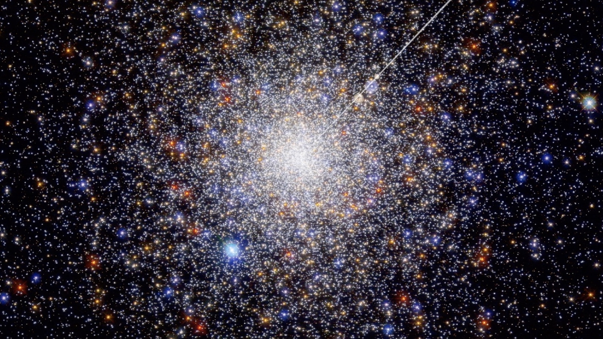

| Campo | Valor |
|---|---|
| Publicado | 23/12/2020 |
| Origem | Imagem do Hubble do aglomerado globular NGC 1851, a 40 mil anos-luz, na constelação Columba |
| Autoria do som | SYSTEM Sounds (M. Russo, A. Santaguida) |
| Arquivos | 6: vídeo 1920×1920 (MP4 e WebM), legendas SRT, 3 imagens |

**Como a sonificação funciona (é o que o desafio quer que se aprenda):**

| Atributo visual | Atributo sonoro |
|---|---|
| Varredura de "radar" girando a partir do centro | Tempo (ordem em que as estrelas soam) |
| Distância da estrela ao centro | Altura: mais longe = mais agudo |
| A imagem inteira | Um coral contínuo |
| Estrelas laranja e vermelhas | Marimba |
| Estrelas azuis | Glockenspiel |

- É sonificação **espacial** (varredura de uma imagem parada), não temporal. Nossas faixas atuais são todas temporais.
- A cor escolhe o **instrumento** (timbre). Nós só usamos cor para obter um valor.
- Página relacionada: [Sonification of the Bubble Nebula (SVS 13999)](https://svs.gsfc.nasa.gov/13999/), varredura de cima para baixo com cor → altura.

### 3.2 Change in Night Lights between 2012 and 2023 — EIC Version — [SVS 5313](https://svs.gsfc.nasa.gov/5313/)

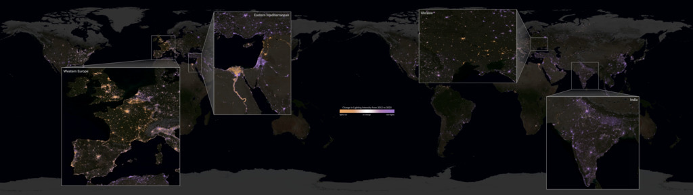

| Campo | Valor |
|---|---|
| Publicado | 14/06/2024 |
| Dado | Black Marble: Next Generation (NASA/NOAA), sensor VIIRS no Suomi NPP |
| Formato | **Só a versão EIC**: 7680×2160 (32:9), 30 fps. MP4 H.265 de 33 MB, ProRes de 4 GB e pasta de frames |
| Versão original 16:9 | [SVS 5276](https://svs.gsfc.nasa.gov/5276/), com outras visualizações de luzes noturnas |
| Créditos | Kel Elkins (visualização); Zhuosen Wang, Miguel Román, Ranjay Shrestha, Srija Chakraborty, Virginia Kalb (ciência) |

**Sequência do vídeo:**

1. Mapa plano com a série de **médias anuais de 2012 a 2023**, com o **ano impresso no centro do mapa**.
2. As luzes somem e aparece o **mapa de mudança 2012→2023** com a legenda "Change in Lighting Intensity from 2012 to 2023": laranja = "lights out", branco = "no change", roxo = "new lights".
3. A sequência se repete com janelas ampliadas de **Índia, Ucrânia, Europa Ocidental e Mediterrâneo Oriental**, de novo com o ano no centro e depois a legenda de mudança.

Medido no vídeo (43,3 s, 1300 frames, 30 fps, H.265 7680×2160):

- Etapa 1 (série anual) dura cerca de 9 s: ~0,75 s ≈ 22 frames por ano.
- Etapas 2 e 3 ocupam o resto; a etapa 3 tem sua própria série anual com zooms.

Para o projeto:

- Mapa plano com câmera fixa e ano impresso encaixa no extrator `coverage` (fração de pixels acesos por região), com datas lidas do próprio frame.
- A legenda de mudança não tem números: dá para ouvir "mais / menos luz", não "quanto".
- Os zooms da etapa 3 ocupam pedaços do mapa: as caixas de região precisam evitar essas janelas ou usar só a etapa 1.
- O vídeo é H.265 (HEVC): o Chrome em muitos sistemas não toca HEVC, então para exibir no site seria preciso recodificar.

### 3.3 Global Sea Surface Currents and Temperature — [SVS 3912](https://svs.gsfc.nasa.gov/3912/)

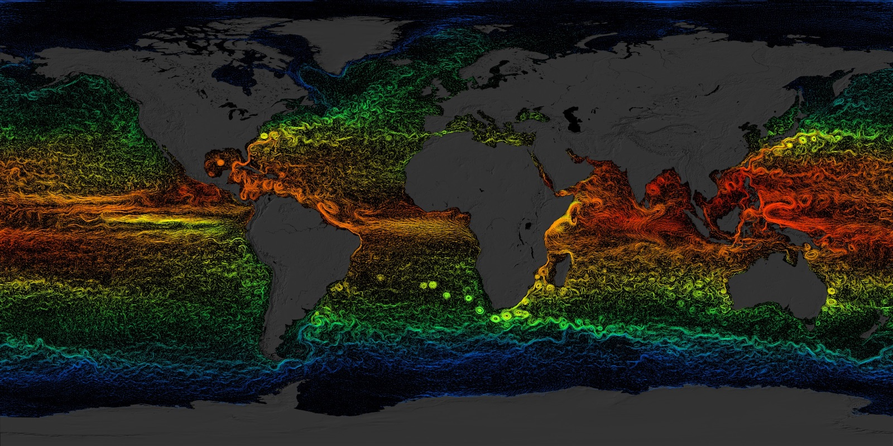
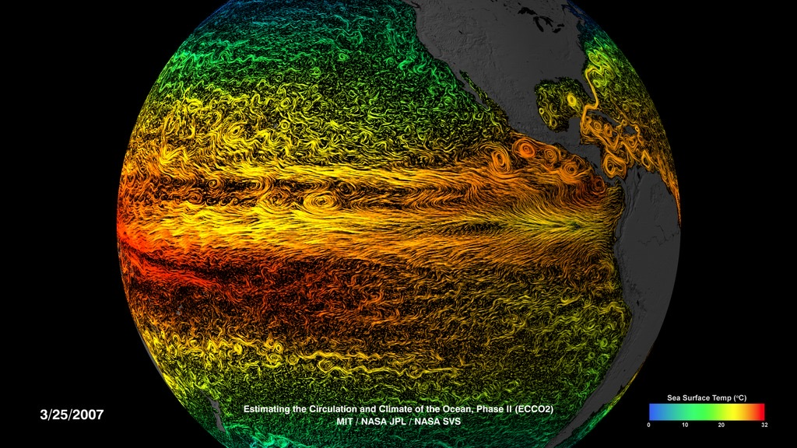

| Campo | Valor |
|---|---|
| Publicado | 16/03/2012 |
| Dado | Modelo ECCO2 (MIT/JPL, MITgcm) + topografia GTOPO30 |
| Período | 25/03/2007 a 03/03/2008 |
| Legenda | 0 °C azul, 10–20 °C verde, ~25 °C amarelo, 32 °C vermelho (`sst_ecco2_cbar.png`, 310×95) |
| Arquivos | 55 |

**Versões:**

| Versão | Câmera | Legenda no frame | Data no frame | Resolução |
|---|---|---|---|---|
| Global mapa plano, sem legenda | fixa | não | não | 2048×1024 (pasta `orig`), 6840×3420 completo |
| Global mapa plano, **com legenda** | fixa | sim | não | 2048×1024, pasta `with_colorbar` com **2001 frames TIFF** |
| Hyperwall 5×3 (15 vídeos recortados a1…e3) | fixa | não | não, há tabela de datas por frame na página | 1368×768 cada |
| Atlântico Norte | fixa | não | não | 6840×2304 |
| Pacífico Leste | globo parado | **sim** | **sim** (ex.: 3/25/2007) | 1920×1080 |
| Pacífico sem sobreposição | globo parado | não | não | 1920×1080 |

- Extras: imagens da grade do modelo (pontos onde o ECCO2 define a corrente) e apresentações `.pptx`/`.key` "The Motions of the Oceans".
- Medido no vídeo `ecco2_sst_flow.mp4` (66,7 s, **2001 frames**, 30 fps, 2048×1024): câmera totalmente fixa, **sem legenda e sem data no frame**. Mesma contagem de frames da pasta `with_colorbar`. Período de ~344 dias em 2001 frames ≈ 1 frame a cada ~4 horas de modelo.
- Para o projeto: é o recurso com **melhor combinação de legenda numérica + câmera fixa + frames prontos**. Encaixa no extrator de legenda de cores (temperatura por região). A cor codifica temperatura, não velocidade; a velocidade das correntes não é legível.

### 3.4 GEOS Aerosols (2025) — [SVS 5669](https://svs.gsfc.nasa.gov/5669/)

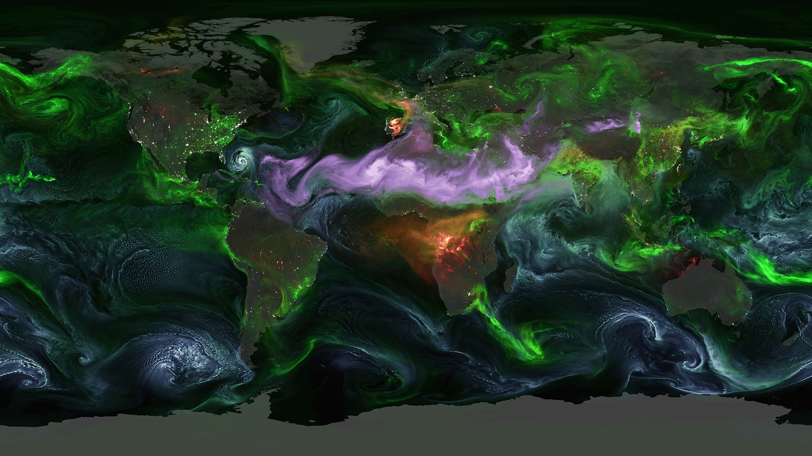

| Campo | Valor |
|---|---|
| Publicado | 10/08/2026 |
| Dado | GEOS Forward Processing, replay de 2 km (GMAO) |
| Instante | **19/08/2025, 20:00 UTC — imagem única** |
| Arquivos | 7: PNG em 1920×1080, 3840×2160, 5760×3240, 7680×4320; versões de impressão 14:11; legenda |
| Legenda | Categórica: Black Carbon (vermelho/laranja, fumaça), Dust (rosa), Sea Salt (azul-acinzentado), Sulfate (verde) |

**Fenômenos que a página destaca na imagem:**

- Furacão Erin no Atlântico puxando poeira da África; sal marinho em espirais azuis.
- Poeira do Saara cruzando o Atlântico até o Caribe e os EUA.
- Plumas de sulfato do Kilauea (Havaí) e do Etna (Itália).
- Fumaça de queimadas agrícolas no sul da África e de incêndios na Espanha.

Para o projeto:

- Não há série temporal. Só serve para sonificação espacial (varredura, como no Caldwell 73).
- É o único recurso com **tipos categóricos**: encaixa naturalmente em "um instrumento por tipo de aerossol" (multi-trilha, como o desafio sugere).
- Sem escala de concentração: a intensidade de cada tipo só pode ser lida como relativa.
- Vídeo relacionado: [Inside the Visualization: Aerosols (SVS 14899)](https://svs.gsfc.nasa.gov/14899/).

### 3.5 Air Quality Model Runs — [SVS 5533](https://svs.gsfc.nasa.gov/5533/)

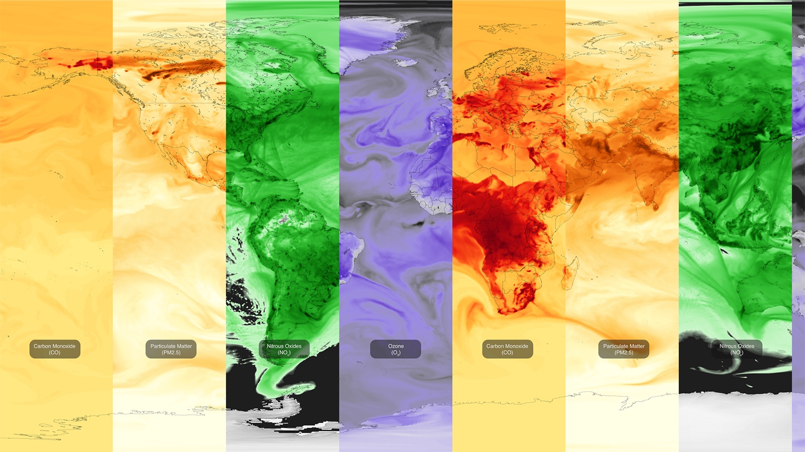
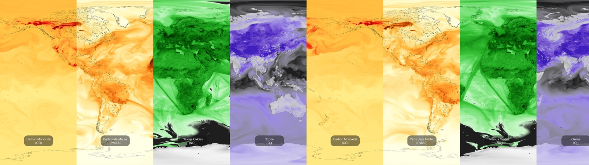

| Campo | Valor |
|---|---|
| Publicado | 05/05/2025 |
| Dado | GEOS-CF (Composition Forecasting, GMAO), período **01/07 a 14/09/2024** |
| Poluentes | Monóxido de carbono (CO), material particulado (PM2.5), óxidos de nitrogênio (NOx), ozônio (O₃) |
| Layout | Faixas verticais lado a lado, uma por poluente, cada uma com sua paleta e rótulo |
| Legenda numérica | **Nenhuma** |
| Arquivos | 17 |

**Versões:**

| Versão | Formato | Câmera |
|---|---|---|
| Sphere With Labels | 5760×3240 MP4 + pasta de frames | globo |
| Map With Labels | 5760×3240 MP4 (286 MB) + pasta de frames + PNG 1920×1080 | mapa plano; não verificado se desliza como a versão EIC |
| Sphere Long | 5760×3240 MP4 + frames | globo |
| **EIC 32:9** | 7680×2160 MP4, prévia 3840×1080 (179 MB), frames | mapa plano **deslizando** |

- A versão EIC mostra "a temporada de incêndios ativa na América do Norte" de julho–agosto de 2024.
- Medido na prévia EIC (75 s, 4502 frames, 60 fps, 3840×1080): **as faixas dos poluentes ficam paradas na tela e o mapa-múndi desliza continuamente por baixo delas**, da direita para a esquerda. Cada lugar da Terra passa pelas quatro faixas ao longo do vídeo; nenhuma caixa de pixels fixa corresponde sempre ao mesmo lugar. Não há data no frame.
- Para o projeto: quatro camadas de som naturais (uma por poluente). Sem legenda numérica, o valor é "mais escuro = mais concentrado" dentro de cada paleta, e isso precisa ser dito na narração. O deslizamento exige calcular a longitude em cada frame (velocidade constante, mas precisa ser medida) ou trabalhar com a faixa inteira como "o que passa agora".

### 3.6 Perpetual Ocean 2: Western Boundary Currents — [SVS 5425](https://svs.gsfc.nasa.gov/5425/)

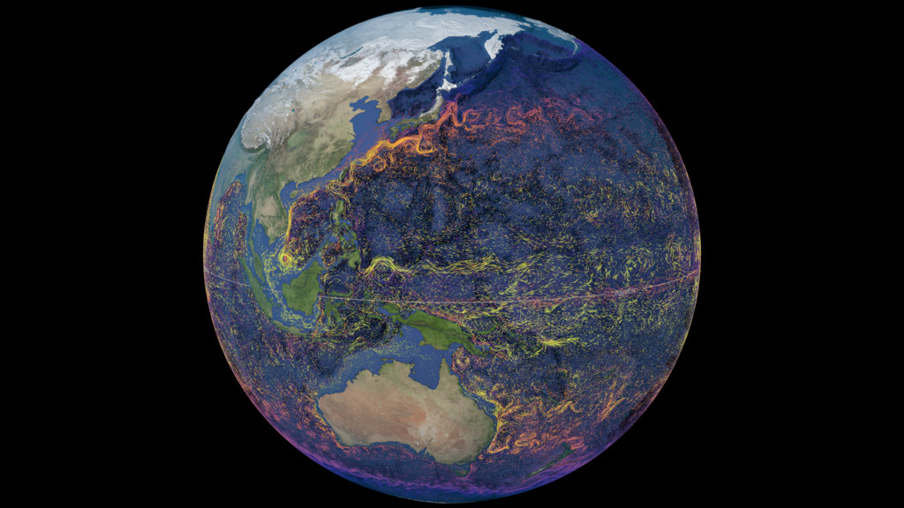

| Campo | Valor |
|---|---|
| Publicado | 27/02/2025 |
| Dado | ECCO2, campo de velocidade 3D, 2021–2023; Blue Marble NG; ETOPO-30 |
| Método | Partículas virtuais soltas no oceano; rastro de 3 dias (acima de 600 m) ou 6 dias (abaixo) |
| Percurso da câmera | Globo girando → Kuroshio (Japão) → Oceano Índico → Agulhas (África do Sul) → Corrente do Golfo |
| Prêmio | Versão narrada aceita no SIGGRAPH 2025 Electronic Theater ([SVS 14745](https://svs.gsfc.nasa.gov/14745/)) |
| Arquivos | 48 |

**Versões e camadas (todas com o mesmo percurso de câmera, para composição):**

| Versão | O que mostra | Legenda |
|---|---|---|
| Beauty | Correntes acima de 600 m em branco; abaixo de 600 m em azul-ciano-branco | −3 a 22 °C (só abaixo de 600 m) |
| Temperature | Correntes coloridas por temperatura | 0 a 25 °C, azul → roxo → amarelo |
| Salinity | Correntes coloridas por salinidade | 33 a 36, verde-ciano → cinza → laranja → vermelho |
| 600 m and below | Só a contracorrente profunda da Corrente do Golfo | igual à Beauty |
| Equator | Linha e rótulo do equador | — |
| Sea ice only, Land only, Land mask | Camadas para pós-produção | — |
| **Dates only** | Só a data, de 15/01/2021 a 25/12/2023 | — |

- A narração da página traz números úteis para roteiro: Kuroshio 20–25 °C e salinidade ~34,5; Índico oeste >36; Corrente do Golfo até 2,5 m/s; anéis das Agulhas com mais de 2 anos de vida.
- Para o projeto: câmera em movimento impede caixas de região fixas. As camadas separadas (data, terra, equador) ajudam a sincronizar, mas não resolvem o movimento.

### 3.7 DYAMOND Global Carbon Dioxide — [SVS 5196](https://svs.gsfc.nasa.gov/5196/)

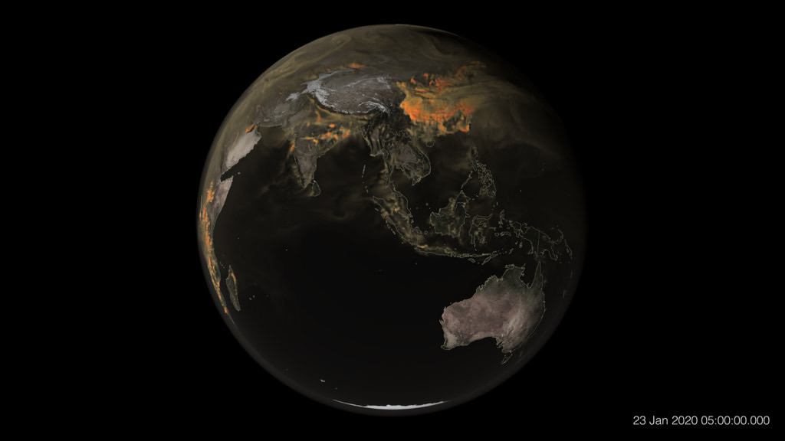
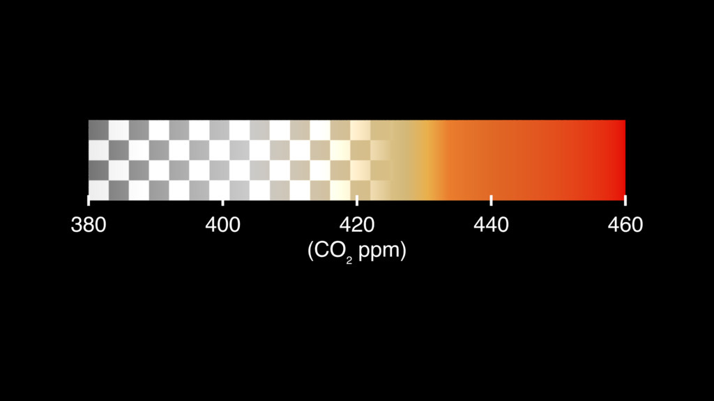

| Campo | Valor |
|---|---|
| Publicado | 22/07/2024 |
| Dado | DYAMOND: modelo acoplado experimental GEOS-MITgcm, rodado no NASA Advanced Supercomputing |
| Período | Janeiro a março de 2020 |
| Legenda | 380 a 460 ppm; abaixo de ~420 ppm o CO₂ é desenhado semitransparente (xadrez na legenda) |
| Data no frame | **Sim**, data e hora no canto inferior direito |
| Arquivos | 37 |

**Movimentos de câmera disponíveis (todos em movimento):**

| Versão | Movimento | Formatos |
|---|---|---|
| Globe orbit | Órbita ao redor da Terra, à distância | 1080p, 2160p, frames 5760×3240 |
| Globe zoom | Aproxima no leste dos EUA | 1080p, 2160p, frames |
| Globe zoom 5×3 | Igual, formato ultralargo 3200×1080 / 9600×3240 | MP4 + frames PNG |
| Globe zoom west | Aproxima no oeste dos EUA | 1080p, 3240p H.265, frames |
| Globe tilt | Voo experimental de leste a oeste pelo dado | 1080p, frames |

- A página explica a "pulsação": queimadas têm ciclo dia-noite e a vegetação absorve e libera CO₂.
- Fontes por região, segundo a cientista Lesley Ott: China, EUA e Sul da Ásia = usinas, indústria e veículos; África e América do Sul = queimadas.
- Contexto da página: 278 ppm em 1750 → 427 ppm em maio/2024.
- Para o projeto: tem tudo que falta nos outros (legenda numérica + data), menos câmera fixa. Ler um valor por região exigiria rastrear a posição do globo em cada frame.

### 3.8 Lightning Events Detected from the ISS 2017–2023 — [SVS 5011](https://svs.gsfc.nasa.gov/5011/)

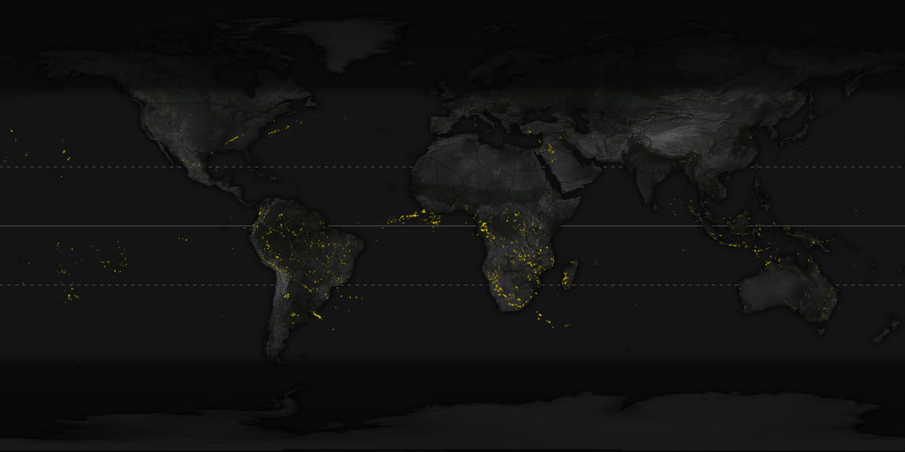

| Campo | Valor |
|---|---|
| Publicado | 19/10/2023 |
| Dado | Lightning Imaging Sensor (LIS) na ISS, dataset com controle de qualidade (Blakeslee 2020, GHRC DAAC) |
| Período | A página diz "janeiro de 2017" num texto e "março de 2017" em outro, até julho de 2023 |
| Janela | Cada frame acumula 10 dias de raios ("roving window") |
| Base | Nuvens CPC Cloud Composite, Natural Earth Gray Earth, Land Cover CMG |
| Arquivos | 11 |

**Versões:**

| Versão | Câmera | Resolução | Tamanho |
|---|---|---|---|
| Sphere | globo | 1920×1080 | 127 MB |
| Sphere 4K 60p | globo | 3840×2160 | 414 MB |
| **EIC display** | painel EIC | 7680×2160 | 580 MB |
| SOS yearly | **mapa plano** (Science On a Sphere) | 4096×2048 | 334 MB |
| SOS yearly debug | mapa plano + linhas tracejadas dos trópicos | 4096×2048 | 692 MB |

Medido nos vídeos:

| Versão | Duração | Frames | O que aparece |
|---|---|---|---|
| Sphere 1080p | 216,7 s, 30 fps | 6501 | Abertura com a ISS varrendo a Terra e carimbo "Mar 01 2017 hh:mm"; depois o globo gira e aparece o mostrador **"10 Day Roving Window"**: o **ano** no centro de um círculo e um ponto que gira pelos rótulos March / June / Sept. / Dec. |
| SOS yearly (mapa plano) | 100 s, 60 fps | 6002 | Mapa plano fixo, **sem data em nenhum ponto do vídeo** |

- A data existe, mas só na versão com câmera móvel. A versão de câmera fixa, que é a que nossa faixa usa, não tem data. Os anos da nossa faixa continuam inferidos.
- O mostrador da versão globo daria o ano e a estação de cada frame dessa versão. Usá-lo para datar o mapa plano exigiria alinhar os dois vídeos, que têm durações e taxas de quadro diferentes; esse alinhamento não foi testado.
- O vídeo começa em 1º de março de 2017, o que confirma o "março de 2017" da página (não janeiro).
- A cobertura do LIS vai só até as latitudes médias (órbita da ISS); o mapa fica escuro perto dos polos.

### 3.9 A 3D View of an Atmospheric River from an Earth System Model — [SVS 4960](https://svs.gsfc.nasa.gov/4960/)

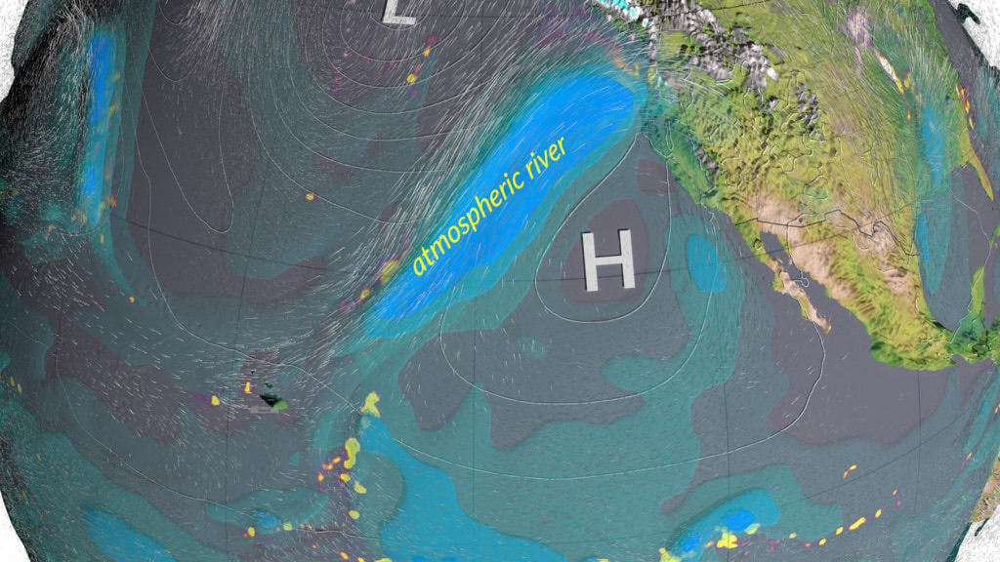
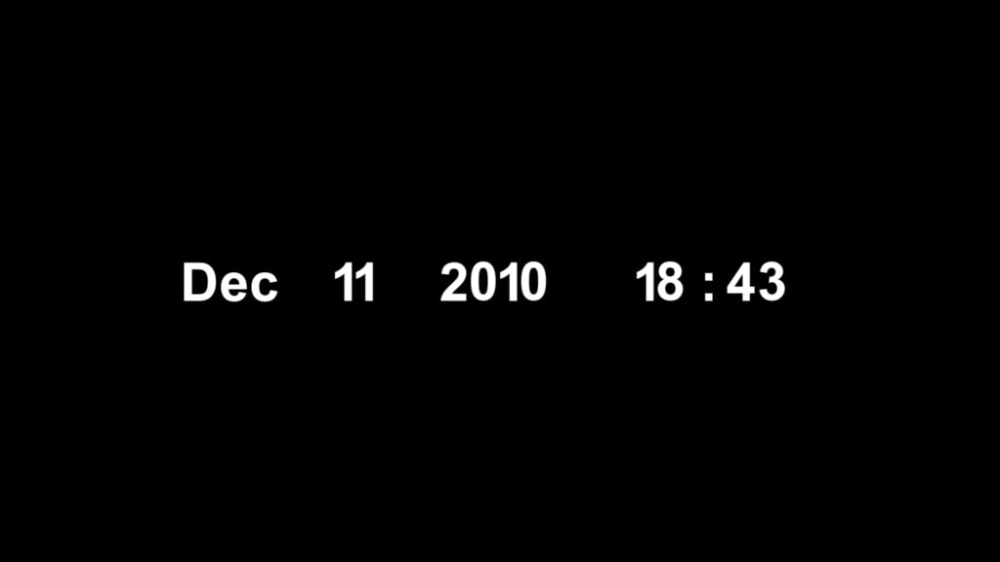

| Campo | Valor |
|---|---|
| Publicado | 25/01/2022 |
| Dado | Reanálise MERRA-2 (GMAO): ventos, nuvens, precipitação, transporte integrado de vapor d'água |
| Evento | Rio atmosférico tipo "pineapple express" (origem perto do Havaí) atingindo a costa oeste dos EUA, dezembro de 2010 |
| Rótulos no frame | "atmospheric river", centros de alta (H) e baixa (L), isóbaras |
| Arquivos | 25 |

**Versões:**

| Versão | Observação |
|---|---|
| Narrada | HD e 4K, com **legendas SRT e VTT em inglês** |
| Não narrada | HD, 4K, frames 3840×2160, 7680×2160 (EIC) e 9600×3240 |
| Date only | Camada só com data e hora (ex.: "Dec 11 2010 18:43"), 1920×1080 |
| Legenda das camadas | `atmo_rivers_cbars01.png`: paletas empilhadas (neve no topo, oceano embaixo); camadas com valor baixo ficam transparentes |

- O texto da página é uma aula completa: zona de convergência intertropical (ITCZ), alta da Califórnia × baixa das Aleutas, levantamento orográfico, importância para a neve e a água do oeste dos EUA.
- Para o projeto: câmera 3D em movimento e várias camadas sobrepostas tornam a leitura por pixel pouco confiável. As legendas narradas são material pronto para roteiro e acessibilidade.

### 3.10 GEDI Forest Height — [SVS 4950](https://svs.gsfc.nasa.gov/4950/)

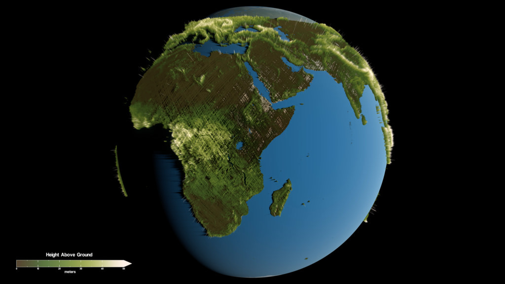

| Campo | Valor |
|---|---|
| Publicado | 29/10/2021 |
| Dado | GEDI (lidar na ISS), métrica RH100 do produto L2B: altura do dossel em relação ao solo |
| Instrumento | 3 lasers, 8 trilhas paralelas, 242 disparos/s, pegadas de 25 m a cada 60 m |
| Período | Global: abr/2019–abr/2020. Regionais: a página diz abr/2018–abr/2019 (inconsistente com o lançamento do GEDI em dez/2018) |
| Cores | Marrom e verde-escuro = vegetação baixa; verde-claro e branco = alta. Altura exagerada em 3D |
| Legendas | 0–50 m no frame; imagens separadas de 0–40, 0–50 e 0–75 m |
| Arquivos | 97 |

**Versões (cada uma com e sem legenda no frame):**

| Versão | O que muda no tempo |
|---|---|
| Global | O globo gira; o dado é o mesmo |
| Costa oeste dos EUA (CA) | A cobertura cresce a cada passagem do satélite |
| Flórida | Idem |
| Goddard (Maryland) | Idem |
| Laurentides (Quebec) | Idem |
| Senegal | Idem |
| Stills | 4 imagens globais e 4 da costa oeste, em JPG e TIFF 3840×2160 |

- O tempo no vídeo é **tempo de coleta**, não mudança da floresta. Ouvir a série temporal seria ouvir o satélite acumulando dado.
- Para o projeto: legenda numérica boa, mas câmera móvel. Faz sentido como varredura espacial de um still (estilo Caldwell 73), comparando regiões.

### 3.11 Verificação nos vídeos

Folhas de contato: frames espaçados igualmente ao longo de cada vídeo, em ordem da esquerda para a direita e de cima para baixo.

| Vídeo | Arquivo baixado | Tamanho |
|---|---|---|
| Night Lights | `nightlights_flat_series_and_change_wZooms_13_EIC_2160p30_h265.mp4` | 32.7 MB |
| Sea Surface Temperature | `ecco2_sst_flow.mp4` | 244.4 MB |
| Air Quality (EIC) | `EIC_AirQuality_Preview_3840x1080.mp4` | 178.8 MB |
| Lightning, globo | `iss_lightning_sphere_07312023.mp4` | 127.0 MB |
| Lightning, mapa plano | `iss_lightning_sos_yearly_07312023_2048p60.mp4` | 334.0 MB |

**Night Lights:** série anual, depois a legenda de mudança, depois os zooms.

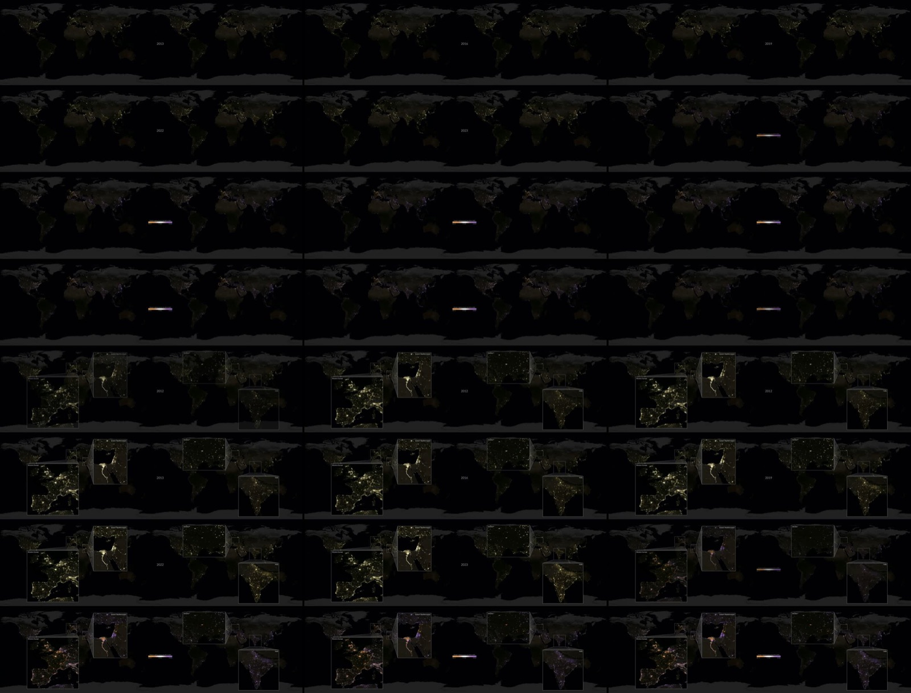

Centro do mapa ampliado: o ano (2013, 2022) e a legenda de mudança.

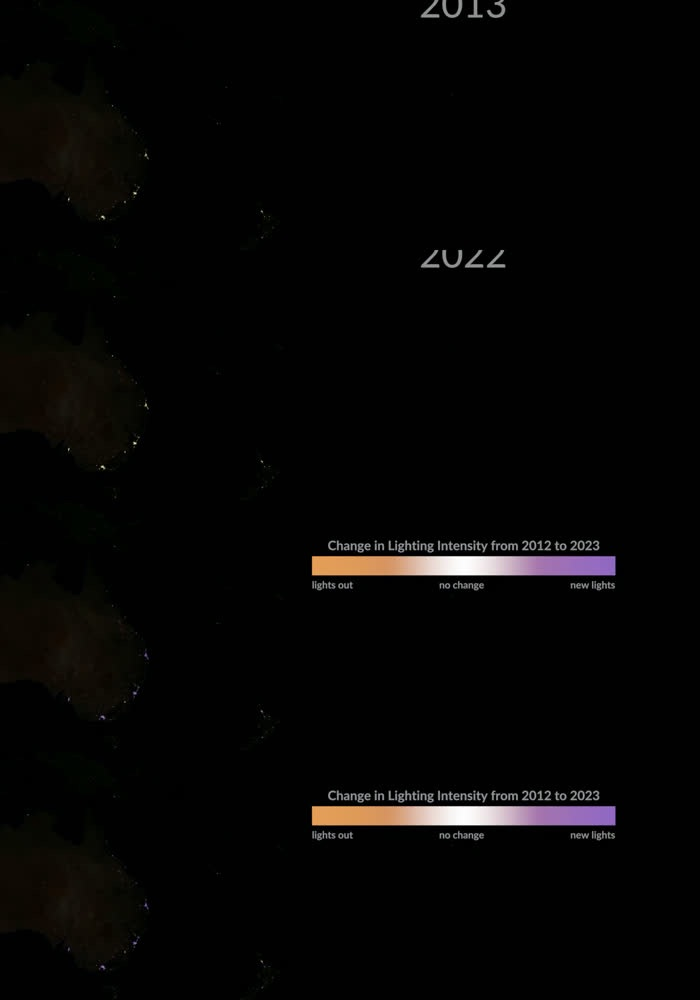

**Sea Surface Temperature:** câmera fixa, sem legenda nem data.

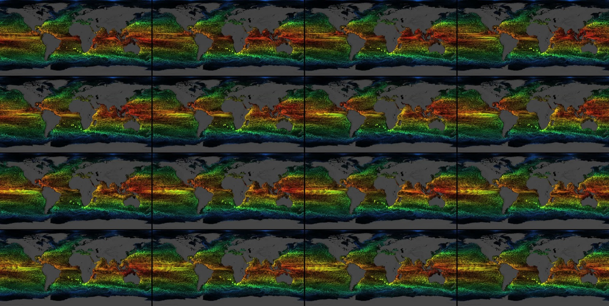

**Air Quality (EIC):** o mapa desliza sob as quatro faixas.

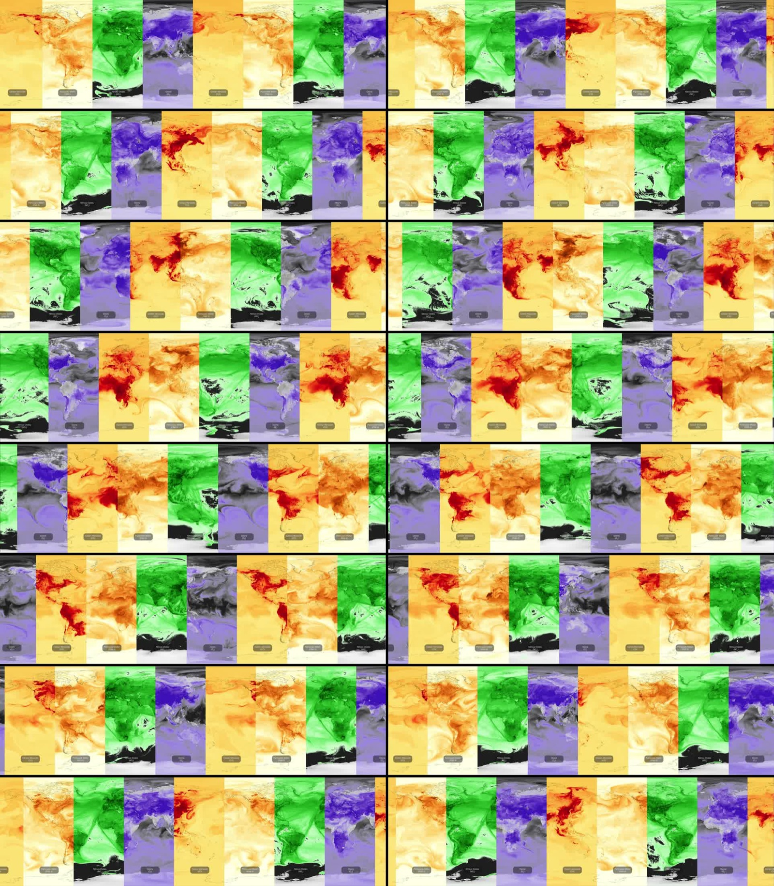

**Lightning, globo:** carimbo de data na abertura e mostrador de ano e estação depois.

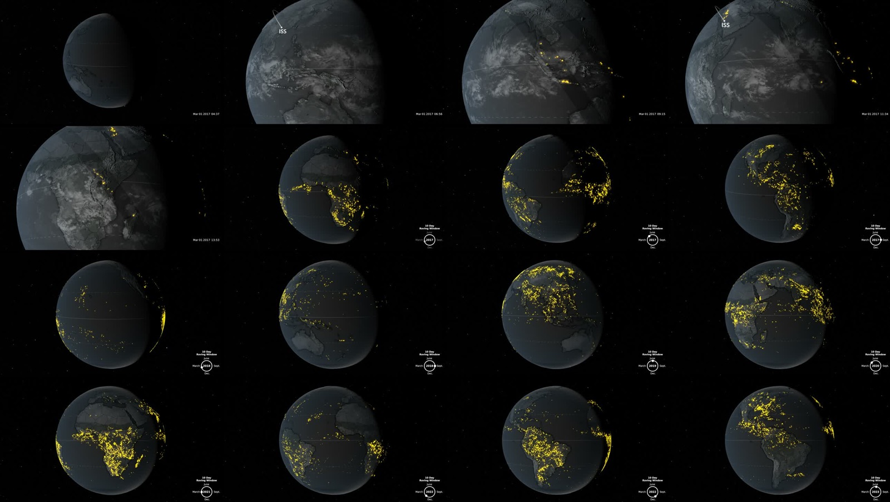
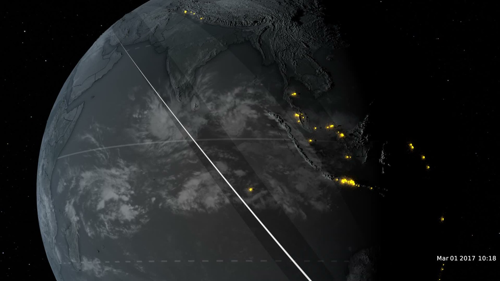
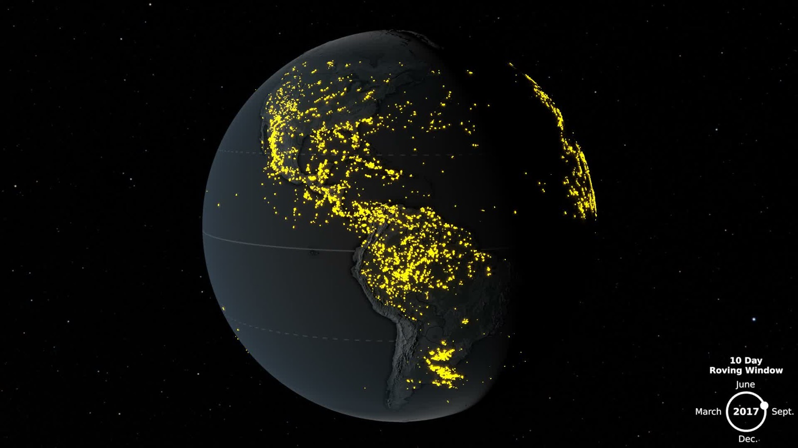

**Lightning, mapa plano:** sem data.

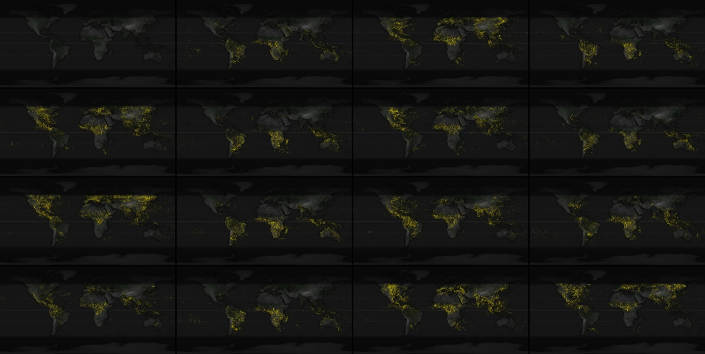

---

## 4. O que temos hoje

### 4.1 Projeto

| Item | Estado |
|---|---|
| Stack | Vite + JavaScript puro, sem framework e sem back end; som com Web Audio API; voz com Web Speech API |
| Site | https://eluaden.github.io/earth-jukebox/ (publicado via branch `gh-pages`, `npm run deploy`) |
| Tamanho | ~1.400 linhas (JS + `index.html`), mais o CSS |
| Idiomas | Interface e narração em inglês, português e espanhol |
| Acessibilidade | Teclado completo, `aria-live`, `aria-valuetext` com valores reais, `prefers-reduced-motion`, camadas com cor + forma |

### 4.2 Faixas

| Faixa | SVS | Recurso da lista? | Marcada como EIC? | Extrator | Frames | Tamanho da pasta |
|---|---|---|---|---|---|---|
| `sea-level-porthole` | [5235](https://svs.gsfc.nasa.gov/5235/) | não | sim (palavra-chave) | `marker` (régua no frame) | 91 | 6,1 MB |
| `dixie-fire-2021` | [4993](https://svs.gsfc.nasa.gov/4993/) | não | sim (na galeria) | `cursor` (gráfico no frame) | 58 | 11 MB |
| `active-fires-viirs` | [5113](https://svs.gsfc.nasa.gov/5113/) | não | sim (palavra-chave) | `coverage` | 147 | 6,6 MB |
| `tempo-no2-great-lakes` | [5175](https://svs.gsfc.nasa.gov/5175/) | não | **não** | legenda de cores (padrão) | 12 | 9,1 MB |
| `iss-lightning` | [5011](https://svs.gsfc.nasa.gov/5011/) | **sim** (recurso 9) | sim | `coverage` | 137 | 7,8 MB |

- 4 das 5 faixas são EIC. A do TEMPO não é, nem pela galeria nem pela palavra-chave.
- 1 das 5 faixas vem da lista de recursos do desafio.

### 4.3 Código

| Arquivo | Linhas | Papel |
|---|---|---|
| `src/data/extract.js` | 279 | Lê valores dos frames no navegador: legenda de cores (padrão), `marker`, `cursor`, `coverage` |
| `src/data/contract.js` | 104 | Valida o `track.json` |
| `src/data/loadTrack.js`, `tracks.js` | 38 + 31 | Carrega o índice, os metadados e a faixa completa (com cache); `roles()` mapeia séries para camadas de som |
| `src/data/illustrative.js` | 10 | Série de dado **inventada** do protótipo ("NOT real NASA data"). **Não é importada por nenhum arquivo** |
| `src/audio/engine.js` | 98 | Síntese: tom (dente de serra + sub, 98–392 Hz), vento (ruído filtrado), tique (1000–3000 Hz), sino, ducking sob a voz, timbre "underwater" |
| `src/narration/*` | 26 | Fala (Web Speech) e legendas |
| `src/ui/player.js` | 217 | Página de escuta: toca a faixa, sincroniza vídeo, tubos, slider |
| `src/ui/earth.js`, `earthDraw.js`, `globe.js` | 146 | Globo da landing (textura Blue Marble) e desenho substituto quando uma faixa não tem vídeo |
| `src/ui/landing.js`, `router.js`, `warp.js`, `fullscreen.js`, `dom.js` | 145 | Landing, rotas, transição do vinil, tela cheia |
| `src/i18n/*` | 49 | Textos da interface |
| `scripts/deploy.mjs` | — | Publica `dist/` no `gh-pages` |

### 4.4 Lacunas encontradas

| Lacuna | Onde | Efeito |
|---|---|---|
| **Não existe script que gere os frames.** Os frames (445 no total) estão versionados, mas o processo (quais frames do vídeo, escala, recorte) só está descrito em texto no `track.json` e no README | `public/tracks/*/` | Não dá para refazer ou trocar uma faixa de forma reprodutível; afeta Validity |
| Código morto do protótipo | `src/data/illustrative.js`; `layers()` em `engine.js`, usado só nas demos | Ruído; e um arquivo com dado inventado num projeto que diz "nothing is invented" |
| Mapeamento sonoro fixo: as mesmas 3 camadas (tom, vento, tique) para toda faixa | `engine.js` | Não há escala musical, instrumento por categoria nem forma musical; a [análise estratégica](analise-estrategica.md) aponta isso como ponto fraco para Creativity e Art & Tech |
| Só sonificação temporal | todo o pipeline | Recursos estáticos (Aerosols, GEDI) e a ideia central do Caldwell 73 (varredura espacial) ficam fora |
| Anos da faixa de raios são inferidos | `iss-lightning/track.json` | O mapa plano do SVS 5011 não traz data; só a versão globo (câmera móvel) tem o mostrador de ano e estação |
| Placeholders na landing | `[X/5]` e citação do testador | O teste com usuários ainda não foi feito |

---

## 5. Cruzamento recursos × projeto

| Recurso | Usamos? | Encaixa no extrator atual? | O que exigiria |
|---|---|---|---|
| EIC Content Database | sim (4 faixas) | — | — |
| Caldwell 73 | não | — | Modo de varredura espacial; instrumento por categoria de cor |
| Night Lights | não | sim (`coverage`) | Caixas de região fora das janelas de zoom; ler o ano impresso; recodificar o vídeo HEVC para exibir |
| Sea Surface Currents & Temp. | não | sim (legenda de cores) | Medir a legenda de 0–32 °C (frames `with_colorbar`); datas calculadas do período (sem data no frame) |
| GEOS Aerosols | não | não (estático) | Varredura espacial; 4 categorias → 4 instrumentos |
| Air Quality | não | não (mapa desliza, sem legenda numérica) | Calcular a longitude por frame ou ler "o que passa" em cada faixa; leitura relativa por paleta |
| Perpetual Ocean 2 | não | não (câmera móvel) | Rastreamento de câmera |
| DYAMOND CO₂ | não | não (câmera móvel) | Rastreamento do globo; ler a data impressa |
| Lightning ISS | sim | sim (`coverage`) | Para datas reais: alinhar com o mostrador da versão globo |
| Atmospheric River | não | não (3D, camadas) | Pouco viável por pixel; legendas SRT servem para narração |
| GEDI Forest Height | não | não (câmera móvel) | Varredura espacial de um still com legenda 0–50 m |

---

## Apêndice A — Todos os arquivos dos recursos

Gerado da API do SVS em 15/11/2026. Tamanho via `Content-Length`. "Pasta" = diretório de frames individuais (sem tamanho único).

### A.1 Caldwell 73 — SVS 13786 (6 arquivos)

**Master Version Horizontal version. This is for use on any YouTube or non-YouTube platform where you want to display the video horizontally.**

| Arquivo | Tipo | Resolução | Tamanho |
|---|---|---|---|
| [print.jpg](https://svs.gsfc.nasa.gov/vis/a010000/a013700/a013786/print.jpg) | Image | 1920×1080 | 850.7 KB |
| [wide.jpg](https://svs.gsfc.nasa.gov/vis/a010000/a013700/a013786/wide.jpg) | Image | 1920×1080 | 850.7 KB |
| [SW.jpg](https://svs.gsfc.nasa.gov/vis/a010000/a013700/a013786/SW.jpg) | Image | 320×180 | 47.1 KB |
| [Caldwell73_2K_Final.mp4](https://svs.gsfc.nasa.gov/vis/a010000/a013700/a013786/Caldwell73_2K_Final.mp4) | Movie | 1920×1920 | 73.9 MB |
| [Caldwell73_2K_Final.webm](https://svs.gsfc.nasa.gov/vis/a010000/a013700/a013786/Caldwell73_2K_Final.webm) | Movie | 1920×1920 | 5.6 MB |
| [CALDWELL73.en_US.SRT](https://svs.gsfc.nasa.gov/vis/a010000/a013700/a013786/CALDWELL73.en_US.SRT) | Captions | — | 49 B |

### A.2 Night Lights 2012–2023 (EIC) — SVS 5313 (6 arquivos)

**This global, flat map view of night lights data begins with a time series depicting annual averages from 2012 to 2023. The lights then fade away to reveal night…**

| Arquivo | Tipo | Resolução | Tamanho |
|---|---|---|---|
| [nightlights_flat_series_and_change_wZooms_13_EIC.02599_print.jpg](https://svs.gsfc.nasa.gov/vis/a000000/a005300/a005313/nightlights_flat_series_and_change_wZooms_13_EIC.02599_print.jpg) | Image | 1024×288 | 62.0 KB |
| [nightlights_flat_series_and_change_wZooms_13_EIC.02599_searchweb.png](https://svs.gsfc.nasa.gov/vis/a000000/a005300/a005313/nightlights_flat_series_and_change_wZooms_13_EIC.02599_searchweb.png) | Image | 320×180 | 49.9 KB |
| [nightlights_flat_series_and_change_wZooms_13_EIC.02599_thm.png](https://svs.gsfc.nasa.gov/vis/a000000/a005300/a005313/nightlights_flat_series_and_change_wZooms_13_EIC.02599_thm.png) | Image | 80×40 | 4.6 KB |
| [nightlights_2012-2023_change_flat_eic](https://svs.gsfc.nasa.gov/vis/a000000/a005300/a005313/frames/7680x2160_32x9_30p/nightlights_2012-2023_change_flat_eic/) | Frames | — | pasta |
| [nightlights_flat_series_and_change_wZooms_13_EIC_2160p30_h265.mp4](https://svs.gsfc.nasa.gov/vis/a000000/a005300/a005313/nightlights_flat_series_and_change_wZooms_13_EIC_2160p30_h265.mp4) | Movie | — | 32.7 MB |
| [nightlights_flat_series_and_change_wZooms_13_EIC_prores.mov](https://svs.gsfc.nasa.gov/vis/a000000/a005300/a005313/nightlights_flat_series_and_change_wZooms_13_EIC_prores.mov) | Movie | — | 4.0 GB |

### A.3 Sea Surface Currents and Temperature — SVS 3912 (55 arquivos)

**Global sea surface currents colored by temperature. These are the assembled (contiguous) versions of the animation. There are several resolutions to choose from…**

| Arquivo | Tipo | Resolução | Tamanho |
|---|---|---|---|
| [flat_global_ecco2_2028x1024.25000.jpg](https://svs.gsfc.nasa.gov/vis/a000000/a003900/a003912/flat_global_ecco2_2028x1024.25000.jpg) | Image | 2048×1024 | 1002.0 KB |
| [flat_global_ecco2_2028x1024.25000_web.png](https://svs.gsfc.nasa.gov/vis/a000000/a003900/a003912/flat_global_ecco2_2028x1024.25000_web.png) | Image | 320×160 | 77.5 KB |
| [flat_global_ecco2_2028x1024.25000_thm.png](https://svs.gsfc.nasa.gov/vis/a000000/a003900/a003912/flat_global_ecco2_2028x1024.25000_thm.png) | Image | 80×40 | 5.7 KB |
| [flat_global_ecco2_2028x1024.25000_searchweb.png](https://svs.gsfc.nasa.gov/vis/a000000/a003900/a003912/flat_global_ecco2_2028x1024.25000_searchweb.png) | Image | 180×320 | 77.4 KB |
| [orig](https://svs.gsfc.nasa.gov/vis/a000000/a003900/a003912/frames/2048x1024_1x1_30p/orig/) | Frames | 2048×1024 | pasta |
| [ecco2_sst_flow.webmhd.webm](https://svs.gsfc.nasa.gov/vis/a000000/a003900/a003912/ecco2_sst_flow.webmhd.webm) | Movie | 960×540 | 14.9 MB |
| [with_colorbar](https://svs.gsfc.nasa.gov/vis/a000000/a003900/a003912/frames/2048x1024_1x1_30p/with_colorbar/) | Frames | 2048×1024 | pasta |
| [ecco2_sst_flow.mp4](https://svs.gsfc.nasa.gov/vis/a000000/a003900/a003912/ecco2_sst_flow.mp4) | Movie | 2048×1024 | 244.4 MB |
| [flat_global_ecco2_2028x1024_comp_p30.mp4](https://svs.gsfc.nasa.gov/vis/a000000/a003900/a003912/flat_global_ecco2_2028x1024_comp_p30.mp4) | Movie | 2048×1024 | 278.6 MB |
| [ecco2_sst_flow.m4v](https://svs.gsfc.nasa.gov/vis/a000000/a003900/a003912/ecco2_sst_flow.m4v) | Movie | 640×320 | 12.1 MB |
| [6840x3420_1x1_30p](https://svs.gsfc.nasa.gov/vis/a000000/a003900/a003912/frames/6840x3420_1x1_30p/) | Frames | 6840×3420 | pasta |
| [the_motions_of_the_oceans.pptx](https://svs.gsfc.nasa.gov/vis/a000000/a003900/a003912/the_motions_of_the_oceans.pptx) | Presentation | — | 54.7 MB |
| [the_motions_of_the_oceans.key](https://svs.gsfc.nasa.gov/vis/a000000/a003900/a003912/the_motions_of_the_oceans.key) | Presentation | — | 54.9 MB |
| [Oceanflows-UHD-2160.mp4](https://svs.gsfc.nasa.gov/vis/a000000/a003900/a003912/Oceanflows-UHD-2160.mp4) | Movie | 3840×2160 | 324.0 MB |
| [multiple-bigmovie.hwshow](https://svs.gsfc.nasa.gov/vis/a000000/a001800/a001801/multiple-bigmovie.hwshow) | HyperwallShow | — | — |

**A cropped region in the Pacific illustrating the distribution of the actual flow vector data points relative to the flow curves. The white dots represent locati…**

| Arquivo | Tipo | Resolução | Tamanho |
|---|---|---|---|
| [ecco2_and_grid_crop1.png](https://svs.gsfc.nasa.gov/vis/a000000/a003900/a003912/ecco2_and_grid_crop1.png) | Image | 320×180 | 133.1 KB |
| [ecco2_and_grid_crop1.jpg](https://svs.gsfc.nasa.gov/vis/a000000/a003900/a003912/ecco2_and_grid_crop1.jpg) | Image | 320×180 | 77.0 KB |
| [ecco2_and_grid_crop1.tif](https://svs.gsfc.nasa.gov/vis/a000000/a003900/a003912/ecco2_and_grid_crop1.tif) | Image | 320×180 | 167.2 KB |

**A cropped region in the Atlantic illustrating the distribution of the actual flow vector data points relative to the flow curves. The white dots represent locat…**

| Arquivo | Tipo | Resolução | Tamanho |
|---|---|---|---|
| [ecco2_and_grid_crop2.png](https://svs.gsfc.nasa.gov/vis/a000000/a003900/a003912/ecco2_and_grid_crop2.png) | Image | 320×180 | 141.4 KB |
| [ecco2_and_grid_crop2.jpg](https://svs.gsfc.nasa.gov/vis/a000000/a003900/a003912/ecco2_and_grid_crop2.jpg) | Image | 320×180 | 77.8 KB |
| [ecco2_and_grid_crop2.tif](https://svs.gsfc.nasa.gov/vis/a000000/a003900/a003912/ecco2_and_grid_crop2.tif) | Image | 320×180 | 183.9 KB |

**Full resolution ECCO2 flow field illustrating the distribution of the actual flow vector data points relative to the flow curves. The white dots represent locat…**

| Arquivo | Tipo | Resolução | Tamanho |
|---|---|---|---|
| [ecco2_and_grid.jpg](https://svs.gsfc.nasa.gov/vis/a000000/a003900/a003912/ecco2_and_grid.jpg) | Image | 6840×3420 | 12.8 MB |
| [ecco2_and_grid_web.png](https://svs.gsfc.nasa.gov/vis/a000000/a003900/a003912/ecco2_and_grid_web.png) | Image | 320×160 | 78.6 KB |
| [ecco2_and_grid.tif](https://svs.gsfc.nasa.gov/vis/a000000/a003900/a003912/ecco2_and_grid.tif) | Image | 6840×3420 | 34.4 MB |

**Sea surface currents and temperatures cropped, scaled, and diced for a 5x3 hyperwall. Date and time information for each frame can be found here. Individual cut…**

| Arquivo | Tipo | Resolução | Tamanho |
|---|---|---|---|
| [global-5x3-3-montage.png](https://svs.gsfc.nasa.gov/vis/a000000/a003900/a003912/global-5x3-3-montage.png) | Image | 6840×2304 | 24.0 MB |
| [global_5x3-3_hw_print.jpg](https://svs.gsfc.nasa.gov/vis/a000000/a003900/a003912/global_5x3-3_hw_print.jpg) | Image | 345×1024 | 180.3 KB |
| [flat_global_ecco2_6840x3420_768p30-b1.webm](https://svs.gsfc.nasa.gov/vis/a000000/a003900/a003912/flat_global_ecco2_6840x3420_768p30-b1.webm) | Movie | 1368×768 | 8.0 MB |
| [flat_global_ecco2_6840x3420_768p30-d1.mp4](https://svs.gsfc.nasa.gov/vis/a000000/a003900/a003912/flat_global_ecco2_6840x3420_768p30-d1.mp4) | Movie | 1368×768 | 25.0 MB |
| [flat_global_ecco2_6840x3420_768p30-c1.mp4](https://svs.gsfc.nasa.gov/vis/a000000/a003900/a003912/flat_global_ecco2_6840x3420_768p30-c1.mp4) | Movie | 1368×768 | 184.5 MB |
| [flat_global_ecco2_6840x3420_768p30-c2.mp4](https://svs.gsfc.nasa.gov/vis/a000000/a003900/a003912/flat_global_ecco2_6840x3420_768p30-c2.mp4) | Movie | 1368×768 | 178.5 MB |
| [flat_global_ecco2_6840x3420_768p30-a1.mp4](https://svs.gsfc.nasa.gov/vis/a000000/a003900/a003912/flat_global_ecco2_6840x3420_768p30-a1.mp4) | Movie | 1368×768 | 268.7 MB |
| [flat_global_ecco2_6840x3420_768p30-e3.mp4](https://svs.gsfc.nasa.gov/vis/a000000/a003900/a003912/flat_global_ecco2_6840x3420_768p30-e3.mp4) | Movie | 1368×768 | 277.9 MB |
| [flat_global_ecco2_6840x3420_768p30-b1.mp4](https://svs.gsfc.nasa.gov/vis/a000000/a003900/a003912/flat_global_ecco2_6840x3420_768p30-b1.mp4) | Movie | 1368×768 | 203.4 MB |
| [flat_global_ecco2_6840x3420_768p30-b2.mp4](https://svs.gsfc.nasa.gov/vis/a000000/a003900/a003912/flat_global_ecco2_6840x3420_768p30-b2.mp4) | Movie | 1368×768 | 245.6 MB |
| [flat_global_ecco2_6840x3420_768p30-b3.mp4](https://svs.gsfc.nasa.gov/vis/a000000/a003900/a003912/flat_global_ecco2_6840x3420_768p30-b3.mp4) | Movie | 1368×768 | 276.6 MB |
| [flat_global_ecco2_6840x3420_768p30-e1.mp4](https://svs.gsfc.nasa.gov/vis/a000000/a003900/a003912/flat_global_ecco2_6840x3420_768p30-e1.mp4) | Movie | 1368×768 | 241.7 MB |
| [flat_global_ecco2_6840x3420_768p30-c3.mp4](https://svs.gsfc.nasa.gov/vis/a000000/a003900/a003912/flat_global_ecco2_6840x3420_768p30-c3.mp4) | Movie | 1368×768 | 311.7 MB |
| [flat_global_ecco2_6840x3420_768p30-e2.mp4](https://svs.gsfc.nasa.gov/vis/a000000/a003900/a003912/flat_global_ecco2_6840x3420_768p30-e2.mp4) | Movie | 1368×768 | 331.2 MB |
| [flat_global_ecco2_6840x3420_768p30-d3.mp4](https://svs.gsfc.nasa.gov/vis/a000000/a003900/a003912/flat_global_ecco2_6840x3420_768p30-d3.mp4) | Movie | 1368×768 | 346.5 MB |
| [flat_global_ecco2_6840x3420_768p30-d2.mp4](https://svs.gsfc.nasa.gov/vis/a000000/a003900/a003912/flat_global_ecco2_6840x3420_768p30-d2.mp4) | Movie | 1368×768 | 318.9 MB |
| [flat_global_ecco2_6840x3420_768p30-a3.mp4](https://svs.gsfc.nasa.gov/vis/a000000/a003900/a003912/flat_global_ecco2_6840x3420_768p30-a3.mp4) | Movie | 1368×768 | 328.2 MB |
| [flat_global_ecco2_6840x3420_768p30-a2.mp4](https://svs.gsfc.nasa.gov/vis/a000000/a003900/a003912/flat_global_ecco2_6840x3420_768p30-a2.mp4) | Movie | 1368×768 | 387.7 MB |
| [test-multiple-movies.hwshow.hwshow](https://svs.gsfc.nasa.gov/hyperwall/data/users/esokolow/sst.hwshow/svs/db/hyperwall/data/users/esokolow/test-multiple-movies.hwshow/svs/db/hyperwall/data/users/esokolow/test-multiple-movies.hwshow.hwshow) | HyperwallShow | — | — |
| [test-multiple-movies.hwshow.hwshow](https://svs.gsfc.nasa.gov/hyperwall/data/users/esokolow/test-multiple-movies.hwshow/svs/db/hyperwall/data/users/esokolow/test-multiple-movies.hwshow.hwshow) | HyperwallShow | — | — |

**Sea Surface currents of the northern Atlantic Ocean. This version was produced for a 5x3 hyperwall.**

| Arquivo | Tipo | Resolução | Tamanho |
|---|---|---|---|
| [atlantic-5x3-montage.png](https://svs.gsfc.nasa.gov/vis/a000000/a003900/a003912/atlantic-5x3-montage.png) | Image | 6840×2304 | 19.1 MB |
| [flat_atlantic_ecco2_6840x2304.23000_print.jpg](https://svs.gsfc.nasa.gov/vis/a000000/a003900/a003912/flat_atlantic_ecco2_6840x2304.23000_print.jpg) | Image | 1024×344 | 151.1 KB |
| [6840x2304_1x1_30p](https://svs.gsfc.nasa.gov/vis/a000000/a003900/a003912/frames/6840x2304_1x1_30p/) | Frames | 6840×2304 | pasta |

**Hyperwall material - Does not display.**

| Arquivo | Tipo | Resolução | Tamanho |
|---|---|---|---|
| [bigtext-ecco2-global_sst_currents_svs003912_caption-2x2-1920x1080.png](https://svs.gsfc.nasa.gov/vis/a000000/a003900/a003912/bigtext-ecco2-global_sst_currents_svs003912_caption-2x2-1920x1080.png) | Image | 3840×2160 | 197.7 KB |

**Sea surface temperature color bar (blue is 0 degrees C, green is 10-20 degrees C, yellow is about 25 degrees C, red is 32 degrees C)**

| Arquivo | Tipo | Resolução | Tamanho |
|---|---|---|---|
| [sst_ecco2_cbar.png](https://svs.gsfc.nasa.gov/vis/a000000/a003900/a003912/sst_ecco2_cbar.png) | Image | 310×95 | 8.7 KB |

**This visualization shows the sea surface currents and temperatures in the eastern Pacific Ocean.**

| Arquivo | Tipo | Resolução | Tamanho |
|---|---|---|---|
| [pacificcurrents.00000_print.jpg](https://svs.gsfc.nasa.gov/vis/a000000/a003900/a003912/pacificcurrents.00000_print.jpg) | Image | 1024×576 | 256.0 KB |
| [pacific](https://svs.gsfc.nasa.gov/vis/a000000/a003900/a003912/frames/1920x1080_16x9_30p/pacific/) | Frames | 1920×1080 | pasta |
| [pacificcurrents_1080p30.webm](https://svs.gsfc.nasa.gov/vis/a000000/a003900/a003912/pacificcurrents_1080p30.webm) | Movie | 1920×1080 | 8.6 MB |
| [pacific_bare](https://svs.gsfc.nasa.gov/vis/a000000/a003900/a003912/frames/1920x1080_16x9_30p/pacific_bare/) | Frames | 1920×1080 | pasta |
| [pacificcurrents_no_overlay_1080p30_2.mp4](https://svs.gsfc.nasa.gov/vis/a000000/a003900/a003912/pacificcurrents_no_overlay_1080p30_2.mp4) | Movie | 1920×1080 | 264.5 MB |
| [pacificcurrents_1080p30.mp4](https://svs.gsfc.nasa.gov/vis/a000000/a003900/a003912/pacificcurrents_1080p30.mp4) | Movie | 1920×1080 | 475.2 MB |

### A.4 GEOS Aerosols (2025) — SVS 5669 (7 arquivos)

**Single image**

| Arquivo | Tipo | Resolução | Tamanho |
|---|---|---|---|
| [Aerosols_2025-08-19T20_00_00_1920x1080.png](https://svs.gsfc.nasa.gov/vis/a000000/a005600/a005669/Aerosols_2025-08-19T20_00_00_1920x1080.png) | Image | 1920×1080 | 2.6 MB |
| [Aerosols_2025-08-19T20_00_00_3840x2160.png](https://svs.gsfc.nasa.gov/vis/a000000/a005600/a005669/Aerosols_2025-08-19T20_00_00_3840x2160.png) | Image | 3840×2160 | 8.8 MB |
| [Aerosols_2025-08-19T20_00_00_5760x3240.png](https://svs.gsfc.nasa.gov/vis/a000000/a005600/a005669/Aerosols_2025-08-19T20_00_00_5760x3240.png) | Image | 5760×3240 | 16.9 MB |
| [Aerosols_2025-08-19T20_00_00_7680x4320.png](https://svs.gsfc.nasa.gov/vis/a000000/a005600/a005669/Aerosols_2025-08-19T20_00_00_7680x4320.png) | Image | 7680×4320 | 23.5 MB |

**Print-Quality Version (14:11 Aspect Ratio)**

| Arquivo | Tipo | Resolução | Tamanho |
|---|---|---|---|
| [Aerosols_2025-08-19T20_00_00_1500x1179_72dpi.png](https://svs.gsfc.nasa.gov/vis/a000000/a005600/a005669/Aerosols_2025-08-19T20_00_00_1500x1179_72dpi.png) | Image | 1500×1179 | 2.2 MB |
| [Aerosols_2025-08-19T20_00_00_4200x3300_300dpi.png](https://svs.gsfc.nasa.gov/vis/a000000/a005600/a005669/Aerosols_2025-08-19T20_00_00_4200x3300_300dpi.png) | Image | 4200×3300 | 12.9 MB |

**Single image**

| Arquivo | Tipo | Resolução | Tamanho |
|---|---|---|---|
| [Aerosols_cbar.png](https://svs.gsfc.nasa.gov/vis/a000000/a005600/a005669/Aerosols_cbar.png) | Image | 1500×300 | 37.8 KB |

### A.5 Air Quality Model Runs — SVS 5533 (17 arquivos)

**Video player**

| Arquivo | Tipo | Resolução | Tamanho |
|---|---|---|---|
| [AirQuality_SphereWithLabels_5760x3240.mp4](https://svs.gsfc.nasa.gov/vis/a000000/a005500/a005533/AirQuality_SphereWithLabels_5760x3240.mp4) | Movie | 5760×3240 | 285.8 MB |
| [AirQuality_Sphere_5760x3240_0000.png](https://svs.gsfc.nasa.gov/vis/a000000/a005500/a005533/AirQuality_Sphere_5760x3240_0000.png) | Image | 5760×3240 | 6.8 MB |
| [AirQuality_Sphere_1920x1080_0000.png](https://svs.gsfc.nasa.gov/vis/a000000/a005500/a005533/AirQuality_Sphere_1920x1080_0000.png) | Image | 1920×1080 | 1.1 MB |
| [AirQuality_SphereWithLabels](https://svs.gsfc.nasa.gov/vis/a000000/a005500/a005533/frames/5760x3240_16x9_30p/AirQuality_SphereWithLabels/) | Frames | 5760×3240 | pasta |

**Video player**

| Arquivo | Tipo | Resolução | Tamanho |
|---|---|---|---|
| [AirQuality_MapWithLabels_5760x3240.mp4](https://svs.gsfc.nasa.gov/vis/a000000/a005500/a005533/AirQuality_MapWithLabels_5760x3240.mp4) | Movie | 5760×3240 | 286.2 MB |
| [AirQuality_WithLabels_1920x1080_0000.png](https://svs.gsfc.nasa.gov/vis/a000000/a005500/a005533/AirQuality_WithLabels_1920x1080_0000.png) | Image | 1920×1080 | 2.2 MB |
| [AirQuality_WithLabels_5760x3240_0000.png](https://svs.gsfc.nasa.gov/vis/a000000/a005500/a005533/AirQuality_WithLabels_5760x3240_0000.png) | Image | 5760×3240 | 9.4 MB |
| [AirQuality_MapWithLabels](https://svs.gsfc.nasa.gov/vis/a000000/a005500/a005533/frames/5760x3240_16x9_30p/AirQuality_MapWithLabels/) | Frames | 5760×3240 | pasta |

**Video player**

| Arquivo | Tipo | Resolução | Tamanho |
|---|---|---|---|
| [AirQuality_Sphere_5760x3240_long.mp4](https://svs.gsfc.nasa.gov/vis/a000000/a005500/a005533/AirQuality_Sphere_5760x3240_long.mp4) | Movie | 5760×3240 | 361.2 MB |
| [AirQuality_SphereLong_5760x3240_3030.png](https://svs.gsfc.nasa.gov/vis/a000000/a005500/a005533/AirQuality_SphereLong_5760x3240_3030.png) | Image | 5760×3240 | 5.9 MB |
| [AirQuality_SphereLong_1920x1080_3030.png](https://svs.gsfc.nasa.gov/vis/a000000/a005500/a005533/AirQuality_SphereLong_1920x1080_3030.png) | Image | 1920×1080 | 908.4 KB |
| [AirQuality_SphereWithLabels_long](https://svs.gsfc.nasa.gov/vis/a000000/a005500/a005533/frames/5760x3240_16x9_30p/AirQuality_SphereWithLabels_long/) | Frames | 5760×3240 | pasta |

****Earth Information Center Version for the Hyperwall (32:9 Aspect ratio, 7680x2160 pixels resolution)** Visualization showcasing the transport of Carbon Monoxid…**

| Arquivo | Tipo | Resolução | Tamanho |
|---|---|---|---|
| [EIC_AirQuality_Preview_3840x1080.mp4](https://svs.gsfc.nasa.gov/vis/a000000/a005500/a005533/EIC_AirQuality_Preview_3840x1080.mp4) | Movie | 3840×1080 | 178.8 MB |
| [EIC_AirQuality_NMNH_7680x2160.mp4](https://svs.gsfc.nasa.gov/vis/a000000/a005500/a005533/EIC_AirQuality_NMNH_7680x2160.mp4) | Movie | 7680×2160 | 536.7 MB |
| [7680x2160_32x9_30p](https://svs.gsfc.nasa.gov/vis/a000000/a005500/a005533/frames/7680x2160_32x9_30p/) | Frames | 7680×2160 | pasta |
| [AirQualityWithLabels_3840x1080_30fps_0000.png](https://svs.gsfc.nasa.gov/vis/a000000/a005500/a005533/AirQualityWithLabels_3840x1080_30fps_0000.png) | Image | 3840×1080 | 2.7 MB |
| [AirQualityWithLabels_7680x2160_30fps_0000.png](https://svs.gsfc.nasa.gov/vis/a000000/a005500/a005533/AirQualityWithLabels_7680x2160_30fps_0000.png) | Image | 7680×2160 | 7.7 MB |

### A.6 Perpetual Ocean 2 — SVS 5425 (48 arquivos)

**This is the 'beauty shot version' of Perpetual Ocean 2: Western Boundary Currents. The visualization starts with a rotating globe showing ocean currents. The ca…**

| Arquivo | Tipo | Resolução | Tamanho |
|---|---|---|---|
| [perpetual_ocean2_CLOSE_093_clean_noDate_1080p30.mp4](https://svs.gsfc.nasa.gov/vis/a000000/a005400/a005425/perpetual_ocean2_CLOSE_093_clean_noDate_1080p30.mp4) | Movie | 1920×1080 | 1.2 GB |
| [perpetual_ocean2_CLOSE_093_clean_noDate_2160p60.mp4](https://svs.gsfc.nasa.gov/vis/a000000/a005400/a005425/perpetual_ocean2_CLOSE_093_clean_noDate_2160p60.mp4) | Movie | 3840×2160 | 5.0 GB |
| [beauty_all_depths](https://svs.gsfc.nasa.gov/vis/a000000/a005400/a005425/frames/3840x2160_16x9_60p/beauty_all_depths/) | Frames | 3840×2160 | pasta |
| [perpetual_ocean2_CLOSE_093_clean_noDate_1080p_carousel.jpg](https://svs.gsfc.nasa.gov/vis/a000000/a005400/a005425/perpetual_ocean2_CLOSE_093_clean_noDate_1080p_carousel.jpg) | Image | 1920×1080 | 638.0 KB |
| [perpetual_ocean2_CLOSE_093_4k_clean_noDate.00000_print.jpg](https://svs.gsfc.nasa.gov/vis/a000000/a005400/a005425/perpetual_ocean2_CLOSE_093_4k_clean_noDate.00000_print.jpg) | Image | 1024×576 | 215.0 KB |
| [perpetual_ocean2_CLOSE_093_4k_clean_noDate.00000_thm.png](https://svs.gsfc.nasa.gov/vis/a000000/a005400/a005425/perpetual_ocean2_CLOSE_093_4k_clean_noDate.00000_thm.png) | Image | 80×40 | 4.5 KB |
| [9600x3240_16x9_30p](https://svs.gsfc.nasa.gov/vis/a000000/a005400/a005425/frames/9600x3240_16x9_30p/) | Frames | 9600×3240 | pasta |
| [perpetual_ocean2_beauty_hw5x3_810p30_5.mp4](https://svs.gsfc.nasa.gov/vis/a000000/a005400/a005425/perpetual_ocean2_beauty_hw5x3_810p30_5.mp4) | Movie | 2400×810 | 990.4 MB |

**The narrated version of this visualization was accepted into ACM/SIGGRAPH's 2025 Electronic Theater. [https://svs.gsfc.nasa.gov/14745/](https://svs.gsfc.nasa.go…**

| Arquivo | Tipo | Resolução | Tamanho |
|---|---|---|---|
| [SIGGRAPH_OfficialSelectionETWhite.png](https://svs.gsfc.nasa.gov/vis/a000000/a005400/a005425/SIGGRAPH_OfficialSelectionETWhite.png) | Image | 1920×1080 | 49.5 KB |

**This is the 'temperature version' of Perpetual Ocean 2: Western Boundary Currents. The visualization starts with a rotating globe showing ocean currents. The ca…**

| Arquivo | Tipo | Resolução | Tamanho |
|---|---|---|---|
| [perpetual_ocean2_CLOSE_096_temperature.00000_print.jpg](https://svs.gsfc.nasa.gov/vis/a000000/a005400/a005425/perpetual_ocean2_CLOSE_096_temperature.00000_print.jpg) | Image | 1024×576 | 189.7 KB |
| [perpetual_ocean2_CLOSE_096_temperature_1080p30.mp4](https://svs.gsfc.nasa.gov/vis/a000000/a005400/a005425/perpetual_ocean2_CLOSE_096_temperature_1080p30.mp4) | Movie | 1920×1080 | 903.8 MB |
| [temperature](https://svs.gsfc.nasa.gov/vis/a000000/a005400/a005425/frames/3840x2160_16x9_60p/temperature/) | Frames | 3840×2160 | pasta |
| [perpetual_ocean2_CLOSE_096_temperature_2160p60.mp4](https://svs.gsfc.nasa.gov/vis/a000000/a005400/a005425/perpetual_ocean2_CLOSE_096_temperature_2160p60.mp4) | Movie | 3840×2160 | 3.3 GB |

**This is the 'salinity version' of Perpetual Ocean 2: Western Boundary Currents. See the colorbar below specified for the 'salinity version'.**

| Arquivo | Tipo | Resolução | Tamanho |
|---|---|---|---|
| [perpetual_ocean2_CLOSE_103_salinity.00001_print.jpg](https://svs.gsfc.nasa.gov/vis/a000000/a005400/a005425/perpetual_ocean2_CLOSE_103_salinity.00001_print.jpg) | Image | 1024×576 | 180.3 KB |
| [salinity](https://svs.gsfc.nasa.gov/vis/a000000/a005400/a005425/frames/3840x2160_16x9_60p/salinity/) | Frames | 3840×2160 | pasta |
| [perpetual_ocean2_CLOSE_103_salinity_1080p30.mp4](https://svs.gsfc.nasa.gov/vis/a000000/a005400/a005425/perpetual_ocean2_CLOSE_103_salinity_1080p30.mp4) | Movie | 1920×1080 | 994.5 MB |
| [perpetual_ocean2_CLOSE_103_salinity_2160p30.mp4](https://svs.gsfc.nasa.gov/vis/a000000/a005400/a005425/perpetual_ocean2_CLOSE_103_salinity_2160p30.mp4) | Movie | 3840×2160 | 3.9 GB |
| [perpetual_ocean2_CLOSE_103_salinity.mp4](https://svs.gsfc.nasa.gov/vis/a000000/a005400/a005425/perpetual_ocean2_CLOSE_103_salinity.mp4) | Movie | 3840×2160 | 4.3 GB |

**This is the '600 meter and deeper beauty version' showing only ocean currents below 600 meters in the Gulf Stream region. This is intended for fading in post pr…**

| Arquivo | Tipo | Resolução | Tamanho |
|---|---|---|---|
| [perpetual_ocean2_CLOSE_095_beauty_600m_and_below.14000_print.jpg](https://svs.gsfc.nasa.gov/vis/a000000/a005400/a005425/perpetual_ocean2_CLOSE_095_beauty_600m_and_below.14000_print.jpg) | Image | 1024×576 | 380.6 KB |
| [perpetual_ocean2_CLOSE_095_beauty_600m_and_below_1080p30.mp4](https://svs.gsfc.nasa.gov/vis/a000000/a005400/a005425/perpetual_ocean2_CLOSE_095_beauty_600m_and_below_1080p30.mp4) | Movie | 1920×1080 | 115.3 MB |
| [beauty_600m_and_lower](https://svs.gsfc.nasa.gov/vis/a000000/a005400/a005425/frames/3840x2160_16x9_60p/beauty_600m_and_lower/) | Frames | 3840×2160 | pasta |
| [perpetual_ocean2_CLOSE_095_beauty_600m_and_below_2160p60.mp4](https://svs.gsfc.nasa.gov/vis/a000000/a005400/a005425/perpetual_ocean2_CLOSE_095_beauty_600m_and_below_2160p60.mp4) | Movie | 3840×2160 | 366.6 MB |

**This is an overlay layer of the equator line and label to enable the enhancement of the equator in post production. It is rendered with a hold-out matte for the…**

| Arquivo | Tipo | Resolução | Tamanho |
|---|---|---|---|
| [perpetual_ocean2_CLOSE_095_equator_holdout.00000_print.jpg](https://svs.gsfc.nasa.gov/vis/a000000/a005400/a005425/perpetual_ocean2_CLOSE_095_equator_holdout.00000_print.jpg) | Image | 1024×576 | 8.4 KB |
| [perpetual_ocean2_CLOSE_095_equator_holdout_1080p30.mp4](https://svs.gsfc.nasa.gov/vis/a000000/a005400/a005425/perpetual_ocean2_CLOSE_095_equator_holdout_1080p30.mp4) | Movie | 1920×1080 | 2.4 MB |
| [perpetual_ocean2_CLOSE_095_equator_holdout.mp4](https://svs.gsfc.nasa.gov/vis/a000000/a005400/a005425/perpetual_ocean2_CLOSE_095_equator_holdout.mp4) | Movie | 3840×2160 | 9.4 MB |
| [equator](https://svs.gsfc.nasa.gov/vis/a000000/a005400/a005425/frames/3840x2160_16x9_60p/equator/) | Frames | 3840×2160 | pasta |

**Optional sea ice only layer.**

| Arquivo | Tipo | Resolução | Tamanho |
|---|---|---|---|
| [perpetual_ocean2_CLOSE_097_SEA_ICE_ONLY.00000_print.jpg](https://svs.gsfc.nasa.gov/vis/a000000/a005400/a005425/perpetual_ocean2_CLOSE_097_SEA_ICE_ONLY.00000_print.jpg) | Image | 1024×576 | 14.2 KB |
| [perpetual_ocean2_CLOSE_097_SEA_ICE_ONLY_1080p30.mp4](https://svs.gsfc.nasa.gov/vis/a000000/a005400/a005425/perpetual_ocean2_CLOSE_097_SEA_ICE_ONLY_1080p30.mp4) | Movie | 1920×1080 | 4.9 MB |
| [perpetual_ocean2_CLOSE_097_SEA_ICE_ONLY.mp4](https://svs.gsfc.nasa.gov/vis/a000000/a005400/a005425/perpetual_ocean2_CLOSE_097_SEA_ICE_ONLY.mp4) | Movie | 3840×2160 | 19.1 MB |
| [sea_ice](https://svs.gsfc.nasa.gov/vis/a000000/a005400/a005425/frames/3840x2160_16x9_60p/sea_ice/) | Frames | 3840×2160 | pasta |

**Layer with land only**

| Arquivo | Tipo | Resolução | Tamanho |
|---|---|---|---|
| [perpetual_ocean2_CLOSE_097_LAND_ONLY2.00000_print.jpg](https://svs.gsfc.nasa.gov/vis/a000000/a005400/a005425/perpetual_ocean2_CLOSE_097_LAND_ONLY2.00000_print.jpg) | Image | 1024×576 | 113.3 KB |
| [perpetual_ocean2_CLOSE_097_LAND_ONLY2_1080p30.mp4](https://svs.gsfc.nasa.gov/vis/a000000/a005400/a005425/perpetual_ocean2_CLOSE_097_LAND_ONLY2_1080p30.mp4) | Movie | 1920×1080 | 229.6 MB |
| [land_only](https://svs.gsfc.nasa.gov/vis/a000000/a005400/a005425/frames/3840x2160_16x9_60p/land_only/) | Frames | 3840×2160 | pasta |
| [perpetual_ocean2_CLOSE_097_LAND_ONLY_2160p60.mp4](https://svs.gsfc.nasa.gov/vis/a000000/a005400/a005425/perpetual_ocean2_CLOSE_097_LAND_ONLY_2160p60.mp4) | Movie | 3840×2160 | 691.0 MB |

**Land mask layer. This is intended to be used with the land layer which has changing snow.**

| Arquivo | Tipo | Resolução | Tamanho |
|---|---|---|---|
| [perpetual_ocean2_CLOSE_097_LAND_MASK.00000_print.jpg](https://svs.gsfc.nasa.gov/vis/a000000/a005400/a005425/perpetual_ocean2_CLOSE_097_LAND_MASK.00000_print.jpg) | Image | 1024×576 | 44.2 KB |
| [perpetual_ocean2_CLOSE_097_LAND_MASK_1080p30.mp4](https://svs.gsfc.nasa.gov/vis/a000000/a005400/a005425/perpetual_ocean2_CLOSE_097_LAND_MASK_1080p30.mp4) | Movie | 1920×1080 | 46.3 MB |
| [land_mask](https://svs.gsfc.nasa.gov/vis/a000000/a005400/a005425/frames/3840x2160_16x9_60p/land_mask/) | Frames | 3840×2160 | pasta |
| [perpetual_ocean2_CLOSE_097_LAND_MASK.mp4](https://svs.gsfc.nasa.gov/vis/a000000/a005400/a005425/perpetual_ocean2_CLOSE_097_LAND_MASK.mp4) | Movie | 3840×2160 | 153.1 MB |

**This is a dates only layer that corresponds to the 'beauty shot version' and 'temperature version' on this page. Dates range from 15 Jan 2021 to 25 Dec 2023.**

| Arquivo | Tipo | Resolução | Tamanho |
|---|---|---|---|
| [perpetual_ocean2_CLOSE_093_datesOnly.00000_print.jpg](https://svs.gsfc.nasa.gov/vis/a000000/a005400/a005425/perpetual_ocean2_CLOSE_093_datesOnly.00000_print.jpg) | Image | 1024×576 | 8.4 KB |
| [perpetual_ocean2_CLOSE_093_datesOnly_1080p30.mp4](https://svs.gsfc.nasa.gov/vis/a000000/a005400/a005425/perpetual_ocean2_CLOSE_093_datesOnly_1080p30.mp4) | Movie | 1920×1080 | 2.5 MB |
| [perpetual_ocean2_CLOSE_093_datesOnly_2160p60.mp4](https://svs.gsfc.nasa.gov/vis/a000000/a005400/a005425/perpetual_ocean2_CLOSE_093_datesOnly_2160p60.mp4) | Movie | 3840×2160 | 10.1 MB |
| [dates](https://svs.gsfc.nasa.gov/vis/a000000/a005400/a005425/frames/3840x2160_16x9_60p/dates/) | Frames | 3840×2160 | pasta |

**This color bar is applied to the 'salinity version' of the ocean currents. The colors range from greenish-cyan to gray to orange to red. Values range from 33 to…**

| Arquivo | Tipo | Resolução | Tamanho |
|---|---|---|---|
| [perpetual_ocean2_CLOSE_100_salinity_cbar.png](https://svs.gsfc.nasa.gov/vis/a000000/a005400/a005425/perpetual_ocean2_CLOSE_100_salinity_cbar.png) | Image | 1920×1080 | 311.4 KB |
| [perpetual_ocean2_CLOSE_100_salinity_cbar_print.jpg](https://svs.gsfc.nasa.gov/vis/a000000/a005400/a005425/perpetual_ocean2_CLOSE_100_salinity_cbar_print.jpg) | Image | 1024×576 | 32.1 KB |

**This is the color bar applied to the 'beauty shot version' and the '600 meters and deeper version' of the ocean currents. In the 'beauty shot version', all curr…**

| Arquivo | Tipo | Resolução | Tamanho |
|---|---|---|---|
| [perpetual_ocean2_CLOSE_101_cbar_beauty.png](https://svs.gsfc.nasa.gov/vis/a000000/a005400/a005425/perpetual_ocean2_CLOSE_101_cbar_beauty.png) | Image | 1920×1080 | 309.1 KB |
| [perpetual_ocean2_CLOSE_101_cbar_beauty_print.jpg](https://svs.gsfc.nasa.gov/vis/a000000/a005400/a005425/perpetual_ocean2_CLOSE_101_cbar_beauty_print.jpg) | Image | 1024×576 | 34.6 KB |

**Color bar applied to the 'temperature version' of the ocean currents. Colors range from blue to purple to yellow in degrees Celcius from 0 to 25.**

| Arquivo | Tipo | Resolução | Tamanho |
|---|---|---|---|
| [perpetual_ocean2_CLOSE_101_cbar_temperature.png](https://svs.gsfc.nasa.gov/vis/a000000/a005400/a005425/perpetual_ocean2_CLOSE_101_cbar_temperature.png) | Image | 1920×1080 | 361.0 KB |
| [perpetual_ocean2_CLOSE_101_cbar_temperature_print.jpg](https://svs.gsfc.nasa.gov/vis/a000000/a005400/a005425/perpetual_ocean2_CLOSE_101_cbar_temperature_print.jpg) | Image | 1024×576 | 34.4 KB |

### A.7 DYAMOND Global CO₂ — SVS 5196 (37 arquivos)

**Global CO2 ppm for January-March of 2020. This camera move orbits the Earth from a distance.**

| Arquivo | Tipo | Resolução | Tamanho |
|---|---|---|---|
| [dyamondPointCloud_12-1-2023b_dyamond_co2_anim_globe_orbit_3x3Hyperwall.00200_print.jpg](https://svs.gsfc.nasa.gov/vis/a000000/a005100/a005196/dyamondPointCloud_12-1-2023b_dyamond_co2_anim_globe_orbit_3x3Hyperwall.00200_print.jpg) | Image | 1024×576 | 46.2 KB |
| [dyamondPointCloud_12-1-2023b_dyamond_co2_anim_globe_orbit_3x3Hyperwall.00200_searchweb.png](https://svs.gsfc.nasa.gov/vis/a000000/a005100/a005196/dyamondPointCloud_12-1-2023b_dyamond_co2_anim_globe_orbit_3x3Hyperwall.00200_searchweb.png) | Image | 320×180 | 31.3 KB |
| [dyamondPointCloud_12-1-2023b_dyamond_co2_anim_globe_orbit_3x3Hyperwall.00200_web.png](https://svs.gsfc.nasa.gov/vis/a000000/a005100/a005196/dyamondPointCloud_12-1-2023b_dyamond_co2_anim_globe_orbit_3x3Hyperwall.00200_web.png) | Image | 320×180 | 31.3 KB |
| [dyamondPointCloud_12-1-2023b_dyamond_co2_anim_globe_orbit_3x3Hyperwall.00200_thm.png](https://svs.gsfc.nasa.gov/vis/a000000/a005100/a005196/dyamondPointCloud_12-1-2023b_dyamond_co2_anim_globe_orbit_3x3Hyperwall.00200_thm.png) | Image | 80×40 | 3.0 KB |
| [dyamondPointCloud_12-1-2023b_dyamond_co2_anim_globe_orbit_1080p30_h265.mp4](https://svs.gsfc.nasa.gov/vis/a000000/a005100/a005196/dyamondPointCloud_12-1-2023b_dyamond_co2_anim_globe_orbit_1080p30_h265.mp4) | Movie | 1920×1080 | 6.9 MB |
| [dyamondPointCloud_12-1-2023b_dyamond_co2_anim_globe_orbit_3x3Hyperwall](https://svs.gsfc.nasa.gov/vis/a000000/a005100/a005196/frames/5760x3240_16x9_30p/dyamondPointCloud_12-1-2023b_dyamond_co2_anim_globe_orbit_3x3Hyperwall/) | Frames | 5760×3240 | pasta |
| [dyamondPointCloud_12-1-2023b_dyamond_co2_anim_globe_orbit_2160p30.mp4](https://svs.gsfc.nasa.gov/vis/a000000/a005100/a005196/dyamondPointCloud_12-1-2023b_dyamond_co2_anim_globe_orbit_2160p30.mp4) | Movie | 3840×2160 | 68.4 MB |
| [dyamondPointCloud_12-1-2023b_dyamond_co2_anim_globe_orbit_2160p30.mp4.hwshow](https://svs.gsfc.nasa.gov/vis/a000000/a005100/a005196/dyamondPointCloud_12-1-2023b_dyamond_co2_anim_globe_orbit_2160p30.mp4.hwshow) | HyperwallShow | — | — |

**Global CO2 ppm for January-March of 2020. This camera move zooms in on the eastern United States.**

| Arquivo | Tipo | Resolução | Tamanho |
|---|---|---|---|
| [dyamondPointCloud_3-29-2023a_dyamond_co2_anim_globe_zoom_3x3hyperwall.00800_print.jpg](https://svs.gsfc.nasa.gov/vis/a000000/a005100/a005196/dyamondPointCloud_3-29-2023a_dyamond_co2_anim_globe_zoom_3x3hyperwall.00800_print.jpg) | Image | 1024×576 | 152.4 KB |
| [dyamondPointCloud_3-29-2023a_dyamond_co2_anim_globe_zoom_3x3hyperwall.00800_searchweb.png](https://svs.gsfc.nasa.gov/vis/a000000/a005100/a005196/dyamondPointCloud_3-29-2023a_dyamond_co2_anim_globe_zoom_3x3hyperwall.00800_searchweb.png) | Image | 320×180 | 101.2 KB |
| [dyamondPointCloud_3-29-2023a_dyamond_co2_anim_globe_zoom_3x3hyperwall.00800_thm.png](https://svs.gsfc.nasa.gov/vis/a000000/a005100/a005196/dyamondPointCloud_3-29-2023a_dyamond_co2_anim_globe_zoom_3x3hyperwall.00800_thm.png) | Image | 80×40 | 7.0 KB |
| [dyamondPointCloud_3-29-2023a_dyamond_co2_anim_globe_zoom_1080p30.mp4](https://svs.gsfc.nasa.gov/vis/a000000/a005100/a005196/dyamondPointCloud_3-29-2023a_dyamond_co2_anim_globe_zoom_1080p30.mp4) | Movie | 1920×1080 | 43.5 MB |
| [dyamondPointCloud_3-29-2023a_dyamond_co2_anim_globe_zoom_3x3hyperwall](https://svs.gsfc.nasa.gov/vis/a000000/a005100/a005196/frames/5760x3240_16x9_30p/dyamondPointCloud_3-29-2023a_dyamond_co2_anim_globe_zoom_3x3hyperwall/) | Frames | — | pasta |
| [dyamondPointCloud_3-29-2023a_dyamond_co2_anim_globe_zoom_2160p30.mp4](https://svs.gsfc.nasa.gov/vis/a000000/a005100/a005196/dyamondPointCloud_3-29-2023a_dyamond_co2_anim_globe_zoom_2160p30.mp4) | Movie | 3840×2160 | 152.2 MB |
| [dyamondPointCloud_3-29-2023a_dyamond_co2_anim_globe_zoom_2160p30.mp4.hwshow](https://svs.gsfc.nasa.gov/vis/a000000/a005100/a005196/dyamondPointCloud_3-29-2023a_dyamond_co2_anim_globe_zoom_2160p30.mp4.hwshow) | HyperwallShow | — | — |

**Global CO2 ppm for January-March of 2020. This camera move zooms in on the eastern United States. This is a super-wide screen format for 5x3 tiled display walls…**

| Arquivo | Tipo | Resolução | Tamanho |
|---|---|---|---|
| [dyamondPointCloud_4-3-2023a_dyamond_co2_anim_globe_zoom_hyperwall5x3.00800_print.jpg](https://svs.gsfc.nasa.gov/vis/a000000/a005100/a005196/dyamondPointCloud_4-3-2023a_dyamond_co2_anim_globe_zoom_hyperwall5x3.00800_print.jpg) | Image | 1024×345 | 55.7 KB |
| [dyamondPointCloud_4-3-2023a_dyamond_co2_anim_globe_zoom_5x3_1080p30.jpg](https://svs.gsfc.nasa.gov/vis/a000000/a005100/a005196/dyamondPointCloud_4-3-2023a_dyamond_co2_anim_globe_zoom_5x3_1080p30.jpg) | Image | 3200×1080 | 501.0 KB |
| [dyamondPointCloud_4-3-2023a_dyamond_co2_anim_globe_zoom_hyperwall5x3.00800_searchweb.png](https://svs.gsfc.nasa.gov/vis/a000000/a005100/a005196/dyamondPointCloud_4-3-2023a_dyamond_co2_anim_globe_zoom_hyperwall5x3.00800_searchweb.png) | Image | 320×180 | 84.5 KB |
| [dyamondPointCloud_4-3-2023a_dyamond_co2_anim_globe_zoom_hyperwall5x3.00800_thm.png](https://svs.gsfc.nasa.gov/vis/a000000/a005100/a005196/dyamondPointCloud_4-3-2023a_dyamond_co2_anim_globe_zoom_hyperwall5x3.00800_thm.png) | Image | 80×40 | 6.2 KB |
| [dyamondPointCloud_4-3-2023a_dyamond_co2_anim_globe_zoom_hyperwall5x3](https://svs.gsfc.nasa.gov/vis/a000000/a005100/a005196/frames/9600x3240_16x9_30p/dyamondPointCloud_4-3-2023a_dyamond_co2_anim_globe_zoom_hyperwall5x3/) | Frames | — | pasta |
| [dyamondPointCloud_4-3-2023a_dyamond_co2_anim_globe_zoom_5x3_1080p30.mp4](https://svs.gsfc.nasa.gov/vis/a000000/a005100/a005196/dyamondPointCloud_4-3-2023a_dyamond_co2_anim_globe_zoom_5x3_1080p30.mp4) | Movie | 3200×1080 | 42.2 MB |
| [dyamondPointCloud_4-3-2023a_dyamond_co2_anim_globe_zoom_hyperwall5x3_pngs](https://svs.gsfc.nasa.gov/vis/a000000/a005100/a005196/frames/9600x3240_16x9_30p/dyamondPointCloud_4-3-2023a_dyamond_co2_anim_globe_zoom_hyperwall5x3_pngs/) | Frames | 9600×3240 | pasta |

**Global CO2 ppm for January-March of 2020. This camera move zooms in on the western United States.**

| Arquivo | Tipo | Resolução | Tamanho |
|---|---|---|---|
| [dyamondPointCloud_1-22-2025a_dyamond_co2_anim_globe_zoomwest_3x3hyperwall.01080_print.jpg](https://svs.gsfc.nasa.gov/vis/a000000/a005100/a005196/dyamondPointCloud_1-22-2025a_dyamond_co2_anim_globe_zoomwest_3x3hyperwall.01080_print.jpg) | Image | 1024×576 | 133.1 KB |
| [dyamondPointCloud_1-22-2025a_dyamond_co2_anim_globe_zoomwest_3x3hyperwall.01080_searchweb.png](https://svs.gsfc.nasa.gov/vis/a000000/a005100/a005196/dyamondPointCloud_1-22-2025a_dyamond_co2_anim_globe_zoomwest_3x3hyperwall.01080_searchweb.png) | Image | 320×180 | 86.7 KB |
| [dyamondPointCloud_1-22-2025a_dyamond_co2_anim_globe_zoomwest_3x3hyperwall.01080_web.png](https://svs.gsfc.nasa.gov/vis/a000000/a005100/a005196/dyamondPointCloud_1-22-2025a_dyamond_co2_anim_globe_zoomwest_3x3hyperwall.01080_web.png) | Image | 320×180 | 86.7 KB |
| [dyamondPointCloud_1-22-2025a_dyamond_co2_anim_globe_zoomwest_3x3hyperwall_1080p30_2.mp4](https://svs.gsfc.nasa.gov/vis/a000000/a005100/a005196/dyamondPointCloud_1-22-2025a_dyamond_co2_anim_globe_zoomwest_3x3hyperwall_1080p30_2.mp4) | Movie | 1920×1080 | 42.6 MB |
| [dyamondPointCloud_1-22-2025a_dyamond_co2_anim_globe_zoomwest_3x3hyperwall](https://svs.gsfc.nasa.gov/vis/a000000/a005100/a005196/frames/5760x3240_16x9_30p/dyamondPointCloud_1-22-2025a_dyamond_co2_anim_globe_zoomwest_3x3hyperwall/) | Frames | 5760×3240 | pasta |
| [dyamondPointCloud_1-22-2025a_dyamond_co2_anim_globe_zoomwest_3x3hyperwall.01080_thm.png](https://svs.gsfc.nasa.gov/vis/a000000/a005100/a005196/dyamondPointCloud_1-22-2025a_dyamond_co2_anim_globe_zoomwest_3x3hyperwall.01080_thm.png) | Image | — | 6.1 KB |
| [dyamondPointCloud_1-22-2025a_dyamond_co2_anim_globe_zoomwest_3x3hyperwall_3240p30_h265_2.mp4](https://svs.gsfc.nasa.gov/vis/a000000/a005100/a005196/dyamondPointCloud_1-22-2025a_dyamond_co2_anim_globe_zoomwest_3x3hyperwall_3240p30_h265_2.mp4) | Movie | 5760×3240 | 159.2 MB |

**Global CO2 ppm for January-March of 2020. This camera move is more experimental and attempts to fly through the data, starting from the East coast and heading w…**

| Arquivo | Tipo | Resolução | Tamanho |
|---|---|---|---|
| [dyamondPointCloud_12-4-2023b_dyamond_co2_anim_globe_tilt_3x3Hyperwall.01085_print.jpg](https://svs.gsfc.nasa.gov/vis/a000000/a005100/a005196/dyamondPointCloud_12-4-2023b_dyamond_co2_anim_globe_tilt_3x3Hyperwall.01085_print.jpg) | Image | 1024×576 | 126.5 KB |
| [dyamondPointCloud_12-4-2023b_dyamond_co2_anim_globe_tilt_3x3Hyperwall.01085_searchweb.png](https://svs.gsfc.nasa.gov/vis/a000000/a005100/a005196/dyamondPointCloud_12-4-2023b_dyamond_co2_anim_globe_tilt_3x3Hyperwall.01085_searchweb.png) | Image | 320×180 | 82.0 KB |
| [dyamondPointCloud_12-4-2023b_dyamond_co2_anim_globe_tilt_3x3Hyperwall.01085_web.png](https://svs.gsfc.nasa.gov/vis/a000000/a005100/a005196/dyamondPointCloud_12-4-2023b_dyamond_co2_anim_globe_tilt_3x3Hyperwall.01085_web.png) | Image | 320×180 | 82.0 KB |
| [dyamondPointCloud_12-4-2023b_dyamond_co2_anim_globe_tilt_3x3Hyperwall.01085_thm.png](https://svs.gsfc.nasa.gov/vis/a000000/a005100/a005196/dyamondPointCloud_12-4-2023b_dyamond_co2_anim_globe_tilt_3x3Hyperwall.01085_thm.png) | Image | 80×40 | 6.2 KB |
| [dyamondPointCloud_12-4-2023b_dyamond_co2_anim_globe_tilt_1080p30.mp4](https://svs.gsfc.nasa.gov/vis/a000000/a005100/a005196/dyamondPointCloud_12-4-2023b_dyamond_co2_anim_globe_tilt_1080p30.mp4) | Movie | 1920×1080 | 24.5 MB |
| [dyamondPointCloud_12-4-2023b_dyamond_co2_anim_globe_tilt_3x3Hyperwall](https://svs.gsfc.nasa.gov/vis/a000000/a005100/a005196/frames/5760x3240_16x9_30p/dyamondPointCloud_12-4-2023b_dyamond_co2_anim_globe_tilt_3x3Hyperwall/) | Frames | — | pasta |

**Color bar showing the range, color, and opacity transfer functions for the above visualizations.**

| Arquivo | Tipo | Resolução | Tamanho |
|---|---|---|---|
| [dyamondCbar_6-27-2024a.png](https://svs.gsfc.nasa.gov/vis/a000000/a005100/a005196/dyamondCbar_6-27-2024a.png) | Image | 1920×1080 | 47.6 KB |
| [dyamondCbar_6-27-2024a_print.jpg](https://svs.gsfc.nasa.gov/vis/a000000/a005100/a005196/dyamondCbar_6-27-2024a_print.jpg) | Image | 1024×576 | 29.3 KB |

### A.8 Lightning from the ISS — SVS 5011 (11 arquivos)

**Lightning events detected by the LIS sensor on the ISS between January 2017 and July 2023 using a 10-day roving window. Data is from the quality controlled scie…**

| Arquivo | Tipo | Resolução | Tamanho |
|---|---|---|---|
| [iss_lightning_preview.jpg](https://svs.gsfc.nasa.gov/vis/a000000/a005000/a005011/iss_lightning_preview.jpg) | Image | 1024×576 | 260.7 KB |
| [iss_lightning_preview_searchweb.png](https://svs.gsfc.nasa.gov/vis/a000000/a005000/a005011/iss_lightning_preview_searchweb.png) | Image | 320×180 | 59.3 KB |
| [iss_lightning_preview_thm.png](https://svs.gsfc.nasa.gov/vis/a000000/a005000/a005011/iss_lightning_preview_thm.png) | Image | 80×40 | 4.9 KB |
| [iss_lightning_sphere_07312023.mp4](https://svs.gsfc.nasa.gov/vis/a000000/a005000/a005011/iss_lightning_sphere_07312023.mp4) | Movie | 1920×1080 | 127.0 MB |
| [iss_lightning_sphere_07312023_60p4k.mp4](https://svs.gsfc.nasa.gov/vis/a000000/a005000/a005011/iss_lightning_sphere_07312023_60p4k.mp4) | Movie | 3840×2160 | 414.2 MB |
| [iss_lightning_eic_display_2160p30_h2652.mp4](https://svs.gsfc.nasa.gov/vis/a000000/a005000/a005011/iss_lightning_eic_display_2160p30_h2652.mp4) | Movie | 7680×2160 | 579.9 MB |
| [iss_lightning_sphere_07312023.mp4.hwshow](https://svs.gsfc.nasa.gov/vis/a000000/a005000/a005011/iss_lightning_sphere_07312023.mp4.hwshow) | HyperwallShow | — | — |

**Global lightning events detected by the LIS on the ISS between March 2017 and July 2023. Movie in 4096x2048 resolution for SOS display.**

| Arquivo | Tipo | Resolução | Tamanho |
|---|---|---|---|
| [iss_lightning_sos_yearly_debug_2023_sos_2048p60.00420_print.jpg](https://svs.gsfc.nasa.gov/vis/a000000/a005000/a005011/iss_lightning_sos_yearly_debug_2023_sos_2048p60.00420_print.jpg) | Image | 1024×512 | 49.5 KB |
| [iss_lightning_sos_yearly_07312023_2048p60.mp4](https://svs.gsfc.nasa.gov/vis/a000000/a005000/a005011/iss_lightning_sos_yearly_07312023_2048p60.mp4) | Movie | 4096×2048 | 334.0 MB |
| [iss_lightning_sos_yearly_debug_2023_sos_2048p60.mp4](https://svs.gsfc.nasa.gov/vis/a000000/a005000/a005011/iss_lightning_sos_yearly_debug_2023_sos_2048p60.mp4) | Movie | 4096×2048 | 659.8 MB |

**Thumbnail image for SOS.**

| Arquivo | Tipo | Resolução | Tamanho |
|---|---|---|---|
| [iss_lightning_SOS_thumb.jpg](https://svs.gsfc.nasa.gov/vis/a000000/a005000/a005011/iss_lightning_SOS_thumb.jpg) | Image | 800×800 | 262.7 KB |

### A.9 Atmospheric River 3D — SVS 4960 (25 arquivos)

**Narrated atmospheric rivers movie Coming soon to our YouTube channel.**

| Arquivo | Tipo | Resolução | Tamanho |
|---|---|---|---|
| [atmos_rivers_narrated_4k.00090_print.jpg](https://svs.gsfc.nasa.gov/vis/a000000/a004900/a004960/atmos_rivers_narrated_4k.00090_print.jpg) | Image | 1024×576 | 88.5 KB |
| [atmos_rivers_narrated_4k.00090_print_searchweb.png](https://svs.gsfc.nasa.gov/vis/a000000/a004900/a004960/atmos_rivers_narrated_4k.00090_print_searchweb.png) | Image | 320×180 | 46.0 KB |
| [atmos_rivers_narrated_HD.webm](https://svs.gsfc.nasa.gov/vis/a000000/a004900/a004960/atmos_rivers_narrated_HD.webm) | Movie | 1920×1080 | 68.6 MB |
| [atmos_rivers_narrated_HD.mp4](https://svs.gsfc.nasa.gov/vis/a000000/a004900/a004960/atmos_rivers_narrated_HD.mp4) | Movie | 1920×1080 | 410.9 MB |
| [atmos_river_narrated_4k.en_US.srt](https://svs.gsfc.nasa.gov/vis/a000000/a004900/a004960/atmos_river_narrated_4k.en_US.srt) | Captions | — | 6.3 KB |
| [atmos_river_narrated_4k.en_US.vtt](https://svs.gsfc.nasa.gov/vis/a000000/a004900/a004960/atmos_river_narrated_4k.en_US.vtt) | Captions | — | 6.3 KB |
| [atmos_rivers_4k.en_US.vtt](https://svs.gsfc.nasa.gov/vis/a000000/a004900/a004960/atmos_rivers_4k.en_US.vtt) | Captions | — | 6.3 KB |
| [atmos_rivers_narrated_4k.mp4](https://svs.gsfc.nasa.gov/vis/a000000/a004900/a004960/atmos_rivers_narrated_4k.mp4) | Movie | 3840×2160 | 646.9 MB |
| [7680x2160_32_9_30p](https://svs.gsfc.nasa.gov/vis/a000000/a004900/a004960/frames/7680x2160_32_9_30p/) | Frames | 7680×2160 | pasta |

**Non-narrated version of atmospheric rivers visualization**

| Arquivo | Tipo | Resolução | Tamanho |
|---|---|---|---|
| [atmos_river.0324_rfm23_2021-11-29_1351.04370_print.jpg](https://svs.gsfc.nasa.gov/vis/a000000/a004900/a004960/atmos_river.0324_rfm23_2021-11-29_1351.04370_print.jpg) | Image | 1024×576 | 239.9 KB |
| [atmos_river_HD.webm](https://svs.gsfc.nasa.gov/vis/a000000/a004900/a004960/atmos_river_HD.webm) | Movie | 1920×1080 | 69.5 MB |
| [atmos_river_HD.mp4](https://svs.gsfc.nasa.gov/vis/a000000/a004900/a004960/atmos_river_HD.mp4) | Movie | 1920×1080 | 789.4 MB |
| [3840x2160_16x9_60p](https://svs.gsfc.nasa.gov/vis/a000000/a004900/a004960/frames/3840x2160_16x9_60p/) | Frames | 3840×2160 | pasta |
| [9600x3240_16x9_30p](https://svs.gsfc.nasa.gov/vis/a000000/a004900/a004960/frames/9600x3240_16x9_30p/) | Frames | 9600×3240 | pasta |
| [atmos_river_4k.mp4](https://svs.gsfc.nasa.gov/vis/a000000/a004900/a004960/atmos_river_4k.mp4) | Movie | 3840×2160 | 2.6 GB |
| [atmos_river_HD.hwshow](https://svs.gsfc.nasa.gov/vis/a000000/a004900/a004960/atmos_river_HD.hwshow) | HyperwallShow | — | — |
| [atmos_river.hwshow](https://svs.gsfc.nasa.gov/vis/a000000/a004900/a004960/atmos_river.hwshow) | HyperwallShow | — | — |
| [7680x2160_32_9_30p](https://svs.gsfc.nasa.gov/vis/a000000/a004900/a004960/frames/7680x2160_32_9_30p/) | Frames | 7680×2160 | pasta |

**Earth surface layer color. Data on the Earth's surface is mapped in order of the color tables (snow on top and ocean on the bottom). When the data layers have v…**

| Arquivo | Tipo | Resolução | Tamanho |
|---|---|---|---|
| [atmo_rivers_cbars01.png](https://svs.gsfc.nasa.gov/vis/a000000/a004900/a004960/atmo_rivers_cbars01.png) | Image | 1683×1859 | 462.3 KB |
| [atmo_rivers_cbars01_print.jpg](https://svs.gsfc.nasa.gov/vis/a000000/a004900/a004960/atmo_rivers_cbars01_print.jpg) | Image | 1024×1131 | 91.0 KB |
| [atmo_rivers_cbars01_thm.png](https://svs.gsfc.nasa.gov/vis/a000000/a004900/a004960/atmo_rivers_cbars01_thm.png) | Image | 80×40 | 4.3 KB |

**Date overlay for this visualization**

| Arquivo | Tipo | Resolução | Tamanho |
|---|---|---|---|
| [atmos_river_DATE_ONLY.06300_print.jpg](https://svs.gsfc.nasa.gov/vis/a000000/a004900/a004960/atmos_river_DATE_ONLY.06300_print.jpg) | Image | 1024×576 | 7.6 KB |
| [atmos_river_DATE_ONLY_rfm23_2021-12-10_1233](https://svs.gsfc.nasa.gov/vis/a000000/a004900/a004960/frames/1920x1080_16x9_60p/atmos_river_DATE_ONLY_rfm23_2021-12-10_1233/) | Frames | 1920×1080 | pasta |
| [atmos_river_DATE_ONLY_HD.webm](https://svs.gsfc.nasa.gov/vis/a000000/a004900/a004960/atmos_river_DATE_ONLY_HD.webm) | Movie | 1920×1080 | 60.1 MB |
| [atmos_river_DATE_ONLY_HD.mp4](https://svs.gsfc.nasa.gov/vis/a000000/a004900/a004960/atmos_river_DATE_ONLY_HD.mp4) | Movie | 1920×1080 | 6.6 MB |

### A.10 GEDI Forest Height — SVS 4950 (97 arquivos)

**This visualization depicts a global view of forest height data collected by the GEDI instrument aboard the International Space Station. Brown and dark green rep…**

| Arquivo | Tipo | Resolução | Tamanho |
|---|---|---|---|
| [GEDI_global_w_colorbar_0900_print.jpg](https://svs.gsfc.nasa.gov/vis/a000000/a004900/a004950/GEDI_global_w_colorbar_0900_print.jpg) | Image | 1024×576 | 83.4 KB |
| [GEDI_global_w_colorbar_0900_searchweb.png](https://svs.gsfc.nasa.gov/vis/a000000/a004900/a004950/GEDI_global_w_colorbar_0900_searchweb.png) | Image | 320×180 | 42.8 KB |
| [GEDI_global_w_colorbar_0900_thm.png](https://svs.gsfc.nasa.gov/vis/a000000/a004900/a004950/GEDI_global_w_colorbar_0900_thm.png) | Image | 80×40 | 4.0 KB |
| [GEDI_global_w_colorbar_1080p60.mp4](https://svs.gsfc.nasa.gov/vis/a000000/a004900/a004950/GEDI_global_w_colorbar_1080p60.mp4) | Movie | 1920×1080 | 17.7 MB |
| [GEDI_global_w_colorbar_1080p60.webm](https://svs.gsfc.nasa.gov/vis/a000000/a004900/a004950/GEDI_global_w_colorbar_1080p60.webm) | Movie | 1920×1080 | 6.0 MB |
| [GEDI_global_w_colorbar](https://svs.gsfc.nasa.gov/vis/a000000/a004900/a004950/frames/3840x2160_16x9_60p/GEDI_global_w_colorbar/) | Frames | 3840×2160 | pasta |
| [GEDI_global_w_colorbar_2160p30.mp4](https://svs.gsfc.nasa.gov/vis/a000000/a004900/a004950/GEDI_global_w_colorbar_2160p30.mp4) | Movie | 3840×2160 | 61.5 MB |
| [GEDI_global_w_colorbar_2160p60.mp4](https://svs.gsfc.nasa.gov/vis/a000000/a004900/a004950/GEDI_global_w_colorbar_2160p60.mp4) | Movie | 3840×2160 | 65.5 MB |
| [captions_silent.31845.en_US.srt](https://svs.gsfc.nasa.gov/vis/a000000/a004900/a004950/captions_silent.31845.en_US.srt) | Captions | — | 43 B |

**This is a closeup view of the GEDI forest height data collected for the west coast of the United States. Data is drawn on the globe over time, depicting how dat…**

| Arquivo | Tipo | Resolução | Tamanho |
|---|---|---|---|
| [GEDI_CA_w_colorbar_0850_print.jpg](https://svs.gsfc.nasa.gov/vis/a000000/a004900/a004950/GEDI_CA_w_colorbar_0850_print.jpg) | Image | 1024×576 | 157.8 KB |
| [GEDI_CA_w_colorbar_1080p60.mp4](https://svs.gsfc.nasa.gov/vis/a000000/a004900/a004950/GEDI_CA_w_colorbar_1080p60.mp4) | Movie | 1920×1080 | 24.5 MB |
| [GEDI_CA_w_colorbar_1080p60.webm](https://svs.gsfc.nasa.gov/vis/a000000/a004900/a004950/GEDI_CA_w_colorbar_1080p60.webm) | Movie | 1920×1080 | 3.7 MB |
| [GEDI_CA_w_colorbar_2160p30.mp4](https://svs.gsfc.nasa.gov/vis/a000000/a004900/a004950/GEDI_CA_w_colorbar_2160p30.mp4) | Movie | 3840×2160 | 86.9 MB |
| [GEDI_CA_w_colorbar_2160p60.mp4](https://svs.gsfc.nasa.gov/vis/a000000/a004900/a004950/GEDI_CA_w_colorbar_2160p60.mp4) | Movie | 3840×2160 | 93.2 MB |
| [GEDI_CA_w_colorbar](https://svs.gsfc.nasa.gov/vis/a000000/a004900/a004950/frames/3840x2160_16x9_60p/GEDI_CA_w_colorbar/) | Frames | 3840×2160 | pasta |
| [captions_silent.31846.en_US.srt](https://svs.gsfc.nasa.gov/vis/a000000/a004900/a004950/captions_silent.31846.en_US.srt) | Captions | — | 43 B |

**Forest height color bar spanning 0m to 50m**

| Arquivo | Tipo | Resolução | Tamanho |
|---|---|---|---|
| [GEDI_colorbar_0to50_01_print.jpg](https://svs.gsfc.nasa.gov/vis/a000000/a004900/a004950/GEDI_colorbar_0to50_01_print.jpg) | Image | 1024×576 | 10.8 KB |
| [GEDI_colorbar_0to50_01.tif](https://svs.gsfc.nasa.gov/vis/a000000/a004900/a004950/GEDI_colorbar_0to50_01.tif) | Image | 3840×2160 | 63.3 MB |

**Forest height color bar spanning 0m to 75m**

| Arquivo | Tipo | Resolução | Tamanho |
|---|---|---|---|
| [GEDI_colorbar_0to75_01_print.jpg](https://svs.gsfc.nasa.gov/vis/a000000/a004900/a004950/GEDI_colorbar_0to75_01_print.jpg) | Image | 1024×576 | 10.7 KB |
| [GEDI_colorbar_0to75_01.tif](https://svs.gsfc.nasa.gov/vis/a000000/a004900/a004950/GEDI_colorbar_0to75_01.tif) | Image | 3840×2160 | 63.3 MB |

**Forest height color bar spanning 0m to 40m**

| Arquivo | Tipo | Resolução | Tamanho |
|---|---|---|---|
| [GEDI_colorbar_0to40_01_print.jpg](https://svs.gsfc.nasa.gov/vis/a000000/a004900/a004950/GEDI_colorbar_0to40_01_print.jpg) | Image | 1024×576 | 7.5 KB |
| [GEDI_colorbar_0to40_01.tif](https://svs.gsfc.nasa.gov/vis/a000000/a004900/a004950/GEDI_colorbar_0to40_01.tif) | Image | 3840×2160 | 63.3 MB |

**This visualization depicts a global view of forest height data collected by the GEDI instrument aboard the International Space Station. Brown and dark green rep…**

| Arquivo | Tipo | Resolução | Tamanho |
|---|---|---|---|
| [GEDI_global.0900_print.jpg](https://svs.gsfc.nasa.gov/vis/a000000/a004900/a004950/GEDI_global.0900_print.jpg) | Image | 1024×576 | 80.1 KB |
| [GEDI_global](https://svs.gsfc.nasa.gov/vis/a000000/a004900/a004950/frames/3840x2160_16x9_60p/GEDI_global/) | Frames | 3840×2160 | pasta |
| [GEDI_global_2160p60.mp4](https://svs.gsfc.nasa.gov/vis/a000000/a004900/a004950/GEDI_global_2160p60.mp4) | Movie | 3840×2160 | 70.7 MB |
| [GEDI_global_2160p60.webm](https://svs.gsfc.nasa.gov/vis/a000000/a004900/a004950/GEDI_global_2160p60.webm) | Movie | 3840×2160 | 20.5 MB |
| [GEDI_global_prores.mov](https://svs.gsfc.nasa.gov/vis/a000000/a004900/a004950/GEDI_global_prores.mov) | Movie | 3840×2160 | 3.1 GB |

**This is a closeup view of the GEDI forest height data collected for the west coast of the United States. Data is drawn on the globe over time, depicting how dat…**

| Arquivo | Tipo | Resolução | Tamanho |
|---|---|---|---|
| [GEDI_CA.4900_print.jpg](https://svs.gsfc.nasa.gov/vis/a000000/a004900/a004950/GEDI_CA.4900_print.jpg) | Image | 1024×576 | 148.8 KB |
| [GEDI_CA](https://svs.gsfc.nasa.gov/vis/a000000/a004900/a004950/frames/3840x2160_16x9_60p/GEDI_CA/) | Frames | 3840×2160 | pasta |
| [GEDI_CA_2160p60.mp4](https://svs.gsfc.nasa.gov/vis/a000000/a004900/a004950/GEDI_CA_2160p60.mp4) | Movie | 3840×2160 | 94.5 MB |
| [GEDI_CA_2160p60.webm](https://svs.gsfc.nasa.gov/vis/a000000/a004900/a004950/GEDI_CA_2160p60.webm) | Movie | 3840×2160 | 13.1 MB |
| [GEDI_CA_prores.mov](https://svs.gsfc.nasa.gov/vis/a000000/a004900/a004950/GEDI_CA_prores.mov) | Movie | 3840×2160 | 3.7 GB |

**This is a closeup view of the GEDI forest height data collected over Florida. Data is drawn on the globe over time, depicting how data coverage increases with e…**

| Arquivo | Tipo | Resolução | Tamanho |
|---|---|---|---|
| [GEDI_FL_w_colorbar1400_print.jpg](https://svs.gsfc.nasa.gov/vis/a000000/a004900/a004950/GEDI_FL_w_colorbar1400_print.jpg) | Image | 1024×576 | 115.7 KB |
| [GEDI_FL_w_colorbar_1080p60.mp4](https://svs.gsfc.nasa.gov/vis/a000000/a004900/a004950/GEDI_FL_w_colorbar_1080p60.mp4) | Movie | 1920×1080 | 14.7 MB |
| [GEDI_FL_w_colorbar_1080p60.webm](https://svs.gsfc.nasa.gov/vis/a000000/a004900/a004950/GEDI_FL_w_colorbar_1080p60.webm) | Movie | 1920×1080 | 3.0 MB |
| [GEDI_FL_w_colorbar](https://svs.gsfc.nasa.gov/vis/a000000/a004900/a004950/frames/3840x2160_16x9_60p/GEDI_FL_w_colorbar/) | Frames | 3840×2160 | pasta |
| [GEDI_FL_w_colorbar_2160p30.mp4](https://svs.gsfc.nasa.gov/vis/a000000/a004900/a004950/GEDI_FL_w_colorbar_2160p30.mp4) | Movie | 3840×2160 | 47.6 MB |
| [GEDI_FL_w_colorbar_2160p60.mp4](https://svs.gsfc.nasa.gov/vis/a000000/a004900/a004950/GEDI_FL_w_colorbar_2160p60.mp4) | Movie | 3840×2160 | 51.0 MB |

**This is a closeup view of the GEDI forest height data collected over the Goddard Space Flight Center in Maryland. Data is drawn on the globe over time, depictin…**

| Arquivo | Tipo | Resolução | Tamanho |
|---|---|---|---|
| [GEDI_Goddard_w_colorbar1394_print.jpg](https://svs.gsfc.nasa.gov/vis/a000000/a004900/a004950/GEDI_Goddard_w_colorbar1394_print.jpg) | Image | 1024×576 | 223.4 KB |
| [GEDI_Goddard_w_colorbar_1080p60.mp4](https://svs.gsfc.nasa.gov/vis/a000000/a004900/a004950/GEDI_Goddard_w_colorbar_1080p60.mp4) | Movie | 1920×1080 | 43.6 MB |
| [GEDI_Goddard_w_colorbar_1080p60.webm](https://svs.gsfc.nasa.gov/vis/a000000/a004900/a004950/GEDI_Goddard_w_colorbar_1080p60.webm) | Movie | 1920×1080 | 4.8 MB |
| [GEDI_Goddard_w_colorbar](https://svs.gsfc.nasa.gov/vis/a000000/a004900/a004950/frames/3840x2160_16x9_60p/GEDI_Goddard_w_colorbar/) | Frames | 3840×2160 | pasta |
| [GEDI_Goddard_w_colorbar_2160p60.mp4](https://svs.gsfc.nasa.gov/vis/a000000/a004900/a004950/GEDI_Goddard_w_colorbar_2160p60.mp4) | Movie | 3840×2160 | 146.5 MB |
| [GEDI_Goddard_w_colorbar_2160p30.mp4](https://svs.gsfc.nasa.gov/vis/a000000/a004900/a004950/GEDI_Goddard_w_colorbar_2160p30.mp4) | Movie | 3840×2160 | 135.5 MB |

**This is a closeup view of the GEDI forest height data collected over the Laurentides region around Quebec Canada. Data is drawn on the globe over time, depictin…**

| Arquivo | Tipo | Resolução | Tamanho |
|---|---|---|---|
| [GEDI_Laurentides_w_colorbar1395_print.jpg](https://svs.gsfc.nasa.gov/vis/a000000/a004900/a004950/GEDI_Laurentides_w_colorbar1395_print.jpg) | Image | 1024×576 | 202.1 KB |
| [GEDI_Laurentides_w_colorbar_1080p60.mp4](https://svs.gsfc.nasa.gov/vis/a000000/a004900/a004950/GEDI_Laurentides_w_colorbar_1080p60.mp4) | Movie | 1920×1080 | 42.5 MB |
| [GEDI_Laurentides_w_colorbar_1080p60.webm](https://svs.gsfc.nasa.gov/vis/a000000/a004900/a004950/GEDI_Laurentides_w_colorbar_1080p60.webm) | Movie | 1920×1080 | 4.7 MB |
| [GEDI_Laurentides_w_colorbar](https://svs.gsfc.nasa.gov/vis/a000000/a004900/a004950/frames/3840x2160_16x9_60p/GEDI_Laurentides_w_colorbar/) | Frames | 3840×2160 | pasta |
| [GEDI_Laurentides_w_colorbar_2160p30.mp4](https://svs.gsfc.nasa.gov/vis/a000000/a004900/a004950/GEDI_Laurentides_w_colorbar_2160p30.mp4) | Movie | 3840×2160 | 132.6 MB |
| [GEDI_Laurentides_w_colorbar_2160p60.mp4](https://svs.gsfc.nasa.gov/vis/a000000/a004900/a004950/GEDI_Laurentides_w_colorbar_2160p60.mp4) | Movie | 3840×2160 | 141.1 MB |

**This is a closeup view of the GEDI forest height data collected over Senegal. Data is drawn on the globe over time, depicting how data coverage increases with e…**

| Arquivo | Tipo | Resolução | Tamanho |
|---|---|---|---|
| [GEDI_senegal_w_colorbar.11345_print.jpg](https://svs.gsfc.nasa.gov/vis/a000000/a004900/a004950/GEDI_senegal_w_colorbar.11345_print.jpg) | Image | 1024×576 | 179.2 KB |
| [GEDI_senegal_w_colorbar_1080p60.mp4](https://svs.gsfc.nasa.gov/vis/a000000/a004900/a004950/GEDI_senegal_w_colorbar_1080p60.mp4) | Movie | 1920×1080 | 26.9 MB |
| [GEDI_senegal_w_colorbar_1080p60.webm](https://svs.gsfc.nasa.gov/vis/a000000/a004900/a004950/GEDI_senegal_w_colorbar_1080p60.webm) | Movie | 1920×1080 | 3.8 MB |
| [GEDI_Senegal_w_colorbar](https://svs.gsfc.nasa.gov/vis/a000000/a004900/a004950/frames/3840x2160_16x9_60p/GEDI_Senegal_w_colorbar/) | Frames | 3840×2160 | pasta |
| [GEDI_senegal_w_colorbar_2160p60.mp4](https://svs.gsfc.nasa.gov/vis/a000000/a004900/a004950/GEDI_senegal_w_colorbar_2160p60.mp4) | Movie | 3840×2160 | 88.5 MB |
| [GEDI_senegal_w_colorbar_2160p30.mp4](https://svs.gsfc.nasa.gov/vis/a000000/a004900/a004950/GEDI_senegal_w_colorbar_2160p30.mp4) | Movie | 3840×2160 | 83.2 MB |

**This is a closeup view of the GEDI forest height data collected over Florida. Data is drawn on the globe over time, depicting how data coverage increases with e…**

| Arquivo | Tipo | Resolução | Tamanho |
|---|---|---|---|
| [GEDI_FL_04.6900_print.jpg](https://svs.gsfc.nasa.gov/vis/a000000/a004900/a004950/GEDI_FL_04.6900_print.jpg) | Image | 1024×576 | 110.0 KB |
| [GEDI_FL_04.6900_searchweb.png](https://svs.gsfc.nasa.gov/vis/a000000/a004900/a004950/GEDI_FL_04.6900_searchweb.png) | Image | 320×180 | 57.9 KB |
| [GEDI_FL_1080p60.mp4](https://svs.gsfc.nasa.gov/vis/a000000/a004900/a004950/GEDI_FL_1080p60.mp4) | Movie | 1920×1080 | 14.6 MB |
| [GEDI_FL_1080p60.webm](https://svs.gsfc.nasa.gov/vis/a000000/a004900/a004950/GEDI_FL_1080p60.webm) | Movie | 1920×1080 | 2.9 MB |
| [GEDI_FL](https://svs.gsfc.nasa.gov/vis/a000000/a004900/a004950/frames/3840x2160_16x9_60p/GEDI_FL/) | Frames | 3840×2160 | pasta |
| [GEDI_FL_2160p60.mp4](https://svs.gsfc.nasa.gov/vis/a000000/a004900/a004950/GEDI_FL_2160p60.mp4) | Movie | 3840×2160 | 51.4 MB |
| [GEDI_FL_2160p30.mp4](https://svs.gsfc.nasa.gov/vis/a000000/a004900/a004950/GEDI_FL_2160p30.mp4) | Movie | 3840×2160 | 48.5 MB |

**This is a closeup view of the GEDI forest height data collected over the Goddard Space Flight Center in Maryland. Data is drawn on the globe over time, depictin…**

| Arquivo | Tipo | Resolução | Tamanho |
|---|---|---|---|
| [GEDI_Goddard_02.8394_print.jpg](https://svs.gsfc.nasa.gov/vis/a000000/a004900/a004950/GEDI_Goddard_02.8394_print.jpg) | Image | 1024×576 | 216.4 KB |
| [GEDI_Goddard_02_1080p60.mp4](https://svs.gsfc.nasa.gov/vis/a000000/a004900/a004950/GEDI_Goddard_02_1080p60.mp4) | Movie | 1920×1080 | 42.9 MB |
| [GEDI_Goddard_02_1080p60.webm](https://svs.gsfc.nasa.gov/vis/a000000/a004900/a004950/GEDI_Goddard_02_1080p60.webm) | Movie | 1920×1080 | 4.6 MB |
| [GEDI_Goddard](https://svs.gsfc.nasa.gov/vis/a000000/a004900/a004950/frames/3840x2160_16x9_60p/GEDI_Goddard/) | Frames | 3840×2160 | pasta |
| [GEDI_Goddard_2160p60.mp4](https://svs.gsfc.nasa.gov/vis/a000000/a004900/a004950/GEDI_Goddard_2160p60.mp4) | Movie | 3840×2160 | 154.2 MB |
| [GEDI_Goddard_2160p30.mp4](https://svs.gsfc.nasa.gov/vis/a000000/a004900/a004950/GEDI_Goddard_2160p30.mp4) | Movie | 3840×2160 | 144.7 MB |

**This is a closeup view of the GEDI forest height data collected over the Laurentides region around Quebec Canada. Data is drawn on the globe over time, depictin…**

| Arquivo | Tipo | Resolução | Tamanho |
|---|---|---|---|
| [GEDI_Laurentides_02.9894_print.jpg](https://svs.gsfc.nasa.gov/vis/a000000/a004900/a004950/GEDI_Laurentides_02.9894_print.jpg) | Image | 1024×576 | 200.6 KB |
| [GEDI_Laurentides_02_1080p60.mp4](https://svs.gsfc.nasa.gov/vis/a000000/a004900/a004950/GEDI_Laurentides_02_1080p60.mp4) | Movie | 1920×1080 | 42.4 MB |
| [GEDI_Laurentides_02_1080p60.webm](https://svs.gsfc.nasa.gov/vis/a000000/a004900/a004950/GEDI_Laurentides_02_1080p60.webm) | Movie | 1920×1080 | 4.7 MB |
| [GEDI_Laurentides](https://svs.gsfc.nasa.gov/vis/a000000/a004900/a004950/frames/3840x2160_16x9_60p/GEDI_Laurentides/) | Frames | 3840×2160 | pasta |
| [GEDI_Laurentides_02_2160p30.mp4](https://svs.gsfc.nasa.gov/vis/a000000/a004900/a004950/GEDI_Laurentides_02_2160p30.mp4) | Movie | 3840×2160 | 142.4 MB |
| [GEDI_Laurentides_02_2160p60.mp4](https://svs.gsfc.nasa.gov/vis/a000000/a004900/a004950/GEDI_Laurentides_02_2160p60.mp4) | Movie | 3840×2160 | 150.2 MB |

**This is a closeup view of the GEDI forest height data collected over Senegal. Data is drawn on the globe over time, depicting how data coverage increases with e…**

| Arquivo | Tipo | Resolução | Tamanho |
|---|---|---|---|
| [GEDI_senegal.11345_print.jpg](https://svs.gsfc.nasa.gov/vis/a000000/a004900/a004950/GEDI_senegal.11345_print.jpg) | Image | 1024×576 | 173.7 KB |
| [GEDI_senegal_1080p60.mp4](https://svs.gsfc.nasa.gov/vis/a000000/a004900/a004950/GEDI_senegal_1080p60.mp4) | Movie | 1920×1080 | 26.7 MB |
| [GEDI_senegal_1080p60.webm](https://svs.gsfc.nasa.gov/vis/a000000/a004900/a004950/GEDI_senegal_1080p60.webm) | Movie | 1920×1080 | 3.7 MB |
| [GEDI_Senegal](https://svs.gsfc.nasa.gov/vis/a000000/a004900/a004950/frames/3840x2160_16x9_60p/GEDI_Senegal/) | Frames | 3840×2160 | pasta |
| [GEDI_senegal_2160p60.mp4](https://svs.gsfc.nasa.gov/vis/a000000/a004900/a004950/GEDI_senegal_2160p60.mp4) | Movie | 3840×2160 | 88.2 MB |
| [GEDI_senegal_2160p30.mp4](https://svs.gsfc.nasa.gov/vis/a000000/a004900/a004950/GEDI_senegal_2160p30.mp4) | Movie | 3840×2160 | 82.7 MB |

**Still image depicting a global view of GEDI forest height data.**

| Arquivo | Tipo | Resolução | Tamanho |
|---|---|---|---|
| [GEDI_global_w_colorbar_0230_print.jpg](https://svs.gsfc.nasa.gov/vis/a000000/a004900/a004950/GEDI_global_w_colorbar_0230_print.jpg) | Image | 1024×576 | 82.8 KB |
| [GEDI_global_w_colorbar_0230_print.tif](https://svs.gsfc.nasa.gov/vis/a000000/a004900/a004950/GEDI_global_w_colorbar_0230_print.tif) | Image | 3840×2160 | 31.7 MB |

**Still image depicting a global view of GEDI forest height data.**

| Arquivo | Tipo | Resolução | Tamanho |
|---|---|---|---|
| [GEDI_global_w_colorbar_0600_print.jpg](https://svs.gsfc.nasa.gov/vis/a000000/a004900/a004950/GEDI_global_w_colorbar_0600_print.jpg) | Image | 1024×576 | 80.2 KB |
| [GEDI_global_w_colorbar_0600_print.tif](https://svs.gsfc.nasa.gov/vis/a000000/a004900/a004950/GEDI_global_w_colorbar_0600_print.tif) | Image | 3840×2160 | 31.7 MB |

**Still image depicting a global view of GEDI forest height data.**

| Arquivo | Tipo | Resolução | Tamanho |
|---|---|---|---|
| [GEDI_global_w_colorbar_1055_print.jpg](https://svs.gsfc.nasa.gov/vis/a000000/a004900/a004950/GEDI_global_w_colorbar_1055_print.jpg) | Image | 1024×576 | 83.4 KB |
| [GEDI_global_w_colorbar_1055_print.tif](https://svs.gsfc.nasa.gov/vis/a000000/a004900/a004950/GEDI_global_w_colorbar_1055_print.tif) | Image | 3840×2160 | 31.7 MB |

**Still image depicting a global view of GEDI forest height data.**

| Arquivo | Tipo | Resolução | Tamanho |
|---|---|---|---|
| [GEDI_global_w_colorbar_1900_print.jpg](https://svs.gsfc.nasa.gov/vis/a000000/a004900/a004950/GEDI_global_w_colorbar_1900_print.jpg) | Image | 1024×576 | 68.3 KB |
| [GEDI_global_w_colorbar_1900_print.tif](https://svs.gsfc.nasa.gov/vis/a000000/a004900/a004950/GEDI_global_w_colorbar_1900_print.tif) | Image | 3840×2160 | 31.7 MB |

**Still image depicting GEDI forest height data being collected over time. Camera is zoomed in on the west coast of the United States.**

| Arquivo | Tipo | Resolução | Tamanho |
|---|---|---|---|
| [GEDI_CA_w_colorbar_0150_print.jpg](https://svs.gsfc.nasa.gov/vis/a000000/a004900/a004950/GEDI_CA_w_colorbar_0150_print.jpg) | Image | 1024×576 | 202.5 KB |
| [GEDI_CA_w_colorbar_0150_print.tif](https://svs.gsfc.nasa.gov/vis/a000000/a004900/a004950/GEDI_CA_w_colorbar_0150_print.tif) | Image | 3840×2160 | 31.7 MB |

**Still image depicting GEDI forest height data being collected over time. Camera is zoomed in on the west coast of the United States.**

| Arquivo | Tipo | Resolução | Tamanho |
|---|---|---|---|
| [GEDI_CA_w_colorbar_0300_print.jpg](https://svs.gsfc.nasa.gov/vis/a000000/a004900/a004950/GEDI_CA_w_colorbar_0300_print.jpg) | Image | 1024×576 | 225.6 KB |
| [GEDI_CA_w_colorbar_0300_print.tif](https://svs.gsfc.nasa.gov/vis/a000000/a004900/a004950/GEDI_CA_w_colorbar_0300_print.tif) | Image | 3840×2160 | 31.7 MB |

**Still image depicting GEDI forest height data being collected over time. Camera is zoomed in on the west coast of the United States.**

| Arquivo | Tipo | Resolução | Tamanho |
|---|---|---|---|
| [GEDI_CA_w_colorbar_1000_print.jpg](https://svs.gsfc.nasa.gov/vis/a000000/a004900/a004950/GEDI_CA_w_colorbar_1000_print.jpg) | Image | 1024×576 | 140.5 KB |
| [GEDI_CA_w_colorbar_1000_print.tif](https://svs.gsfc.nasa.gov/vis/a000000/a004900/a004950/GEDI_CA_w_colorbar_1000_print.tif) | Image | 3840×2160 | 31.7 MB |

**Still image depicting GEDI forest height data being collected over time. Camera is zoomed in on the west coast of the United States.**

| Arquivo | Tipo | Resolução | Tamanho |
|---|---|---|---|
| [GEDI_CA_w_colorbar_1400_print.jpg](https://svs.gsfc.nasa.gov/vis/a000000/a004900/a004950/GEDI_CA_w_colorbar_1400_print.jpg) | Image | 1024×576 | 118.0 KB |
| [GEDI_CA_w_colorbar_1400_print.tif](https://svs.gsfc.nasa.gov/vis/a000000/a004900/a004950/GEDI_CA_w_colorbar_1400_print.tif) | Image | 3840×2160 | 31.7 MB |

